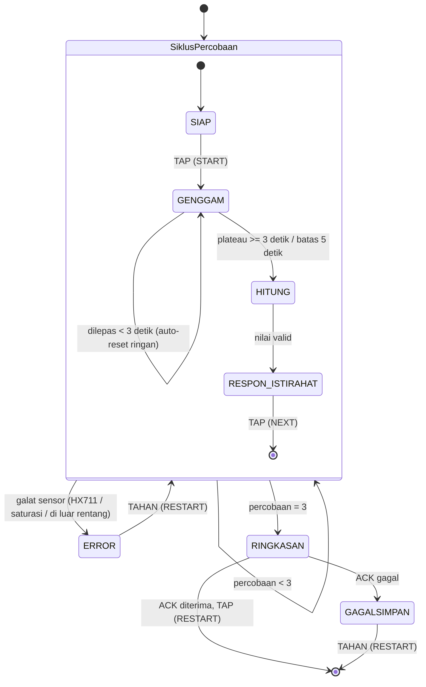
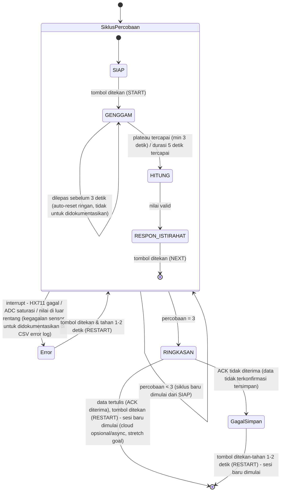

# Alur Program - Hand Grip Dynamometer (v1)
**Proyek akhir - embedded system**

> **Status: rancangan.** Firmware dan perangkat lunak laptop belum dikode; semua isi di bawah adalah rencana kecuali yang bertanda ✔. Versi v1 (13 Okt. 2026), disusun dari alur proyek WIP-0.1 (10 Okt. 2026) dan Bagian 6-8 catatan lama. Tanda (✔ ▣ ◐ `[sitasi]`) dijelaskan di [catatan-proyek-hgd.md](../catatan-proyek-hgd.md); sumber `[sitasi]` ada di [sitasi-hgd.md](../sitasi/sitasi-hgd.md).

Dokumen ini memuat semua yang berkaitan dengan firmware ESP32 dan program sisi laptop: data dan state, konstanta, perlindungan input, fungsi, alur utama, pembacaan HX711, logging, antarmuka, pengujian modul, dan cara build. Fungsinya sama dengan "Alur Program" pada proyek C: menjawab *apa yang terjadi, urutannya, dan kenapa dipilih begitu*. Perangkat keras ada di [desain-pcb-hgd.md](../pcb/desain-pcb-hgd.md), prosedur kalibrasi di [protokol-kalibrasi-hgd.md](../kalibrasi/protokol-kalibrasi-hgd.md). Bagian 15-17 adalah lampiran dari catatan proyek lama yang sebagian tumpang tindih dengan Bagian 6 dan 10; perlu digabung kemudian.

## Peta isi

1. Arsitektur dan struktur berkas
2. Struktur data
3. Konstanta dan threshold
4. Fungsi pelindung
5. Fungsi firmware
6. Alur utama (state machine)
7. Pembacaan HX711 dan pengolahan sinyal
8. Kalibrasi
9. Logging dan `logger.py`
10. Antarmuka pengguna
11. Uji modul dan uji galat
12. Build dan cara menjalankan
13. Memori
14. Ringkasan constraint dan edge case
15. Lampiran: arsitektur sistem dan state machine (dari catatan proyek)
16. Lampiran: narasi pengalaman pengguna (dari catatan proyek)
17. Lampiran: catatan platform, ESP32 vs Raspberry Pi (dari catatan proyek)

---

## 1. ARSITEKTUR DAN STRUKTUR BERKAS

### 1.1 Lapisan sistem
```
┌─────────────────────────────────────────────────────────────┐
│ LAPISAN FISIK     Pelat A/B + load cell (housing grip)        │
├─────────────────────────────────────────────────────────────┤
│ AKUISISI          HX711 (penguat + ADC 24 bit)                │
├─────────────────────────────────────────────────────────────┤
│ PEMROSES          ESP32 DevKit V1 (firmware, state machine)   │
├─────────────────────────────────────────────────────────────┤
│ ANTARMUKA         LCD 16x2 I2C, LED, 1 tombol                  │
├─────────────────────────────────────────────────────────────┤
│ PENCATATAN        USB-Serial → logger.py → CSV (+ ACK)         │
└─────────────────────────────────────────────────────────────┘
```

### 1.2 Dua gaya arsitektur dalam satu sistem
| Bagian | Gaya | Alasan |
|--------|------|--------|
| Tombol, ACK, error | **Event-driven**: sistem menunggu kejadian (interrupt, balasan) lalu bereaksi | Hemat, tanggap, non-blocking `[sitasi]` |
| Pembacaan HX711 saat `GENGGAM` | **Data-driven**: aliran sampel dari sensor diproses berulang | Plateau dan puncak butuh aliran data kontinu `[sitasi]` |

> Keduanya dipisah jelas dalam kode: ISR dan flag untuk event, fungsi `layaniGenggam()` untuk aliran data.

### 1.3 Dua lapisan state
- **Lapisan luar (sesi):** `SiklusPercobaan` diulang 3 kali, lalu `RINGKASAN`. Satu interrupt transition di batas `SiklusPercobaan` menangani semua kegagalan sensor, tanpa panah `Error` dari tiap state anak `[sitasi]`.
- **Lapisan dalam (percobaan):** `SIAP → GENGGAM → HITUNG → RESPON_ISTIRAHAT`.
- **Implementasi:** state machine **berbasis tabel** (tabel baris `state × event → aksi, state berikut`) dengan satu mesin umum, supaya tiap baris mudah diuji terpisah `[sitasi]`.

### 1.4 Struktur berkas firmware (Arduino IDE, tab)
| Berkas | Isi |
|--------|-----|
| `hgd.ino` | `setup()`, `loop()`, pemanggil mesin state |
| `config.h` | Pin, konstanta, threshold, versi |
| `tipe.h` | Enum dan struct (Bagian 2) |
| `sensor.h/.cpp` | Pembacaan HX711, tare, konversi counts ke kg, buffer, plateau |
| `tombol.h/.cpp` | ISR tombol, debounce, tap vs tahan |
| `tampilan.h/.cpp` | LCD, LED, teks per state |
| `catat.h/.cpp` | Format baris, checksum, kirim, tunggu ACK |
| `galat.h/.cpp` | Modul penanganan galat bersama (`Error` dan `GagalSimpan`) |
| `mesin.h/.cpp` | Tabel transisi dan fungsi tiap state |

### 1.5 Struktur berkas sisi laptop
| Berkas | Isi |
|--------|-----|
| `logger.py` | pyserial; validasi checksum; tulis CSV; `flush()` tiap baris; balas ACK/NAK |
| `kalibrasi.py` | Olah data kalibrasi: regresi, R², sisa, histeresis, drift, verifikasi |

### 1.6 Pembagian hardware
| Unit | Isi |
|------|-----|
| Housing grip | Hanya pelat A/B + load cell + spacer + baut + penjepit kabel |
| Housing elektronik | PCB (ESP32, tombol, LED, resistor), LCD, modul HX711 |
| Penghubung | Kabel load cell (4 inti) ke modul HX711; kabel jumper F-M dari PCB ke LCD dan HX711; USB ke laptop |

---

## 2. STRUKTUR DATA

### Enum
| Enum | Nilai | Fungsi |
|------|-------|--------|
| `State` | `SIAP=0`, `GENGGAM`, `HITUNG`, `RESPON_ISTIRAHAT`, `RINGKASAN`, `ERROR`, `GAGALSIMPAN` | Tujuh state mesin |
| `FaseGenggam` | `MENUNGGU_MULAI=1`, `MENGHITUNG=2` | Dua fase di dalam `GENGGAM` |
| `FaseRespon` | `LEPAS_ISTIRAHAT=1`, `TUNGGU_LANJUT=2` | Dua sub-fase `RESPON_ISTIRAHAT` |
| `JenisGalat` | `GALAT_NONE=0`, `HX711_TIMEOUT`, `ADC_SATURASI`, `DI_LUAR_RENTANG` | Kegagalan sensor yang dicatat |
| `KeluarGenggam` | `TETAP=0`, `DILEPAS_AWAL`, `PLATEAU`, `BATAS_5S` | Tiga jalur keluar `GENGGAM` |
| `Tekan` | `TIDAK=0`, `TAP`, `TAHAN` | Hasil klasifikasi tekanan tombol |

> **Kenapa `GALAT_NONE=0`?** Semua struct di-reset dengan `memset(..., 0, ...)`, jadi nilai nol harus berarti "tidak ada".

### Struct `Percobaan`
```
ref          → nilai akhir percobaan (float, kg, presisi penuh)
valid        → true bila lolos validasi rentang
durasiMs     → lama genggam sampai keluar
keluar       → KeluarGenggam (PLATEAU atau BATAS_5S)
```
> Nilai float disimpan sebelum dibulatkan untuk LCD agar presisi tidak hilang untuk RMSE/MAE.

### Struct `Sesi`
```
nomorSesi    → naik 1 tiap sesi baru sejak boot
percobaanKe  → 1..3
hasil[3]     → Percobaan
peak, avg    → dihitung sekali di RINGKASAN
t0Ms         → millis() saat sesi mulai (untuk penanda T+mm:ss)
```

### Struct `Sensor`
```
offset       → counts hasil tare terakhir
skala        → counts per kg (dari kalibrasi)
raw          → pembacaan counts terakhir
kg           → (raw - offset) / skala
buf[5]       → buffer melingkar 5 pembacaan kg terakhir
bufIdx, bufN → indeks tulis dan jumlah terisi
```

### Struct `StatusTombol`
```
volatile bool   flag        → diset ISR
volatile uint32 tsInt       → waktu interrupt terakhir (hanya dibaca/ditulis di ISR)
bool            sedangTekan → dibaca loop dari level pin
uint32          tsMulaiTekan
```

### Struct `StatusCatat`
```
seq          → nomor urut baris, naik tiap baris dikirim
menungguSeq  → seq yang menunggu ACK
tsKirim      → waktu kirim (untuk timeout)
```

### Memori
Semua struct dialokasikan **statis** (variabel global/`static`), tanpa `malloc`. Tidak ada struktur yang ukurannya tidak diketahui sebelumnya: 3 percobaan, 5 sampel, 1 sesi aktif.

### Variabel bersama ISR dan loop
Hanya dua: `StatusTombol.flag` dan `StatusTombol.tsInt`, keduanya `volatile`. Variabel multi-byte yang dibaca ISR dan loop sekaligus tidak ada; `tsInt` hanya diakses di dalam ISR. Bila nanti ada yang dibagi, akses dari loop dibungkus `noInterrupts()/interrupts()` `[sitasi]`.

---

## 3. KONSTANTA DAN THRESHOLD

### 3.1 Nilai tetap (sudah diputuskan)
| Konstanta | Nilai | Fungsi |
|-----------|-------|--------|
| `T_GENGGAM_MIN_MS` | 3000 | Di bawah ini = dilepas terlalu awal |
| `T_GENGGAM_MAX_MS` | 5000 | Force-stop |
| `JUMLAH_PERCOBAAN` | 3 | Percobaan per sesi |
| `UKURAN_BUF` | 5 | Sampel buffer plateau |
| `T_ISTIRAHAT_S` | 60 | Istirahat antar percobaan |
| `T_UPDATE_HITUNG_MS` | 100 | Interval update hitung mundur (S2) |
| `T_DEBOUNCE_MS` | 50 | Abaikan re-trigger ISR |
| `REF_MIN_KG` / `REF_MAX_KG` | 0 / 100 | Validasi rentang `ref` (0 < ref ≤ 100) |
| `RENTANG_TARGET_KG` | 20-70 | Spesifikasi S1 |
| `ADC_MAX` | 8.388.607 | Skala penuh ADC 24 bit bertanda |
| `SATURASI_FRAKSI` | 0,95 | Saturasi bila \|raw\| ≥ 0,95 × `ADC_MAX` ≈ 7.969.177 |
| `I2C_HZ` | 100000 | Kecepatan I2C LCD |
| `BAUD` | 115200 | Serial ke laptop |
| `OVERLOAD_KGF` | 96 (120% F.S.) | Batas aman desain load cell |
| `LAJU_HX711` | 10 SPS | Bawaan papan modul |

### 3.2 Nilai awal yang disetel lewat eksperimen
| Konstanta | Nilai awal | Cara menyetel |
|-----------|------------|---------------|
| `THRESHOLD_ONSET_KG` | 1,0 | **E1**: rekam 60 detik load cell diam; ambil simpangan baku σ; onset = maks(1,0 kg; 10σ). Satu nilai dipakai untuk onset (naik), dilepas-terlalu-awal (turun), dan lepas di `RESPON_ISTIRAHAT` |
| `THRESHOLD_STABIL_KG` | 0,5 | **E2**: genggaman latihan; selisih tertinggi-terendah buffer 5 sampel pada plateau nyata; threshold di atas fluktuasi tahan stabil |
| `T_TARE_SAMPEL` | 10 | Tare = rata-rata 10 sampel ≈ 1 detik pada 10 SPS; diperiksa di **E1** |
| `T_REFRESH_LCD_MS` | 250 | **E3**: coba 50-500 ms dengan pola jalan cahaya (tanpa tombol); pilih yang terbaca mata; + ≈ 20 ms cadangan I2C |
| `T_TUNGGU_HX711_MS` | 1000 | Waktu maksimum menunggu `is_ready()`; HX711 10 SPS siap tiap ≈ 100 ms, jadi 1 s adalah 10× margin |
| `T_TAHAN_MS` | 1500 | **E4**: uji tekan-tahan dengan beberapa orang; ambang di antara 1000 dan 2000 yang tidak terpicu tak sengaja |
| `T_ACK_MS` | 2000 | **E5**: ukur waktu balasan `logger.py` pada 100 baris; ambang = 10× balasan terlama, tidak kurang dari 500 ms |
| `SKALA_COUNTS_PER_KG` | 53.687 | **Bagian 8**: diganti hasil regresi kalibrasi. Nilai awal dari hitungan: 2,0 mV/V × 128 × 2²⁴ / 80 kg, rasiometrik |

> **Kenapa satu threshold untuk tiga fungsi?** Cukup satu eksperimen (E1) dan satu angka yang bisa dipertanggungjawabkan, bukan tiga.

### 3.3 Eksperimen penyetelan
| ID | Eksperimen | Keluaran |
|----|------------|----------|
| E1 | Noise load cell diam 60 s (alat sudah terpasang dan hangat 10 menit) | σ, threshold onset, durasi tare |
| E2 | Lima genggaman latihan per anggota tim | Threshold stabilitas |
| E3 | Pola jalan cahaya di LCD, delay 50-500 ms | Refresh LCD |
| E4 | Uji tekan-tahan (tap vs tahan) | Ambang tahan |
| E5 | 100 baris CSV + ACK | Timeout ACK |
| E6 | Tarik kabel load cell perlahan | Besar pergeseran pembacaan akibat kabel (dokumen [desain-housing-load-cell.md](../housing-load-cell/desain-housing-load-cell.md)) |

---

## 4. FUNGSI PELINDUNG

### 4.1 Debounce software (di dalam ISR)
Kontak mekanik tombol memantul beberapa milidetik sehingga satu tekanan terbaca berkali-kali `[sitasi]`. Di dalam ISR: bila `millis() − tsInt < T_DEBOUNCE_MS`, interrupt diabaikan; selain itu `tsInt = millis()` dan `flag = true`.

### 4.2 Pull-up internal
Pin tombol memakai `INPUT_PULLUP`. Pin masukan yang tidak disambung ke apa pun mengambang dan dapat memicu interrupt acak `[sitasi]`.

### 4.3 `volatile`
Variabel yang diubah ISR (`flag`, `tsInt`) dideklarasikan `volatile`. Tanpa itu compiler dapat meng-cache nilainya dan mesin state macet di `SIAP` walau tombol sudah ditekan `[sitasi]`.

### 4.4 Reset flag tombol
`flag` dan `tsMulaiTekan` di-reset tiap **masuk** state yang menunggu tombol: `SIAP`, `ERROR`, `GAGALSIMPAN`, sub-fase 2 `RESPON_ISTIRAHAT`, dan `RINGKASAN`. Tekanan nyasar dari state lain tidak tersimpan diam-diam lalu terkonsumsi di state yang sedang menunggu. Ini generalisasi dari aturan `volatile`.

### 4.5 Klasifikasi tap vs tahan
Perpanjangan debounce: sampling level pin tiap loop + counter durasi.
- Level turun (tekan) → `tsMulaiTekan = millis()`, `sedangTekan = true`.
- Level naik (lepas) sebelum `T_TAHAN_MS` → `TAP`.
- Tekan terus ≥ `T_TAHAN_MS` → `TAHAN` (dilaporkan sekali saat ambang tercapai, tanpa menunggu lepas).
- Cara menahan **tidak ditampilkan** di LCD (pengetahuan pengawas).

### 4.6 Modul penanganan galat bersama (`galat.cpp`)
`Error` dan `GagalSimpan` memakai satu fungsi `galatTahan(jenis, data)`: menggambar layar, memperbarui nilai live, menunggu `TAHAN`, lalu mengembalikan kendali. Satu tempat untuk mengubah kebijakan galat `[sitasi]`. Keduanya tetap dua state FSM karena tujuan keluarnya berbeda.

### 4.7 Pembagian filosofi galat
| Jenis | Contoh | Perlakuan |
|-------|--------|-----------|
| **Kegagalan sensor/hardware** | HX711 tidak siap, ADC mendekati saturasi, `ref` di luar rentang fisik | Masuk `ERROR`; dicatat otomatis ke CSV (jenis + `T+mm:ss`); tidak dihitung sebagai satu dari 3 percobaan |
| **Human error** | Dilepas sebelum 3 detik | Auto-reset ringan ke fase 1 `GENGGAM`; tanpa pesan galat; tidak dicatat |

> Pencatatan galat dipindah dari logbook manual ke CSV otomatis, karena logbook manual di tengah sesi sering terlewat.

### 4.8 Protokol ACK
ESP32 tidak dapat mengetahui sendiri apakah baris benar-benar tertulis di laptop. Mekanisme:
1. Tiap baris diberi nomor urut `seq` dan checksum.
2. `logger.py` memvalidasi checksum, menulis, `flush()`, lalu membalas `ACK,<seq>`; bila checksum salah membalas `NAK,<seq>`.
3. ESP32 menunggu `ACK,<seq>` maksimal `T_ACK_MS`. `NAK` atau tanpa balasan → kirim ulang sekali; bila tetap gagal → `GAGALSIMPAN`.
4. Nilai selalu juga dicetak ke Serial Monitor sehingga pengawas dapat menyalinnya manual.

> Deteksi koneksi USB saja tidak cukup: tidak mendeteksi skrip host yang mati atau lupa dijalankan. ACK per baris mendeteksi semuanya, termasuk baris terpotong (lewat checksum).

### 4.9 Watchdog
Timer pengawas ESP32 (task watchdog) diaktifkan dengan **satu titik** `esp_task_wdt_reset()` di ujung `loop()`. Titik ganda atau di dalam `delay` melemahkan pengawasan `[sitasi]`. Watchdog menangani macet total yang tidak bisa dipulihkan perangkat lunak; bukan pengganti penanganan galat normal. Diaktifkan setelah state machine stabil (jadwal Bagian 11 di [catatan-proyek-hgd.md](../catatan-proyek-hgd.md)).

---

## 5. FUNGSI FIRMWARE

> Daftar fungsi yang akan dikode. Format: tujuan, masukan/keluaran, langkah, pemakai.

### 5.1 `setup()` ▣
Inisialisasi sekali: `Serial.begin(BAUD)`; `Wire.begin(21, 22)`; `Wire.setClock(I2C_HZ)`; LCD `begin`; `pinMode(LED, OUTPUT)`; `pinMode(TOMBOL, INPUT_PULLUP)` + `attachInterrupt(FALLING)`; `sensorInit()`; `mesinInit()` (sesi 1, percobaan 1, state `SIAP`); watchdog (setelah stabil).
**Pemakai:** dijalankan Arduino core satu kali.

### 5.2 `loop()` ▣
Satu pola: `tombolUpdate(); mesinJalan(); watchdogReset();`. Tidak ada `delay()` panjang; semua pewaktuan memakai `millis()`. Satu-satunya pemanggilan blocking adalah `sensorTare()` dan `sensorBaca()` (alasan di Bagian 6.4).

### 5.3 `isrTombol()` ▣
ISR `IRAM_ATTR`. Menerapkan debounce 6.1. Hanya menulis `flag` dan `tsInt`. Tidak memanggil `Serial`, `Wire`, atau `millis` selain yang diperlukan.

### 5.4 `tombolUpdate()` ▣
Membaca level pin dan `flag`, menjalankan klasifikasi 6.5, dan mengisi `Tekan tekanan` (TIDAK/TAP/TAHAN). Dipanggil sekali per `loop()`.
**Pemakai:** `mesinJalan()`.

### 5.5 `tombolReset()` ▣
Mengosongkan `flag`, `sedangTekan`, dan `tsMulaiTekan`. Dipanggil tiap masuk state yang menunggu tombol (Bagian 4.4).

### 5.6 `sensorInit()` ▣
Memulai library HX711 (`begin(DT, SCK)`), memasang `set_scale(SKALA)`, menunggu siap hingga `T_TUNGGU_HX711_MS`. Bila tidak siap → melapor `HX711_TIMEOUT`.

### 5.7 `sensorBaca(float *kg)` ▣
Menunggu `is_ready()` paling lama `T_TUNGGU_HX711_MS`. Bila tidak siap → mengembalikan `HX711_TIMEOUT`. Bila siap → membaca `raw`; bila `|raw| ≥ SATURASI_FRAKSI × ADC_MAX` → `ADC_SATURASI`; selain itu `kg = (raw − offset) / skala` → `GALAT_NONE`. **Blocking** hingga ≈ 100 ms per baca pada 10 SPS.
**Pemakai:** `layaniGenggam()`, `layaniRespon()`, `sensorTare()`.

### 5.8 `sensorTare()` ▣
Merata-rata `T_TARE_SAMPEL` pembacaan mentah menjadi `offset`. **Blocking** ≈ 1 detik. Dipanggil sekali tiap masuk `SIAP`. Alasan blocking diterima: `tare()` memakai fungsi baca HX711 yang sama dengan `sensorBaca()`, sehingga blocking adalah konsekuensi satu akar sebab; durasinya singkat dan terjadi sekali per siklus.

### 5.9 `bufTambah(float kg)` / `bufPlateau()` ▣
`bufTambah` menulis ke buffer melingkar 5 sampel. `bufPlateau` mengembalikan `true` bila buffer penuh dan (maks − min) ≤ `THRESHOLD_STABIL_KG`. Rata-rata buffer menjadi `ref`.

### 5.10 `layaniGenggam()` ▣
State `GENGGAM`, dua fase (rincian di Bagian 6.2). Mengembalikan `KeluarGenggam`.

### 5.11 `hitungRef()` ▣
One-shot: `ref = rata-rata buffer` (atau nilai buffer terbaik pada `BATAS_5S`); menyimpan ke `hasil[percobaanKe]`. Tanpa tampilan LCD.

### 5.12 `validasiRef(float ref)` ▣
Dipanggil di titik masuk `RESPON_ISTIRAHAT`. `ref ≤ REF_MIN_KG` atau `ref > REF_MAX_KG` → `DI_LUAR_RENTANG`.

### 5.13 `layaniRespon()` ▣
Dua sub-fase (Bagian 6.2). Memakai `THRESHOLD_ONSET_KG` untuk mendeteksi pelepasan, lalu hitung mundur 60 detik tanpa ganti layar.

### 5.14 `ringkas()` ▣
Sekali setelah percobaan ke-3: `peak = maks(hasil[].ref)`, `avg = rata-rata(hasil[].ref)`; memanggil `catatKirimSesi()`.

### 5.15 `catatKirimBaris(jenis, ...)` ▣
Menyusun baris `HGD,<jenis>,...*<checksum>` dengan `seq` berikutnya, mengirim lewat `Serial.print`, dan mencatat `menungguSeq` dan `tsKirim`.

### 5.16 `catatTungguAck()` ▣
Non-blocking: dipanggil tiap loop sampai `ACK,<seq>` diterima (→ sukses), `NAK` atau `T_ACK_MS` lewat (→ kirim ulang sekali; bila gagal lagi → gagal).

### 5.17 `galatTahan(jenis, data)` ▣
Lihat 6.6. Menampilkan jenis galat dan `raw` live (atau data yang gagal tersimpan), menunggu `TAHAN`.

### 5.18 `tampil*()` ▣
Satu fungsi per state yang menggambar teks 16 karakter per baris (Bagian 10). Pembaruan LCD dibatasi `T_REFRESH_LCD_MS` agar tidak membanjiri bus I2C.

### 5.19 `mesinJalan()` ▣
Memilih fungsi sesuai `State` saat ini lewat tabel transisi (Bagian 6.3), menangani interrupt transition ke `ERROR`, dan memanggil `*Masuk()` saat state berganti.

### 5.20 `mesinSesiBaru()` ▣
Mereset struct sesi (`memset`), menaikkan `nomorSesi`, `percobaanKe = 1`, `t0Ms = millis()`, state `SIAP`. Dipanggil dari `RINGKASAN` dan `GAGALSIMPAN` setelah RESTART.

### 5.21 Mode kalibrasi serial ▣
Perintah serial: `t` = tare ulang; `k` = cetak rata-rata 10 sampel mentah (`get_value(10)`); `p` = cetak `raw`, `offset`, `kg`. Dipakai di Bagian 8; dinonaktifkan di build akhir.

### 5.22 Fungsi sisi laptop ▣
- `logger.py`: baca baris dari port serial → validasi checksum → tulis CSV + `flush()` → balas `ACK`/`NAK`.
- `kalibrasi.py`: baca tabel hasil kalibrasi → regresi linier (kemiringan = skala, intersep = offset) → R², sisa terbesar, histeresis, drift → cetak `SKALA_COUNTS_PER_KG`.

---

## 6. ALUR UTAMA (STATE MACHINE)

### 6.1 Alur keseluruhan
```
MULAI (ESP32 dicatu USB; logger.py sudah berjalan di laptop)
│
├─ setup(): Serial, I2C, LCD, pin, interrupt tombol, HX711, mesin → SIAP
│
└─ loop() berulang selamanya:
   │
   ├─ tombolUpdate()        → TIDAK / TAP / TAHAN
   ├─ mesinJalan()          → jalankan state aktif; cek interrupt transition
   └─ watchdogReset()       → satu titik

SESI (3 percobaan)
│
└─ SiklusPercobaan (superstate)
   │
   ├─ [SIAP]
   │    ├─ Masuk: tombolReset(); LCD "Nol-kan..."; sensorTare() (blocking ≈ 1 s)
   │    ├─ LCD "Tekan START"; tunggu TAP
   │    └─ TAP → GENGGAM
   │
   ├─ [GENGGAM]  LED menyala menembus kedua fase
   │    ├─ Fase 1  MENUNGGU_MULAI: LCD "Genggam..."; baca kg; kg > THRESHOLD_ONSET → Fase 2
   │    ├─ Fase 2  MENGHITUNG: timer mulai; LCD "Tahan 3-5 dtk";
   │    │          baca kg → bufTambah → bufPlateau
   │    ├─ Keluar 1: kg < onset sebelum 3000 ms → kembali ke Fase 1 (tanpa pesan, tanpa catatan)
   │    ├─ Keluar 2: plateau dan ≥ 3000 ms      → HITUNG
   │    └─ Keluar 3: 5000 ms tanpa plateau      → HITUNG (nilai buffer terbaik)
   │
   ├─ [HITUNG]  one-shot, tanpa LCD
   │    ├─ ref = rata-rata buffer → hasil[percobaanKe]
   │    └─ validasiRef(ref):
   │         ├─ valid   → RESPON_ISTIRAHAT
   │         └─ invalid → interrupt → ERROR (DI_LUAR_RENTANG)
   │
   └─ [RESPON_ISTIRAHAT]  LED mati
        ├─ Sub-fase 1 LEPAS_ISTIRAHAT: LCD hasil + "Lepas, rest 60s";
        │             kg < onset → hitung mundur 60→0 (update 100 ms, tanpa ganti layar)
        └─ Sub-fase 2 TUNGGU_LANJUT: LCD hasil + "NEXT: lanjut"; tunggu TAP
             ├─ percobaanKe < 3 → percobaanKe++ → SIAP
             └─ percobaanKe = 3 → RINGKASAN

[Interrupt transition dari batas SiklusPercobaan]
   HX711_TIMEOUT / ADC_SATURASI / DI_LUAR_RENTANG ──► [ERROR]
   [ERROR]: catat galat ke CSV; galatTahan(); TAHAN → SIAP (percobaanKe tidak berubah)

[RINGKASAN]  satu kali, setelah percobaan ke-3
   ├─ ringkas(): peak, avg → kirim baris percobaan dan sesi
   ├─ ACK semua diterima → LCD Puncak/Rerata; TAP → mesinSesiBaru()
   └─ ACK gagal          → [GAGALSIMPAN]; galatTahan(); TAHAN → mesinSesiBaru()
```

> **Kenapa hierarki dua lapisan?** Satu panah interrupt di batas `SiklusPercobaan` menggantikan satu panah `ERROR` dari tiap state anak; seperti aturan "alarm kebakaran: semua keluar gedung" tanpa aturan per ruangan `[sitasi]`.

### 6.2 Rincian state

**[SIAP]**
- Masuk: `tombolReset()`, LED mati.
- Auto-tare tiap masuk, termasuk setelah kembali dari siklus sebelumnya. **Keputusan tim sendiri:** tiga percobaan dibandingkan dan dirata-ratakan, jadi konsistensi titik nol antar percobaan penting.
- Dua langkah: (1) layar "Nol-kan...", `sensorTare()`; (2) selesai (≈ 1 detik) → layar "Tekan START".
- Tidak ada jalur ke `ERROR` dari state ini, kecuali `HX711_TIMEOUT` pada tare.

**[GENGGAM]** (dua fase dalam satu state; LED menyala tanpa putus)
- *Fase 1 - Menunggu mulai:* timer 3-5 detik **belum jalan**. Sistem hanya menunggu gaya pertama melewati `THRESHOLD_ONSET_KG`.
- *Fase 2 - Menghitung:* timer mulai. Tiap baca: `bufTambah`; lalu uji plateau.
- *Threshold onset dan dilepas-terlalu-awal adalah nilai yang sama*, dicek dua arah: naik melewati threshold di Fase 1 = mulai; turun di bawahnya sebelum 3 detik = dilepas terlalu awal.
- *Tiga jalur keluar:* (1) dilepas sebelum 3 detik → kembali Fase 1; (2) plateau dan durasi ≥ 3 detik → `HITUNG`; (3) 5 detik tanpa plateau → `HITUNG` memakai nilai buffer terbaik (batas 5 detik adalah force-stop, bukan pembatalan).
- Tidak ada kondisi "gaya turun ke ambang" generik untuk mengakhiri genggaman: akhir ditentukan plateau atau batas 5 detik. Threshold hanya menentukan kapan timer mulai dan kapan percobaan di-reset.

**[HITUNG]**
- One-shot. Tidak ada tampilan LCD (murni komputasi internal).
- Nilai float disimpan penuh; relative HGS (HGS/BMI) **tidak** dihitung di firmware, tetapi di analisis pasca-pengukuran.
- Validasi rentang terjadi di titik masuk `RESPON_ISTIRAHAT`, bukan di dalam `HITUNG`.

**[RESPON_ISTIRAHAT]** (dua sub-fase)
- *Sub-fase 1:* tampil hasil dan perintah lepas. Begitu gaya turun di bawah `THRESHOLD_ONSET_KG` (nilai sama, simetris), hitung mundur 60 → 0 berjalan di tempat, diperbarui tiap 100 ms dengan `millis()`.
- *Sub-fase 2:* tampil hasil lagi dan "NEXT"; tunggu tombol. Pada percobaan ke-3 teksnya "NEXT: ringkasan".

**[RINGKASAN]**
- Terjadi satu kali. Menghitung puncak dan rerata, mengirim baris CSV, menunggu ACK (Bagian 9).
- Riwayat sesi sebelumnya **tidak** ditampilkan di layar; perbandingan antar sesi dikerjakan di analisis pasca-pengukuran dari berkas CSV. Layar hanya menampilkan sesi berjalan.

**[ERROR]**
- Tahan sungguhan: alat berhenti, layar menampilkan jenis galat dan `raw` live, supaya pengawas memeriksa fisik alat.
- Audiens: pengawas (bukan partisipan); larangan menampilkan angka mentah dikecualikan di sini.
- Dicatat otomatis ke CSV (jenis + `T+mm:ss`). Percobaan yang error tidak dihitung.

**[GAGALSIMPAN]**
- Pola sama dengan `ERROR` (modul `galatTahan`). Menampilkan data yang tidak terkonfirmasi tersimpan. Keluar lewat TAHAN langsung ke akhir sesi (datanya benar, hanya tidak tersimpan; setelah diselamatkan manual tidak perlu mengulang sesi).

### 6.3 Tabel transisi
| State | Peristiwa / kondisi | Aksi | State berikut |
|-------|---------------------|------|---------------|
| SIAP | TAP | LED on | GENGGAM (fase 1) |
| GENGGAM f1 | kg > onset | mulai timer | GENGGAM f2 |
| GENGGAM f2 | kg < onset dan t < 3000 | reset buffer | GENGGAM f1 |
| GENGGAM f2 | plateau dan t ≥ 3000 | LED off | HITUNG |
| GENGGAM f2 | t ≥ 5000 | LED off | HITUNG |
| HITUNG | ref valid | simpan | RESPON_ISTIRAHAT |
| HITUNG | ref tidak valid | catat galat | ERROR |
| RESPON f1 | kg < onset | mulai hitung mundur | RESPON f1 (menghitung) |
| RESPON f1 | hitung mundur = 0 | - | RESPON f2 |
| RESPON f2 | TAP dan percobaanKe < 3 | percobaanKe++ | SIAP |
| RESPON f2 | TAP dan percobaanKe = 3 | - | RINGKASAN |
| RINGKASAN | semua ACK | - | tunggu TAP → sesi baru |
| RINGKASAN | ACK gagal | - | GAGALSIMPAN |
| ERROR | TAHAN | - | SIAP |
| GAGALSIMPAN | TAHAN | - | sesi baru |
| (apa pun dalam SiklusPercobaan) | galat sensor | catat, hentikan | ERROR |

### 6.4 Mekanisme waktu
| State | Mekanisme | Catatan |
|-------|-----------|---------|
| SIAP | `sensorTare()` blocking ≈ 1 s; sisanya interrupt/non-blocking | Konsekuensi library HX711 |
| GENGGAM | Loop non-blocking; `sensorBaca()` blocking ≈ 100 ms per baca | Diterima apa adanya |
| HITUNG | Non-blocking, one-shot | - |
| RESPON_ISTIRAHAT | `millis()`, update 100 ms | Non-blocking sepanjang waktu |
| RINGKASAN | Kirim non-blocking; ACK dengan timeout | `T_ACK_MS` |
| ERROR / GAGALSIMPAN | Menunggu TAHAN, non-blocking | Layar diperbarui live |

> Refresh LCD (`T_REFRESH_LCD_MS`) dipisah dari laju sampel sensor lewat timer `millis()` terpisah. Dua blocking yang diterima (`tare`, `get_units`) berasal dari satu akar sebab, bukan dua keputusan.

### 6.5 Satu tombol fisik untuk semua fungsi
| Aksi | State | Cara |
|------|-------|------|
| START | `SIAP` | TAP |
| NEXT | `RESPON_ISTIRAHAT` sub-fase 2 | TAP |
| RESTART (data tertulis) | `RINGKASAN` | TAP |
| RESTART (pengawas) | `ERROR`, `GAGALSIMPAN` | TAHAN 1,5 s (nilai awal) |

> Karena hanya anggota tim yang menggenggam alat, pembedaan "partisipan awam vs pengawas" (alasan dua tombol) tidak diperlukan.

### 6.6 Diagram


---

## 7. PEMBACAAN HX711 DAN PENGOLAHAN SINYAL

### 7.1 Protokol baca HX711
1. Tunggu `DT` turun (data siap).
2. Kirim 24 pulsa `SCK`; pada tiap pulsa baca `DT` (bit MSB lebih dulu).
3. Kirim pulsa ke-25 untuk memilih kanal A dengan gain 128 untuk pembacaan berikutnya.
4. Sambung 24 bit menjadi bilangan bertanda dua-komplemen: bila bit 23 = 1, kurangi 2²⁴ (perluasan tanda).

> Bit-bang memakai GPIO 18/19. Library HX711 dipakai untuk kerja utama; sketsa uji cepat lokal (tidak di repo) membaca langsung dengan pola yang sama untuk pemeriksaan awal.

### 7.2 Dari counts ke kilogram
```
kg = (raw − offset) / skala
offset = rata-rata T_TARE_SAMPEL pembacaan saat beban nol (tiap masuk SIAP)
skala  = counts per kg dari regresi kalibrasi
```
- Nilai awal `skala` = 53.687 counts/kg: sinyal skala penuh 2,0 mV/V × V_eksitasi untuk 80 kg, gain 128, rentang ADC 2²⁴ counts pada AVDD. Karena rasiometrik (E+ = AVDD), nilainya sama pada 3,3 V dan 5 V.
- Resolusi: 1 kg ≈ 53.687 counts, jadi 1 count ≈ 0,019 g. Resolusi nyata dibatasi noise, bukan LSB.
- Satuan Newton: `N = kg × 9,80665`, ditampilkan bila layar mengizinkan.

### 7.3 Noise dan kestabilan
- Noise masukan HX711 ≈ 50 nV rms (datasheet); pada 3,3 V noise relatif ≈ 1,5× pada 5 V karena sinyal 0,083 mV/kg versus 0,125 mV/kg. Diukur di E1, bukan diasumsikan.
- Buffer melingkar 5 sampel dan rata-rata menekan noise acak; median disimpan sebagai cadangan bila ada pencilan `[sitasi]`.
- Laju 10 SPS dipilih bawaan modul (80 SPS butuh modifikasi resistor 0 ohm pada papan, bukan lewat firmware).

### 7.4 Deteksi kegagalan sensor
| Kondisi | Deteksi | Jenis |
|---------|---------|-------|
| HX711 tidak merespons | `is_ready()` tidak benar selama `T_TUNGGU_HX711_MS` | `HX711_TIMEOUT` |
| ADC mendekati saturasi | \|raw\| ≥ 0,95 × 8.388.607 | `ADC_SATURASI` |
| Nilai di luar rentang fisik | `ref ≤ 0` atau `ref > 100 kg` (angka 100 kg dari data kekuatan genggam tertinggi di literatur `[sitasi]`) | `DI_LUAR_RENTANG` |
| Pembacaan macet (nilai sama persis berulang) | Dicek di uji, bukan di firmware utama | - |

### 7.5 Polaritas dan tanda
Bila pembacaan turun saat beban naik, kabel sinyal ditukar atau `skala` dipakai negatif. Dicek di uji bertegangan pertama.

---

## 8. KALIBRASI

### 8.1 Tujuan
Mencari **faktor skala** (counts per kg) agar pembacaan tampil dalam kg. Nol ditangani tare di firmware pada state `SIAP`, jadi yang dicari hanya kemiringan. Kalibrasi juga memeriksa linearitas, histeresis, dan drift.

### 8.2 Prinsip setup
Rakitan **dibalik**: batang A di bawah (dijepit ke alas karet antiselip di meja), batang B di atas. Beban acuan dumbbell ditaruh pada papan kayu di atas balok PLA dengan lidah di antara dua ridge B. Gaya ke bawah searah remasan (B menuju A); jalur gaya tunggal: beban, papan, balok PLA, ridge, B, load cell, A, meja.

| Komponen setup | Spesifikasi rencana |
|----------------|--------------------|
| Alas A | Alas karet antiselip berlubang untuk kepala baut di bawah A (tebal 6 mm, lebih besar dari tinggi washer + kepala baut ≈5,6 mm; satu slot 29 x 14 mm di bawah kedua kepala baut) |
| Balok PLA | Dengan lidah masuk di antara dua ridge; selisih 1 mm dari puncak ridge |
| Papan kayu | 480 x 350 x 12 mm |
| Pemandu kayu | Berdiri di meja, jarak ≈ 1 cm dari papan, tidak menyentuh; pengaman jika tumpukan miring |
| Beban | Dumbbell berpasangan 1, 2, 3, 4, 5, 6 kg (total 42 kg), satu di kiri dan satu di kanan garis tengah |
| Timbangan | Timbangan badan; massa tiap dumbbell ditimbang dengan metode selisih |

### 8.3 Persiapan
1. Timbang 12 dumbbell satu per satu (label biasanya meleset beberapa persen); catat resolusi timbangan.
2. Pasang alas, A, load cell, B dengan baut seperti rakitan final; kabel tidak tertekan.
3. Sambungkan ke HX711 dan ESP32 final dengan kabel dan tegangan yang sama dengan pemakaian nanti.
4. Nyalakan dan biarkan **10 menit**.
5. Pasang balok dan papan; letakkan pemandu ≈ 1 cm dari ujung papan.
6. Pastikan papan hanya menyentuh balok.

### 8.4 Tahap 1: sampai 20 kg (rakitan housing v5)
Tiap titik: tunggu **10 detik**, catat rata-rata 10 sampel.

| No | Susunan | Massa (kg) |
|----|---------|------------|
| 0 | Papan kosong, 3 kali | 0 |
| A1-A6 | Dumbbell tunggal 1, 2, 3, 4, 5, 6 kg (satu per satu; papan kosong dan catat nol setelah tiap dumbbell) | 1-6 |
| B1 | Pasangan 6 kg (satu kiri, satu kanan) | 12 |
| B2 | + pasangan 4 kg di atas 6 kg | 20 |
| Turun | Kembali ke 12 kg, lalu papan kosong (nol akhir) | 12, 0 |

Tumpukan 20 kg ≈ 19 cm di atas papan. 20 kg baru ≈ 29% dari 70 kgf, jadi skala dari tahap 1 belum cukup untuk seluruh rentang.

### 8.5 Tahap 2: sampai 42 kg
| No | Susunan | Massa (kg) |
|----|---------|------------|
| B1 | Pasangan 6 kg | 12 |
| B2 | + pasangan 5 kg di luar 6 kg | 22 |
| B3 | + pasangan 4 kg di atas 6 kg | 30 |
| B4 | + pasangan 3 kg di atas 5 kg | 36 |
| B5 | + pasangan 2 kg di atas 4 kg | 40 |
| B6 | + pasangan 1 kg di atas 3 kg | 42 |
| Turun | Angkat dalam urutan terbalik, catat di 40, 36, 30, 22, 12 kg, lalu nol akhir | - |

Tiap seri diulang minimal **dua kali**. Massa kumulatif memakai hasil timbang, bukan label. Tumpukan penuh 42 kg setinggi ≈ 25-28 cm dengan tumpuan hanya lidah ≈ 21 mm: goyah, sehingga pemandu dan keselamatan (Bagian 8.8) wajib.

### 8.6 Pengolahan data (`kalibrasi.py`)
1. Plot counts (y) terhadap massa timbang (x), dikurangi nol awal R0.
2. Regresi linier: **kemiringan = `SKALA_COUNTS_PER_KG`**; kemiringan negatif dipakai apa adanya.
3. R², sisa terbesar (kg) dibandingkan dengan toleransi S1.
4. **Histeresis:** selisih terbesar antara pembacaan naik dan turun pada massa yang sama.
5. **Drift:** selisih nol awal dan nol akhir.
6. **Konsistensi:** kemiringan seri A dan seri B harus mendekati sama; bila seri B berbeda jauh, periksa papan menyentuh pemandu atau beban tidak di tengah.
7. **Verifikasi independen:** setelah `skala` dipasang, ukur massa yang **tidak** dipakai fitting (mis. 2 + 5 kg, atau 3 + 4 + 6 kg); catat galat.
8. Laporan: RMSE dan MAE per titik `[sitasi]`, dibandingkan dengan lantai teoretis ±24 g (±34 g dengan suhu dan drift).

### 8.7 Aturan orientasi
Massa batang B ≈ 138 g di ujung bebas load cell menggeser offset bila orientasi berubah setelah tare. **Tare, kalibrasi, dan pengukuran dilakukan pada orientasi yang sama.** Karena setup kalibrasi terbalik dan posisi pakai bisa berbeda, tare ulang dilakukan sebelum mengukur, dan efeknya diperiksa pada uji akhir.

### 8.8 Keselamatan kalibrasi
- Turunkan dumbbell pelan-pelan; jangan dijatuhkan.
- Tangan dan wajah tidak berada di bawah atau di antara tumpukan; berdiri di samping.
- Tumpukan miring atau menyentuh pemandu → **berhenti**, angkat dari atas ke bawah.
- Jangan melebihi 42 kg (tahap 1: 20 kg). Batas aman load cell dipegang di 120% kapasitas (96 kgf).
- Jangan menekan papan dengan tangan saat membaca.
- Jangan menjepit meja lab tanpa izin (tepinya tipis); alas karet menahan A.
- Kotak penadah di lantai dan sepatu tertutup.

### 8.9 Batasan yang dicatat di laporan
1. Kalibrasi hanya sampai 42 kg; 42-70 kgf adalah ekstrapolasi.
2. Beban statis di titik tengah; genggaman nyata memberi beban di empat jari dengan posisi sedikit berbeda.
3. Massa acuan dari timbangan badan; ketelitiannya membatasi ketelitian kalibrasi.
4. A bertumpu pada meja saat kalibrasi, jadi **lenturan A saat digenggam tidak teruji**; hanya celah sisi B yang teruji pada beban tinggi.
5. Lebar bidang tumpu di antara dua ridge ≈ 22 mm; alas beban harus muat di situ (adaptor ditetapkan bila perlu).

---

## 9. LOGGING DAN `logger.py`

### 9.1 Alur
```
ESP32 ── Serial.print(baris) ──► logger.py ── tulis + flush ──► berkas CSV
   ▲                                  │
   └────────── ACK,<seq> / NAK,<seq> ◄┘
```

### 9.2 Format baris dari ESP32 (115200 baud, satu baris per `\n`)
```
HGD,<jenis>,<seq>,<sesi>,<percobaan>,<nilai1>,<nilai2>*<checksum>
```
| Jenis | Isi | Contoh |
|-------|-----|--------|
| `T` | Hasil satu percobaan: `nilai1` = gaya (kg) | `HGD,T,12,3,2,46.82,0*0B` |
| `S` | Ringkasan sesi: `nilai1` = puncak, `nilai2` = rerata | `HGD,S,14,3,0,47.20,44.85*12` |
| `E` | Galat: `percobaan` = nomor, `nilai1` = jenis galat (1-3), `nilai2` = detik sejak sesi mulai | `HGD,E,15,3,2,3,41*3D` |

`checksum` = XOR semua byte dari `H` (awal `HGD`) sampai karakter tepat sebelum `*`, ditulis dua digit heksadesimal huruf besar. Baris terpotong atau rusak gagal checksum dan dibalas `NAK`.

### 9.3 Format berkas CSV (dari `logger.py`)
```
timestamp,sesi,jenis,percobaan,gaya_kg,rerata_kg,catatan
2026-10-21T10:15:32,3,T,2,46.82,,
2026-10-21T10:16:40,3,S,0,47.20,44.85,
2026-10-21T10:17:05,3,E,2,3,41,DI_LUAR_RENTANG
```
- `timestamp` diberikan `logger.py` dari jam laptop saat menulis (ESP32 tidak punya jam kalender).
- `catatan` memuat nama jenis galat untuk baris `E`.
- Satu berkas per hari: `hgd_YYYYMMDD.csv`; header ditulis sekali di awal berkas.

### 9.4 Perilaku `logger.py`
1. Buka port (argumen: nama port, baud 115200) dan berkas CSV (mode tambah).
2. Baca baris; validasi awalan `HGD`, jumlah kolom, dan checksum.
3. Valid → tulis baris CSV, `flush()`, balas `ACK,<seq>`.
4. Tidak valid → balas `NAK,<seq>` (bila `seq` terbaca), tanpa menulis.
5. Cetak ke layar tiap baris yang diterima, supaya pengawas melihat bahwa pencatat hidup.
6. Tidak menutup berkas sampai dihentikan; `flush()` tiap baris menjamin data tidak hilang bila laptop mati mendadak.

### 9.5 Urutan di `RINGKASAN`
1. Kirim 3 baris `T` (satu per percobaan), lalu 1 baris `S`; tiap baris menunggu `ACK` sendiri.
2. Semua `ACK` diterima → layar menampilkan puncak dan rerata; menunggu TAP.
3. Ada baris yang gagal setelah satu kali kirim ulang → `GAGALSIMPAN`.
4. Baris galat `E` dikirim saat masuk `ERROR`. Bila ACK-nya gagal, galat tetap tampil di layar dan tercetak ke Serial Monitor.

### 9.6 Prasyarat dan batasan
- Laptop host tersambung USB dan `logger.py` sudah berjalan **sebelum** sesi dimulai.
- Alat bukan data logger mandiri.
- **Tidak dipakai:** modul SD card (lab hanya punya satu unit, risiko rebutan) dan cloud sebagai jalur utama.
- **Stretch goal:** pengiriman cloud asinkron setelah CSV tersimpan, dan dashboard tren antar sesi.
- Variabel yang dicatat manual (analisis pasca-pengukuran, bukan firmware): tinggi, berat, tangan dominan, frekuensi olahraga; dipakai untuk relative HGS (HGS/BMI) `[sitasi]`.

---

## 10. ANTARMUKA PENGGUNA

### 10.1 Prinsip
- LCD 16x2: **maksimal 16 karakter per baris**. Teks di bawah adalah bentuk ringkas dari kalimat lengkap pada tabel transisi (Bagian 4.3).
- Pengguna tidak melihat angka mentah (counts) yang belum terkalibrasi; pengecualian hanya untuk pengawas pada `ERROR` dan `GAGALSIMPAN`.
- Refresh LCD diperlambat (`T_REFRESH_LCD_MS`) agar angka terbaca mata.
- Kegagalan pembacaan tidak boleh senyap.

### 10.2 Teks per state (≤ 16 karakter per baris)
| State | Baris 1 | Baris 2 |
|-------|---------|---------|
| SIAP (tare) | `UKUR 1/3` | `Nol-kan...` |
| SIAP (siap) | `UKUR 1/3` | `Tekan START` |
| GENGGAM fase 1 | `UKUR 1/3` | `Genggam...` |
| GENGGAM fase 2 | `UKUR 1/3  25.3kg` | `Tahan 3-5 dtk` |
| RESPON sub-fase 1 (sebelum lepas) | `UKUR 1  P=47.2kg` | `Lepas tangan` |
| RESPON sub-fase 1 (hitung mundur) | `UKUR 1  P=47.2kg` | `Rest 58 dtk` |
| RESPON sub-fase 2 | `UKUR 1  P=47.2kg` | `NEXT: lanjut` |
| RESPON sub-fase 2 (percobaan 3) | `UKUR 3  P=46.9kg` | `NEXT: ringkasan` |
| RINGKASAN | `Puncak 47.2 kg` | `Rerata 44.8 kg` |
| RINGKASAN (setelah ACK) | `Pk47.2 Av44.8` | `RESTART: ulang` |
| ERROR | `ERR:HX711 TMOUT` | `RAW -1234567` |
| GAGALSIMPAN | `GAGAL SIMPAN` | `Pk47.2 Av44.8` |

> Dua jenis galat lain: `ERR:ADC SATURASI` dan `ERR:DI LUAR RNTG`. Pada `GAGALSIMPAN`, instruksi menyalin data dari Serial Monitor diberikan secara lisan oleh pengawas.

### 10.3 LED
Menyala sepanjang `GENGGAM` (kedua fase, termasuk saat auto-reset), mati di luar itu. **Alasan:** aksesibilitas. Refresh LCD sengaja lambat sehingga pengguna belum tentu bisa mengikuti angka yang berubah; LED menjadi sinyal biner "sedang direkam" yang jauh lebih mudah diikuti mata, sebagai pelengkap LCD, bukan pengganti.

### 10.4 Narasi satu sesi
1. Persiapan: ESP32 tersambung USB ke laptop, `logger.py` berjalan; pengguna duduk, siku 90°, bahu netral `[sitasi]`.
2. Alat menyala → "Nol-kan..." ≈ 1 detik → "Tekan START".
3. Pengguna menekan START dan mengambil genggaman; LED menyala; layar menampilkan kg langsung.
4. Setelah ≥ 3 detik stabil (atau 5 detik), LED mati; layar menampilkan hasil dan perintah melepas.
5. Setelah genggaman dilepas, hitung mundur istirahat 60 detik; lalu "NEXT".
6. Diulang sampai tiga percobaan; "NEXT: ringkasan".
7. Ringkasan: puncak dan rerata; data otomatis tersimpan ke CSV; RESTART untuk sesi baru.

### 10.5 Untuk pengawas
- Galat sensor: layar tahan, jenis galat dan `raw` live; periksa kabel dan modul; TAHAN tombol 1,5 detik untuk melanjutkan.
- Gagal simpan: salin nilai dari Serial Monitor sebelum TAHAN.

---

## 11. UJI MODUL DAN UJI GALAT

### 11.1 Uji modul (bench)
| ID | Uji | Lulus bila | Status |
|----|-----|-----------|--------|
| U1 | Loopback pin proyek (18, 19, 21, 22, 25, 27) | Semua pin lolos | ✔ 8 Okt. 2026 |
| U2 | Catu papan (multimeter) | 3V3 ≈ 3,3 V, VIN ≈ 5 V | ✔ 3,26-3,34 V; 4,98-5,08 V |
| U3 | Resistansi load cell (6 pasangan) | Masukan 401 ±10, keluaran 350 ±5 ohm | ✔ 10 Okt. 2026 (393; 347) |
| U4 | Pemindai I2C | Alamat LCD terbaca (0x27/0x3F) | ▣ menunggu backpack diukur |
| U5 | Tegangan SDA/SCL backpack saat diam | Sesuai keputusan Bagian 6 di [desain-pcb-hgd.md](../pcb/desain-pcb-hgd.md) | ▣ |
| U6 | E+ dan E− modul HX711; DVDD dari VCC? | E− ke GND, E+ stabil | ▣ menunggu modul |
| U7 | Baca HX711 (sketsa uji lokal): respons, noise, tare, tanda | Tidak "NO RESPONSE", nilai berubah saat ditekan | ▣ menunggu modul |
| U8 | Tombol: debounce, tap vs tahan | Satu tekanan = satu event | ▣ |
| U9 | ACK: 100 baris, tiap baris berbalas | 100/100 ACK | ▣ |
| U10 | Format baris dan checksum | Baris rusak dibalas NAK | ▣ |

### 11.2 Uji galat (adversarial)
| ID | Skenario | Hasil yang diharapkan |
|----|----------|----------------------|
| X1 | Cabut kabel DT atau SCK HX711 | `ERROR: HX711 TMOUT`, dicatat, layar tahan |
| X2 | Beri eksitasi di luar batas / simulasi saturasi | `ERROR: ADC SATURASI` |
| X3 | Tekan load cell melewati 100 kg setara (nilai disimulasikan) | `ERROR: DI LUAR RNTG` |
| X4 | Matikan `logger.py` sebelum RINGKASAN | `GAGALSIMPAN`, nilai tercetak ke Serial |
| X5 | Putus kabel USB saat kirim | `GAGALSIMPAN` |
| X6 | Kirim baris rusak ke `logger.py` | NAK, baris tidak ditulis |
| X7 | Lepas genggaman sebelum 3 detik | Kembali ke fase 1, tanpa catatan |
| X8 | Tekan tombol berulang cepat di `GENGGAM` | Tidak ada transisi palsu |
| X9 | Tekan tombol sebelum masuk `SIAP` | Tekanan nyasar tidak terkonsumsi |
| X10 | Tahan genggaman 5+ detik tanpa plateau | Force-stop, `HITUNG` dengan nilai buffer terbaik |

---

## 12. BUILD DAN CARA MENJALANKAN

### 12.1 Firmware (Arduino IDE)
1. Pasang dukungan papan ESP32; pilih papan **ESP32 Dev Module** (DevKit V1).
2. Pasang library: **HX711** dan library **LCD I2C** (LiquidCrystal_I2C atau yang kompatibel dengan PCF8574).
3. Buka folder `hgd/` (tab-tab di 2.4), pilih port, kompilasi, unggah.
4. Buka Serial Monitor pada **115200** baud untuk pemeriksaan.

### 12.2 Sisi laptop
1. Pasang Python 3 dan `pip install pyserial`.
2. Jalankan `python logger.py <PORT>` sebelum memulai sesi.
3. Berkas CSV muncul di folder kerja (`hgd_YYYYMMDD.csv`).
4. Untuk kalibrasi: `python kalibrasi.py <berkas-hasil>`.

### 12.3 Uji cepat load cell
Sketsa uji cepat lokal, tidak di repo (DT = 18, SCK = 19): pembacaan 24 bit dengan pulsa ke-25, rata-rata 5 sampel dengan selisih terkecil dan terbesar, tare saat mulai dan lewat serial `t`, taksiran kg dengan 53.687 counts/kg, peringatan "NO RESPONSE" dan nilai macet. Dijalankan saat modul HX711 tiba.

---

## 13. MEMORI
Semua alokasi statis (tanpa `malloc`/`new` di jalur utama); tidak ada struktur dengan ukuran tak diketahui. Rincian di Bagian 2.

---

## 14. RINGKASAN CONSTRAINT DAN EDGE CASE

| Constraint / Edge Case | Lokasi | Alasan |
|------------------------|--------|--------|
| Dilepas sebelum 3 detik | `GENGGAM` | Human error: auto-reset ke fase 1, tidak dicatat |
| 5 detik tanpa plateau | `GENGGAM` | Force-stop; `HITUNG` memakai nilai buffer terbaik |
| `ref ≤ 0` atau `ref > 100 kg` | Titik masuk `RESPON_ISTIRAHAT` | Kegagalan sensor → `ERROR` |
| HX711 tidak siap dalam `T_TUNGGU_HX711_MS` | `sensorBaca` | `ERROR: HX711_TIMEOUT` |
| \|raw\| ≥ 0,95 × skala penuh | `sensorBaca` | `ERROR: ADC_SATURASI` |
| Percobaan yang error | `ERROR` | Tidak dihitung sebagai satu dari 3 |
| ACK tidak datang / NAK dua kali | `RINGKASAN` | Data belum aman → `GAGALSIMPAN`, nilai tercetak ke Serial |
| Baris terpotong | `logger.py` | Checksum gagal → NAK |
| Tekan-tahan ≈ 1,5 s | `ERROR`, `GAGALSIMPAN` | Konfirmasi kesengajaan pengawas; nilai awal |
| Flag tombol di-reset tiap masuk state yang menunggu | Semua state tombol | Tekanan nyasar tidak terkonsumsi di state lain |
| Variabel ISR `volatile` | Tombol | Cegah macet karena optimasi compiler |
| Pull-up internal pada pin tombol | `setup` | Pin mengambang memicu interrupt palsu |
| Satu threshold untuk onset/dilepas-awal/lepas | Konfigurasi | Satu eksperimen (E1) |
| `tare()` dan `get_units()` blocking | `SIAP`, `GENGGAM` | Satu akar sebab (library HX711); durasi singkat |
| Auto-tare tiap masuk `SIAP` | `SIAP` | Konsistensi titik nol antar percobaan |
| Tare, kalibrasi, pengukuran pada orientasi sama | Kalibrasi | Massa B ≈ 138 g menggeser offset |
| Pemetaan kabel: eksitasi hitam/putih, sinyal merah/hijau | Load cell | Terukur; berbeda dari datasheet; jangan menyambung berdasarkan warna datasheet |
| Polaritas sinyal belum diketahui | Uji bertegangan | Tertukar = tanda terbalik; tukar dua kabel sinyal atau skala negatif |
| Backpack tidak dicatu 5 V sebelum SDA/SCL diukur | Catu | Pull-up ke VCC dapat menarik SDA/SCL ke 5 V (> batas ESP32 ≈ 3,6 V) |
| Level logika DT HX711 | Catu HX711 | Modul dicatu 3,3 V supaya DT tidak melebihi batas GPIO |
| `VIN` tidak dipakai | PCB | Papan dicatu USB; jangan menyambung catu luar bersamaan |
| Antena modul bebas tembaga | PCB | Tembaga di bawah antena melemahkan radio |
| Elektrolit + ke 3V3 | PCB | Polaritas kapasitor |
| Hanya 6 pin proyek dipakai; GPIO 16/17 dihindari | Pin | PSRAM pada WROVER |
| Lenturan Al 10 mm 0,24 mm < celah 2,5 mm | Housing | A dan B tidak boleh bersentuh |
| Lenturan A saat digenggam tidak teruji di kalibrasi | Kalibrasi | A bertumpu pada meja |
| Bidang tumpu ≈ 22 mm antar ridge | Kalibrasi | Alas beban harus muat; tumpukan tinggi goyah |
| Jangan menekan papan dengan tangan saat membaca | Kalibrasi | Tangan menambah gaya |
| Kabel load cell tertarik | Housing | Terbaca sebagai gaya; penjepit di A |
| Gaya > 96 kgf | Load cell | Di luar batas aman desain; belum ada stop overload |
| Laptop host harus tersambung dan `logger.py` berjalan | Logging | Alat bukan data logger mandiri |
| Hanya anggota tim yang diuji | Cakupan | Sesuai batas pengukuran non-invasif |
| Nilai di luar 20-70 kgf tidak dijamin | Spesifikasi | Di luar rentang kalibrasi/target |

---

## 15. LAMPIRAN: ARSITEKTUR SISTEM DAN STATE MACHINE (DARI CATATAN PROYEK)

Dirancang berlapis (hierarchical state, lihat §6.4) - bukan satu loop datar seperti draf awal. **Lapisan luar** menangani satu sesi (loop 3 percobaan + ringkasan). **Lapisan dalam** menangani satu percobaan tunggal (SIAP → GENGGAM → HITUNG → RESPON+ISTIRAHAT). `Istirahat` **bukan lagi state terpisah** di lapisan luar seperti draf sebelumnya - sudah melebur jadi sub-fase dalam `RESPON+ISTIRAHAT` di lapisan dalam (lihat §6.2), menyederhanakan hierarki.

### 15.1 Lapisan luar (per sesi)

Ada satu **interrupt transition** yang berlaku untuk seluruh isi kotak `SiklusPercobaan` - bukan transisi dari satu state tertentu di dalamnya:

```
[Siklus percobaan] --(interrupt: kondisi error terdeteksi)--> [Error: tahan, tampilkan detail]
[Error] --(tombol restart ditekan pengawas)--> kembali ke [Siklus percobaan]
[Siklus percobaan] --(< 3 kali)--> kembali ke [Siklus percobaan] (siklus baru dari SIAP)
[Siklus percobaan] --(= 3 kali)--> [Ringkasan: rata-rata & histori]
[Ringkasan] --(ACK tidak diterima: data tidak terkonfirmasi tersimpan)--> [GagalSimpan: tahan, tampilkan data] --(tombol restart tekan-tahan)--> [Sesi baru dimulai]
[Ringkasan] --(ACK diterima: data tertulis)--> [tombol RESTART ditekan] --> [Sesi baru dimulai]
```

- **Catatan tampilan LCD**: teks layar tiap state untuk jalur normal tercatat di Bagian 15.2c. Tampilan layar `Error` dan `GagalSimpan` baru berupa garis besar (jenis kesalahan dan nilai ADC mentah live); bentuk finalnya ditentukan setelah modul Error Handling Library (W2) benar-benar dikoding, bukan didesain visual lebih dulu.
- **Error**: state "tahan" (hold) sungguhan - alat berhenti total, menampilkan jenis error dan pembacaan ADC mentah **secara live** supaya pengawas bisa memeriksa fisik alat. Layar tidak berubah sampai pengawas menekan tombol RESTART (tekan-tahan, lihat bawah) - pola **"Error Handling Library"** (W2), dipakai lagi di `GagalSimpan`. Percobaan yang error TIDAK dihitung sebagai salah satu dari 3. Audiens: pengawas (TA/tim riset), bukan partisipan - larangan "tidak boleh lihat angka mentah" di Bagian 16 sengaja dikecualikan di sini. **Dicatat OTOMATIS ke CSV** (jenis error + `T+mm:ss`) - **keputusan direvisi** dari rencana logbook manual sebelumnya, berdasarkan pengalaman lab langsung: logbook manual di tengah kesibukan sesi pengukuran ternyata kurang efektif/sering terlewat dalam praktik, jadi dipindah ke mekanisme otomatis. Reuse infrastruktur CSV yang sama dengan Fitur #5 (logging data pengukuran) - cuma jenis barisnya beda (baris event error, bukan baris hasil pengukuran). **Kondisi pemicu (hanya kegagalan sensor/hardware, BUKAN human error - lihat pembagian filosofi di §6.2):** HX711 gagal `is_ready()`, ADC mendekati saturasi, nilai `ref` di luar rentang fisik masuk akal (terdeteksi di titik masuk RESPON+ISTIRAHAT, lihat §6.2).
- **Satu tombol fisik untuk semua fungsi** (START, NEXT, RESTART - label beda secara fungsional/dokumentasi, tombol fisik sama) - keputusan direvisi dari draf lama yang sempat pakai 2 tombol terpisah. Alasan: di v5 (Bagian 5 di [catatan-proyek-hgd.md](../catatan-proyek-hgd.md)), yang menggenggam alat cuma anggota tim sendiri, jadi pembedaan "partisipan awam vs pengawas" yang jadi alasan 2-tombol dulu sudah tidak relevan. **`GagalSimpan` dan `Error` sama-sama dilabeli "RESTART" dan sama-sama butuh tekan-tahan ~1-2 detik** - direvisi dari rencana awal (`GagalSimpan` sempat cukup tap biasa dengan alasan "data sudah aman sebelum titik ini"). Itu **tidak lagi berlaku** sejak CSV jadi mekanisme logging inti (bukan cloud, lihat `Ringkasan` di bawah) - kalau CSV gagal ditulis, data **belum** aman, profil risikonya sama dengan `Error`.
  - **Teknik implementasi tekan-tahan**: perpanjangan dari mekanisme debounce (W1) - sampling berkala + counter, ambang durasinya diperpanjang dari orde puluhan-ratusan ms (filter noise listrik) ke 1-2 detik (konfirmasi kesengajaan). Tidak ada sitasi buku spesifik untuk pola ini - sudah dicek ke Marwedel dan White, tidak dibahas eksplisit di keduanya. **Angka 1-2 detik masih tentatif (subject to change)** - perlu diuji fisik dulu. Sengaja tidak ditampilkan caranya di LCD - pengetahuan pengawas, bukan instruksi ke layar.
- **Disiplin reset flag**: `tombolDitekan` (dan variabel durasi tekan terkait) wajib di-reset tiap masuk state yang akan menunggu tombol (`Siap`, `Error`, `GagalSimpan`, sub-fase 2 `Respon+Istirahat`) - supaya tekanan "nyasar" dari state lain tidak tersimpan diam-diam lalu tiba-tiba terkonsumsi di state lain yang sedang menunggu. Generalisasi dari RU1 (`volatile`).
- **Ringkasan**: terjadi satu kali saja, setelah percobaan ke-3. Hitung rata-rata 3 percobaan, ambil riwayat sesi lalu (sumbernya belum ditentukan, lihat Bagian 7 di [catatan-proyek-hgd.md](../catatan-proyek-hgd.md)), lalu kirim hasil sebagai baris CSV lewat USB-Serial. Pembagian peran: ESP32 hanya `Serial.print()` baris CSV, sedangkan skrip Python `logger.py` (pyserial, modul `csv` bawaan, `f.flush()` tiap baris; modul praktikum) di laptop yang benar-benar menulis berkas. Cloud bukan requirement (stretch goal, asinkron).
  - **Data tertulis**: tampilkan Peak HGS dan Avg HGS, tunggu tombol RESTART (tap biasa) untuk sesi baru.
  - **Data tidak terkonfirmasi tersimpan**: kondisi merugikan (data pengukuran berisiko hilang), jadi memicu pola Error Handling Library (W2) dan masuk state `GagalSimpan`: hold, tampilan live, keluar dengan tekan-tahan 1-2 detik. Nilai selalu juga dicetak ke Serial Monitor sehingga pengawas bisa menyalinnya manual sebelum keluar. `GagalSimpan` langsung ke akhir sesi (data pengukurannya sendiri benar, hanya tidak tersimpan; setelah diselamatkan manual tidak perlu mengulang sesi).
  - **Cara mendeteksi "tidak tersimpan": protokol acknowledgement (ACK).** Masalahnya, ESP32 tidak punya cara tahu apakah baris benar-benar tertulis di laptop. Dua opsi yang ditimbang: (A) hanya mendeteksi USB-Serial terputus. Sederhana, tetapi tidak mendeteksi skrip host yang mati atau lupa dijalankan, dan pada ESP32 DevKit dengan chip jembatan USB-UART status koneksi host kemungkinan tidak tersedia dari `Serial` (perlu diverifikasi di hardware). (B) `logger.py` membalas "ACK" per baris setelah tulis dan flush, dan ESP32 masuk `GagalSimpan` bila ACK tidak datang dalam batas waktu. Opsi A dipilih lebih dulu, lalu digantikan opsi B: Opsi B (ACK) dipilih sebagai mitigasi. Konsekuensi: `logger.py` perlu dimodifikasi dari contoh modul (tambah balasan ACK), firmware perlu timeout ACK (nilainya belum ditentukan, uji fisik), dan maksud "penulisan CSV gagal" tetap terpenuhi karena ACK tidak diterima berarti penulisan tidak terkonfirmasi.

### 15.2 Lapisan dalam (satu siklus percobaan): SIAP -> GENGGAM -> HITUNG

**[SIAP]**
- Menunggu interrupt tombol (bukan polling `digitalRead()`), agar tetap non-blocking (topik kuliah). Debounce **software** - abaikan re-trigger < ~50ms sejak interrupt terakhir (dicek di dalam ISR pakai `millis()`), teknik dari (W1) - dikonfirmasi juga di modul praktikum.
- **Pin tombol wajib pakai pull-up** (internal `INPUT_PULLUP`, bukan dibiarkan floating) - kalau pin input tidak disambung ke apapun saat tidak ditekan, sinyalnya "mengambang" dan bisa memicu interrupt palsu secara acak (RU2).
- **Variabel yang diubah di dalam ISR (misal flag "tombol ditekan") wajib dideklarasikan `volatile`** - tanpa ini, compiler bisa meng-optimasi pembacaan variabel itu di loop utama seolah nilainya tidak pernah berubah dari luar, dan state machine bisa macet permanen di `Siap` walau tombol sudah ditekan (RU1). Kalau nanti ada variabel multi-byte (misal timestamp `unsigned long`) yang dibaca ISR **dan** loop utama sekaligus, perlu hati-hati juga terhadap risiko "setengah lama-setengah baru" saat interrupt terjadi persis di tengah pembacaan (RU1) - untuk desain sekarang risiko ini belum relevan karena variabel debounce cuma diakses di dalam ISR sendiri, tapi perlu diingat kalau nanti ada variabel baru yang dishare ke loop utama.
- Auto-tare, dijalankan tiap masuk state ini (termasuk setelah kembali dari siklus sebelumnya) - **keputusan desain kami sendiri** (bukan dari sumber eksternal manapun - tidak ada satupun dari 5 paper referensi yang membahas auto-tare per percobaan), diputuskan karena kami membandingkan 3 percobaan dalam satu sesi untuk dirata-ratakan, jadi konsistensi titik nol antar percobaan penting untuk validitas data. Dua langkah berurutan dalam state yang sama: (1) tampilkan `"Menyesuaikan nol..."` di LCD, jalankan fungsi `tare()` (**blocking, diputuskan eksplisit** - dan ini bukan pilihan independen: `tare()` secara internal memanggil fungsi baca library HX711 yang sama dengan `get_units()` untuk menentukan offset nol, jadi blocking-nya adalah konsekuensi langsung dari memakai library HX711, sama seperti di GENGGAM - bukan dua keputusan terpisah, satu akar sebab yang sama. Diterima karena durasinya singkat dan tare cuma terjadi sekali per siklus, bukan berulang tiap iterasi loop); (2) begitu selesai (~1 detik, angka pasti menunggu pengujian fisik), ganti tampilan jadi `"Siap - tekan tombol"`. Tidak perlu animasi/state terpisah - durasi tare cukup singkat untuk cukup ditandai teks statis.
- Tidak ada jalur ke ERROR dari state ini.

**[GENGGAM]** - dua fase di dalam satu state, LED menyala menembus keduanya tanpa putus.

*Fase 1 - Menunggu mulai:* begitu masuk dari SIAP, timer 3-5 detik **belum jalan**. LED menyala (lihat rasional LED di bawah), LCD menampilkan `"Menunggu genggaman"`. Sistem cuma menunggu fluktuasi gaya pertama melewati **threshold onset** (nilai pasti menunggu eksperimen - sama metodologi dengan threshold kestabilan: ukur noise alami load cell diam, threshold di atas itu).

*Fase 2 - Menghitung:* begitu threshold onset terlampaui, timer 3-5 detik mulai, LCD ganti jadi `"Tahan selama 3-5 detik"` (teks berbeda dari Fase 1 supaya pengguna tahu timer sudah berjalan). Baca ADC dari HX711, terapkan `calibration_factor`. HX711 `get_units()` bersifat blocking (~100ms pada 10Hz) - **diterima apa adanya**, sudah dibahas modul praktikum soal kapan delay masih acceptable. **Smoothing + deteksi plateau** (circular buffer, W5+W6): simpan 5 pembacaan terakhir dalam buffer melingkar, bandingkan selisih (tertinggi-terendah) terhadap threshold kestabilan. Konsep "tunggu sampai plateau" sejalan dengan protokol Box 1 (V1): *"squeeze... until I say stop (when the needle stops rising)"*.

**Threshold onset dan threshold "dilepas terlalu awal" adalah nilai yang SAMA, dicek dua arah** - naik melewati threshold saat Fase 1 = mulai (masuk Fase 2); turun kembali di bawah threshold itu **sebelum 3 detik** = dilepas terlalu awal. Ini simplifikasi sengaja - cuma butuh satu eksperimen kalibrasi, bukan dua threshold terpisah.

**Filosofi pembagian error (keputusan tim):** error yang didokumentasikan (dicatat otomatis ke CSV, pola `Error` penuh) itu **cuma untuk kegagalan sensor/hardware murni** (HX711, ADC saturasi, nilai di luar rentang fisik). **Human error murni** (user tidak mengikuti instruksi, misal dilepas sebelum 3 detik) **TIDAK didokumentasikan** - dianggap kejadian ringan/wajar, bukan kegagalan alat.

**Tiga jalur keluar dari GENGGAM:**
1. **Dilepas sebelum 3 detik** → **auto-reset ringan, TIDAK masuk `Error`**: tampilkan pesan singkat, sistem otomatis kembali ke Fase 1 ("Menunggu genggaman...") - bukan pindah state, bukan hold, tidak dicatat sama sekali, tidak butuh pengawas. Percobaan ini otomatis diulang tanpa intervensi manual.
2. **Plateau tercapai, durasi ≥3 detik** → HITUNG (jalur normal).
3. **Durasi mencapai 5 detik tanpa plateau** → sistem otomatis berhenti menerima gaya, langsung ke HITUNG memakai nilai buffer terbaik yang ada saat itu (batas 5 detik = force-stop, bukan pembatalan percobaan).

Tidak ada kondisi "gaya turun ke ambang" generik lagi seperti draf sangat awal - sudah digantikan mekanisme onset/plateau/5-detik di atas (dicek juga ke R2 & G2: tidak ada satupun referensi yang pakai threshold gaya untuk deteksi akhir - tetapi onset dan early-release di sini beda kategori: threshold hanya menentukan kapan timer mulai dan kapan percobaan di-reset, sedangkan akhir genggaman tetap ditentukan oleh plateau atau batas 5 detik).

Refresh rate LCD tetap dipisah dari sample rate sensor via timer terpisah (`millis()`). Metodologi penentuan angka: eksperimen langsung (tantangan Walking Light dari modul praktikum tanpa tombol, coba delay 50-500ms) + ~20ms buffer kompensasi I2C (**estimasi teknis kami sendiri**). **Angka final masih menunggu hasil eksperimen.**

**Rasional LED (keputusan kami sendiri, bukan sitasi eksternal):** LED menyala sepanjang GENGGAM (kedua fase) sampai keluar (ke HITUNG atau ERROR). Alasannya murni aksesibilitas - refresh LCD **sengaja dilambatkan** (angka pasti belum ditentukan; kisaran uji 50-500 ms, lihat paragraf refresh rate di atas) supaya mata manusia bisa mengikuti angka yang berubah, tapi ini berarti pengguna belum tentu bisa "keep up" secara visual dengan LCD saat itu juga. LED jadi sinyal biner sederhana ("sedang aktif direkam") yang jauh lebih mudah diikuti mata dibanding membaca angka fluktuatif - pelengkap LCD, bukan pengganti.

**[HITUNG]**
- One-shot (bukan loop), dieksekusi sekali begitu GENGGAM selesai jalur normal (`ref` = rata-rata buffer stabil, atau nilai buffer terbaik kalau exit via batas 5 detik). Simpan ke posisi percobaan ke-1/2/3.
- **Tidak ada tampilan LCD sama sekali di state ini** (murni komputasi internal) - tampilan hasil pengukuran ada di RESPON+ISTIRAHAT.
- Sengaja TIDAK menghitung relative HGS (V3) di sini - dipindah ke analisis data pasca-pengukuran (Bagian 6 di [catatan-proyek-hgd.md](../catatan-proyek-hgd.md)).
- Smoothing sudah selesai di GENGGAM - alasannya murni kualitas pengalaman, bukan soal larangan nilai mentah di Bagian 16.
- Nilai float mentah tetap disimpan di memori sebelum dibulatkan untuk LCD nanti, supaya presisi tidak hilang untuk analisis akurasi (M5).
- Transisi keluar: langsung ke RESPON+ISTIRAHAT (lihat bawah) - **validasi rentang nilai `ref` terjadi tepat di titik masuk RESPON+ISTIRAHAT ini, bukan di dalam HITUNG sendiri** (reject kalau `ref` > 100kg atau `ref` < 0 - **angka 100kg dari data Gotthelf (G1)**, angka ambang pasti menunggu pengujian fisik). Kalau valid → masuk RESPON+ISTIRAHAT normal. Kalau invalid (overshoot/undershoot) → interrupt transition ke ERROR dari batas SiklusPercobaan (§6.1) - ini kategori **kegagalan sensor**, jadi TETAP didokumentasikan penuh (beda dari early-release GENGGAM yang human error).

**[RESPON+ISTIRAHAT]** - satu state, dua sub-fase berurutan (pola sama seperti GENGGAM dua fase).

*Sub-fase 1 - Lepaskan genggaman + istirahat:* LCD tampilkan "PENGUKURAN X", nilai ADC/tegangan/kg/N, dan pesan "Lepaskan genggaman - masuk ke fase istirahat (XX detik)". Begitu gaya turun di bawah threshold onset (reuse threshold yang sama dari GENGGAM, simetris), angka detik pada pesan ini mulai berjalan mundur secara real-time dari 60 ke 0, diperbarui tiap 100ms (`millis()`, non-blocking) - tanpa berganti tampilan layar. Exit sub-fase begitu hitung mundur mencapai 0.

*Sub-fase 2 - Tunggu lanjut:* LCD berganti, tampilkan kembali hasil pengukuran + "Tekan tombol NEXT untuk lanjut" (atau "...untuk melihat ringkasan" khusus di percobaan ke-3). Tunggu tombol NEXT/START ditekan.

Transisi keluar (ke lapisan luar): percobaan < 3 → kembali ke SIAP (siklus baru); percobaan = 3 → RINGKASAN.

**Buzzer sudah dihapus dari scope sejak awal** - LED cukup, diikat ke durasi GENGGAM (bukan momen "selesai" terpisah). Keputusan tim kami sendiri (Bagian 6 di [catatan-proyek-hgd.md](../catatan-proyek-hgd.md)) - alat riset kecil-kecilan yang diawasi langsung tidak butuh sinyal audio berlebihan.

### 15.2b Diagram Mermaid (gabungan lapisan luar & dalam)



*`Error` dan `GagalSimpan` memakai pola yang sama (tahan layar, live/tidak berubah sampai pengawas selesai menyelamatkan/mencatat data, keluar lewat tekan-tahan 1-2 detik) - cukup diimplementasikan sebagai satu fungsi/modul kode yang dipanggil dari dua titik berbeda di firmware, meski keduanya tetap dua state FSM terpisah karena tujuan keluarnya berbeda.*

*Satu tombol fisik untuk SEMUA transisi di diagram ini (mulai, next, restart) - lihat Bagian 15.1. Cara tekannya yang beda: tap biasa di semua tempat, KECUALI keluar dari `Error` yang butuh tekan-tahan 1-2 detik (tentatif, subject to change). Kalau ada label "tombol X ditekan" di panah manapun, itu selalu tombol fisik yang sama - bukan tombol terpisah per state.*

*Render otomatis di GitHub. Untuk versi draw.io (dokumen formal), gunakan shape UML State Machine dengan composite state untuk `SiklusPercobaan` dan guard condition `[percobaan < 3]` / `[percobaan = 3]` pada label transisi keluar.*

### 15.2c Tabel state lengkap (referensi kerja)

*Ini versi paling lengkap untuk kerja internal kami. Kolom "Status" menandai mana yang closed vs masih open item.*

| State | Yang terjadi (entry + loop) | Variabel kunci | Kondisi keluar → tujuan | Mekanisme waktu | Sitasi/basis | Status |
|---|---|---|---|---|---|---|
| SIAP | Entry: LCD "Menyesuaikan nol...", jalankan `tare()` (**blocking** - sama akar sebab dengan `get_units()`, dua-duanya panggilan library HX711). Setelah ~1s, LCD → "Siap - tekan tombol". Tunggu interrupt tombol. | `volatile bool tombolDitekan`; timestamp debounce di ISR | Tombol ditekan (lolos debounce ~50ms) → GENGGAM | `tare()` blocking ~1s (konsekuensi library HX711, bukan pilihan terpisah dari GENGGAM); sisanya interrupt-driven non-blocking | W1, RU1, RU2 | Closed |
| GENGGAM - Fase 1 | Entry: LED on, LCD "Menunggu genggaman". Polling ADC, bandingkan ke `thresholdOnset`. | `thresholdOnset` (TBD) | Force > `thresholdOnset` → lanjut Fase 2 (internal, state sama) | Non-blocking, belum ada timer aktif | Keputusan kami sendiri | Angka threshold masih open |
| GENGGAM - Fase 2 | Mulai timer, LCD ganti "Tahan selama 3-5 detik". Baca HX711, isi circular buffer 5 sampel, cek stabilitas, update LCD tiap refresh interval. | `buffer[5]`, `thresholdStabilitas` (TBD), `startTime`, `elapsed` | (a) elapsed<3000ms & force<thresholdOnset → **auto-reset ringan ke Fase 1** (human error, TIDAK didokumentasikan, TIDAK masuk ERROR). (b) elapsed≥3000ms & buffer stabil → HITUNG. (c) elapsed≥5000ms → HITUNG paksa (force-stop) | Campuran: loop non-blocking; `get_units()` blocking ~100ms/baca | V1, W5+W6, R2+G2 | thresholdStabilitas dan refresh rate LCD masih pending eksperimen |
| HITUNG | Simpan `ref` ke slot percobaan ke-n. **Tidak ada tampilan LCD.** Validasi rentang (0<ref≤100kg) terjadi di TITIK MASUK RESPON+ISTIRAHAT, bukan di sini. | `ref` (float presisi penuh), `percobaanKe` | → RESPON+ISTIRAHAT (kalau valid). Invalid → ERROR (kategori kegagalan sensor, didokumentasikan) | Non-blocking, one-shot | G1, M5, V3 | Angka ambang pasti (selain placeholder 100kg) masih pending fisik |
| RESPON+ISTIRAHAT | Satu state, 2 sub-fase: (1) tampilkan hasil + "lepaskan genggaman" (exit: force<thresholdOnset, reuse simetris), lalu pesan yang sama menampilkan countdown 60 detik berjalan mundur di tempat (refresh 100ms, tanpa ganti layar). (2) tampilkan hasil lagi + "tekan NEXT" (tunggu tombol). | `startTime`, reuse `thresholdOnset`, hasil percobaan | Sub-fase 1→2 berurutan. Tombol NEXT di sub-fase 2 → percobaan<3: SIAP (siklus baru); percobaan=3: RINGKASAN | Non-blocking sepanjang (threshold check, timer, tombol) | V1 | Closed - menggabungkan fungsi ISTIRAHAT lama + tampilan hasil |
| RINGKASAN | **Satu kali saja, setelah percobaan ke-3.** Hitung rata-rata 3 percobaan, ambil riwayat sesi lalu (sumber belum ditentukan), kirim hasil sebagai baris CSV lewat USB-Serial (`Serial.print()`); `logger.py` di laptop yang menulis berkas dan membalas ACK. Cloud (stretch goal): async. | `rataRata`, `riwayatSesiLalu`, status ACK | ACK diterima → tampilkan Peak/Avg, tunggu tombol RESTART (tap biasa) → sesi baru. ACK tidak diterima dalam batas waktu → GAGALSIMPAN | Kirim serial: non-blocking (asumsi, belum diverifikasi). Menunggu ACK: timeout (nilai TBD, uji fisik). Cloud: async | V2 | Sumber riwayat dan nilai timeout ACK masih open; `logger.py` perlu dimodifikasi untuk ACK |
| ERROR | Tampilkan jenis error (3 kondisi: HX711 timeout, ADC saturasi, nilai di luar rentang - kegagalan sensor SAJA, dilepas <3 detik BUKAN di sini lagi sejak v17) + ADC mentah live. Tunggu tombol RESTART (tekan-tahan 1-2 detik, khusus pengawas). Dicatat otomatis ke CSV. | `jenisError`, waktu masuk (T+mm:ss) | Tombol RESTART (hold) → SIAP (counter percobaan TIDAK berubah) | Interrupt masuk (3 sumber), non-blocking menunggu restart | W2 | Closed secara pola |
| GAGALSIMPAN | Tampilkan data yang tidak terkonfirmasi tersimpan, live/tahan. Pola sama ERROR (reuse modul). Nilai tetap tercetak ke Serial Monitor untuk diselamatkan manual. | `dataGagalSimpan` | Tombol RESTART tekan-tahan 1-2 detik → selesai (langsung akhir sesi, beda dari ERROR) | Sama seperti ERROR, termasuk tekan-tahan (direvisi dari tap biasa) | W2 | Closed secara pola; syarat masuk bergantung pada protokol ACK |

### 15.3 Diagram blok komponen

`Load cell -> HX711 (amplifier + ADC 24-bit, bit-bang GPIO DOUT/SCK) -> ESP32 -> {LCD 16x2 (I2C), LED (GPIO output), tombol (GPIO interrupt), USB-Serial ke laptop (logging CSV), WiFi (cloud, stretch goal)}`

Pin dan antarmuka ada di Bagian 9 di [desain-pcb-hgd.md](../pcb/desain-pcb-hgd.md) (netlist PCB v1). Pembagian hardware: load cell dan grip berada di housing terpisah ([desain housing](../housing-load-cell/desain-housing-load-cell.md#hl1-keputusan-dua-housing-terpisah)); ESP32 DevKit V1 duduk di PCB kustom lewat dua soket betina 1x15 (bukan disolder langsung), bersama tombol, LED, dan resistor; modul HX711 dan LCD tersambung lewat header pin jantan di PCB dan kabel jumper betina-jantan (Bagian 9.2 di [desain-pcb-hgd.md](../pcb/desain-pcb-hgd.md)). Cara menyambung kabel load cell ke modul HX711 belum diputuskan.

### 15.4 Referensi teori

*Isi lengkap tiap kode ada di Bagian 1 di [sitasi-hgd.md](../sitasi/sitasi-hgd.md) (Library Sitasi). Daftar di bawah cuma peta cepat: kode mana dipakai di keputusan mana.*

- Formalisasi hierarki dua lapisan (§6, §6.1): **M1**
- Justifikasi platform ESP32 (Bagian 17): **M2**
- Pipeline sensor/ADC (GENGGAM): **M3**
- Aktuator/PWM (dasar teori, meski buzzer akhirnya dilepas - LED di GENGGAM): **M4**
- Metodologi validasi akurasi (Bagian 7 di [catatan-proyek-hgd.md](../catatan-proyek-hgd.md)): **M5**
- Metodologi daftar risiko (Bagian 7 di [catatan-proyek-hgd.md](../catatan-proyek-hgd.md)): **M6**
- Debounce tombol (SIAP): **W1**
- Pull-up internal, hindari floating pin (SIAP): **RU2**
- Kebenaran teknis ISR-loop utama, `volatile` (SIAP): **RU1**
- Pola shared-module Error/GagalSimpan (§6.1): **W2**
- Cara implementasi kode state machine (belum dikerjakan; diputuskan saat implementasi firmware): **W3**
- Watchdog (belum diintegrasikan; dipertimbangkan saat implementasi firmware): **W4**
- Smoothing nilai puncak (GENGGAM): **W5, W6**
- Event-driven vs data-driven, dasar kenapa GENGGAM "terasa beda": **W7**
- Durasi tahan, rest antar percobaan (GENGGAM, Istirahat): **V1**
- Deteksi plateau (GENGGAM): **V1**
- Argumen pengukuran serial (Fitur #5, Bagian 16): **V2**
- Kapasitas load cell & ambang validasi (HITUNG, Bagian 7 di [catatan-proyek-hgd.md](../catatan-proyek-hgd.md)): **G1**
- Tidak ada threshold gaya untuk deteksi akhir di referensi manapun (GENGGAM): **R2, G2**

---

## 16. LAMPIRAN: NARASI PENGALAMAN PENGGUNA (DARI CATATAN PROYEK)

*Alur pengalaman pengguna, disintesis dari pola UX di referensi (tombol fisik dan LCD+indikator di Ramadhani (R1), instruksi sederhana di Gotthelf (G3), riwayat sesi di Becerra (B1)) dan disesuaikan dengan kebutuhan proyek ini. Teks LCD final per state ada di Bagian 10.2.*

- Pengguna: anggota tim sendiri (v5), tidak diasumsikan awam; posisi duduk, siku 90 derajat (protokol V1).
- Persiapan: ESP32 tersambung USB ke laptop dan `logger.py` sudah berjalan sebelum sesi dimulai.
- Memulai (SIAP): LCD menampilkan "Menyesuaikan nol...", lalu "Tekan tombol START".
- Meremas (GENGGAM): LED menyala. LCD menampilkan "Menunggu genggaman..." lalu "Tahan selama 3-5 detik", dengan nilai ADC/tegangan dan kg/N real-time menurut rancangan layar. Refresh LCD sengaja diperlambat supaya terbaca mata, dan LED menjadi sinyal biner yang lebih mudah diikuti.
- Selesai satu percobaan (RESPON+ISTIRAHAT): LED mati; LCD menampilkan hasil dan hitung mundur istirahat 60 detik, lalu "Tekan tombol NEXT untuk lanjut".
- Akhir sesi (RINGKASAN): "Peak HGS" dan "Avg HGS", lalu "Tekan tombol RESTART untuk memulai ulang pengukuran".
- Antar sesi: riwayat tersimpan di berkas CSV di laptop. Inti nilai alat adalah pencatatan serial otomatis (V2: nilai klinis HGS datang dari pengukuran berulang, bukan sekali baca). Visualisasi tren (dashboard) adalah stretch goal; perbandingan "lebih kuat dari sesi lalu" di layar menunggu keputusan sumber riwayat (Bagian 7 di [catatan-proyek-hgd.md](../catatan-proyek-hgd.md)).
- Yang dihindari: pengguna tidak melihat angka mentah yang belum terkalibrasi (dikecualikan untuk pengawas di state Error dan GagalSimpan, Bagian 15.1); kegagalan pembacaan tidak boleh senyap (rubrik penilaian "ketahanan uji adversarial").

---

## 17. LAMPIRAN: CATATAN PLATFORM, ESP32 VS RASPBERRY PI (DARI CATATAN PROYEK)

- Dokumen formal pertama jatuh tempo minggu 5-6; Raspberry Pi baru diajarkan minggu 10 (topik kuliah) - artinya arsitektur inti proyek **realistisnya harus ESP32-only** pada tahap itu
- Raspberry Pi dicatat sebagai **kemungkinan ekstensi pasca-minggu 10** (mis. sebagai local data hub/dashboard), bukan kebutuhan wajib
- Edge AI (minggu 11, topik kuliah) dinilai **tidak relevan** dipaksakan ke proyek ini - tidak ada tugas inferensi on-device yang bermakna untuk dynamometer

**Justifikasi ESP32 (M2):**
> "Embedded systems are information processing systems embedded into enclosing products." - ESP32 di dalam alat genggam ini persis memenuhi definisi ini.

| Kriteria (M2) | Embedded (ESP32) | PC-like |
|---|---|---|
| Arsitektur | Kompak, heterogen | Tidak kompak, homogen |
| Tujuan optimasi | Energi, ukuran | Performa rata-rata |
| Relevansi real-time | Sering penting | Jarang |
| Safety-critical | Mungkin | Biasanya tidak |

Argumen: alat genggam butuh ukuran kompak, daya rendah, dan pewaktuan yang bisa diprediksi (non-blocking) - ESP32 cocok, PC/laptop tidak.
