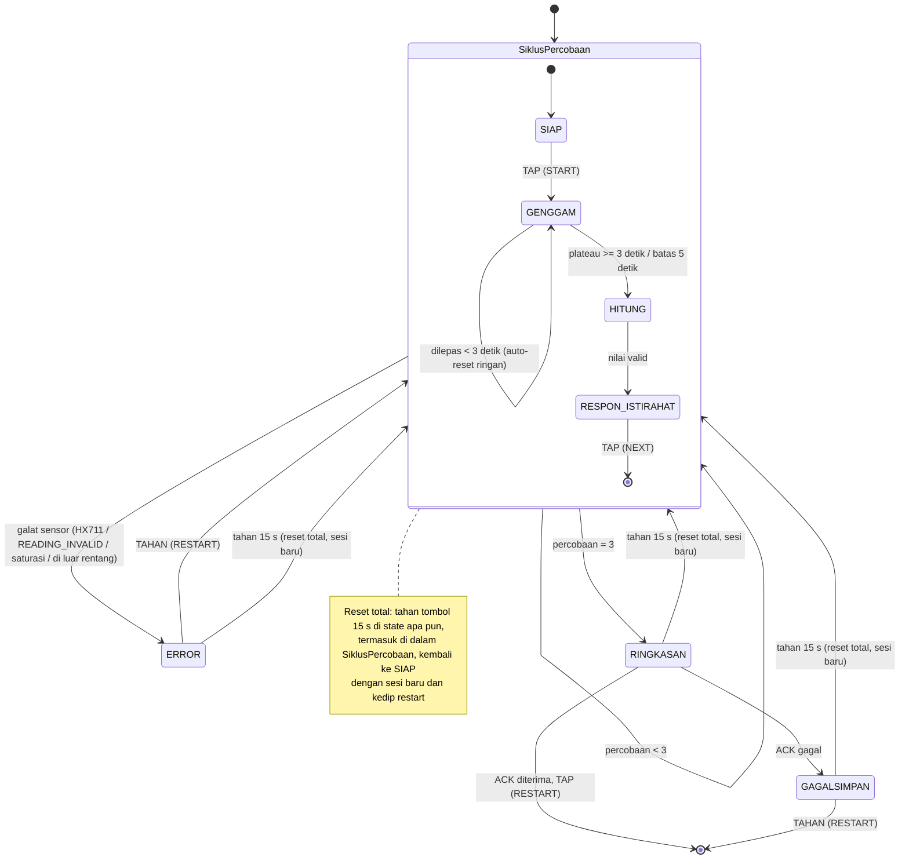
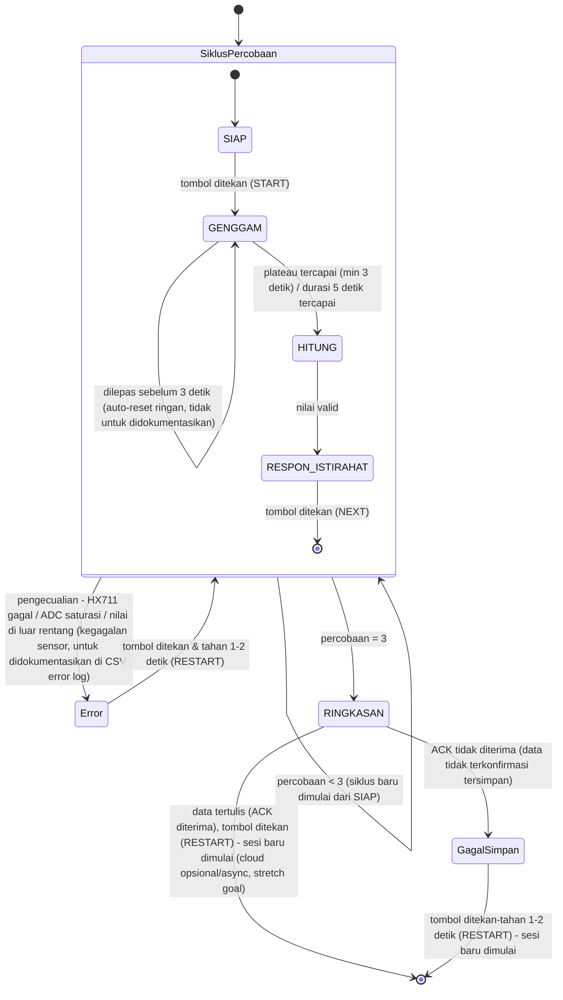

# Alur Program - Hand Grip Dynamometer (v5)
**Proyek akhir - embedded system**

> **Status: rancangan.** Firmware dan perangkat lunak laptop belum dikode; semua isi di bawah adalah rencana kecuali yang bertanda ✔. Sketsa uji modul (U4, U7, U8) sudah ada di `sketches/` (Bagian 11.3); langkah uji bench ada di [protokol-uji-bench-hgd.md](protokol-uji-bench-hgd.md). Versi v5 (18 Okt. 2026), perubahan:
> - (1) **Aturan LED baru** (menyala selama plateau di `GENGGAM`, tetap menyala sampai genggaman dilepas, kedip 5 detik setelah tiap restart, mati di galat) **menggantikan spesifikasi proposal S5** (LED menyala sepanjang `GENGGAM`), karena LED kini memberi dua sinyal: "genggaman stabil" dan "restart" (Bagian 10.3).
> - (2) **S2 diubah**: hitung mundur istirahat digambar ulang tiap `T_REFRESH_LCD_MS` = 500 ms, bukan 100 ms ±10-20 ms (aturan modul praktikum; A6 dan A7 selesai).
> - (3) **Reset total**: tahan tombol 15 detik di state apa pun; nomor sesi naik, baris `E` `FORCE_RESET`; uji X11a-c.
> - (4) **Batas rentang 80 kg** (kapasitas CZL 601, sebelumnya 100 kg) dengan **cek live di `GENGGAM`**, selain cek `ref` di `HITUNG`.
> - (5) **Baca HX711 non-blocking** tanpa library HX711 (baca saat DT rendah, 25 pulsa dalam `noInterrupts()`, tare 10 sampel lintas `loop()`); A5 selesai.
> - (6) Galat baru **`READING_INVALID`** (mis. SCK tercabut): utama 3 sampel berturut-turut datang < 40 ms, cadangan 10 nilai `raw` identik (langkah 4b, Bagian 7.4).
> - (7) **Identifier kode berbahasa Inggris** dengan tabel pemetaan nama (Bagian 1.4a); state machine berbentuk `switch` + handler per state (Bagian 1.3).
> - (8) **Build:** PlatformIO (core 2.0.17) untuk pengembangan, Arduino IDE core 3.3.11 untuk build akhir dan flash demo; satu folder sketsa untuk keduanya (Bagian 12.1).
> - (9) **`logger.py`** meneruskan tombol (`x`) ke ESP32 dan mencetak baris non-`HGD` ke konsolnya; **layar `GAGALSIMPAN`** bergantian tiap 3 detik menampilkan semua nilai (A8 selesai); X4 diperluas.
> - (10) **Uji galat diperbarui:** X1 dipecah (X1a DT → `HX711_TIMEOUT`, X1b SCK → `READING_INVALID`); X2 tanpa eksitasi berlebih (cabut satu kabel sinyal); X3 lewat `x`; X5 = catu hilang (bukan `GAGALSIMPAN`); X11a-c reset total.
>
> Versi v4 (16 Okt. 2026): E1 resmi setelah pemanasan (σ 35,0 counts), uji arah tekan, U8 kumulatif. Versi v3 (16 Okt. 2026): hasil uji bench 15 Okt. 2026 (U4, U5, U7, U8 sebagian, E1) dicatat; `THRESHOLD_ONSET_KG` = 1,0 kg terkonfirmasi E1; data untuk A5 dan A12 di Bagian 18. Versi v2 (15 Okt. 2026): sitasi dan rujukan silang dikoreksi terhadap modul praktikum dan buku, hal terbuka dicatat di Bagian 18; keputusan desain tidak berubah. Versi v1 (13 Okt. 2026) disusun dari alur proyek WIP-0.1 (10 Okt. 2026) dan Bagian 6-8 catatan lama. Tanda (✔ ▣ ◐ `[sitasi]`) dijelaskan di [catatan-proyek-hgd.md](../catatan-proyek-hgd.md); sumber `[sitasi]` ada di [sitasi-hgd.md](../sitasi/sitasi-hgd.md).

Dokumen ini memuat semua yang berkaitan dengan firmware ESP32 dan program sisi laptop: data dan state, konstanta, perlindungan input, fungsi, alur utama, pembacaan HX711, logging, antarmuka, pengujian modul, dan cara build. Fungsinya sama dengan "Alur Program" pada proyek C: menjawab *apa yang terjadi, urutannya, dan kenapa dipilih begitu*. Perangkat keras ada di [desain-pcb-hgd.md](../pcb/desain-pcb-hgd.md), prosedur kalibrasi di [protokol-kalibrasi-hgd.md](../kalibrasi/protokol-kalibrasi-hgd.md). Bagian 15-17 adalah lampiran dari catatan proyek lama yang sebagian tumpang tindih dengan Bagian 6 dan 10; perlu digabung kemudian.

## Peta isi

1. Arsitektur dan struktur berkas
2. Struktur data
3. Konstanta dan threshold
4. Fungsi pelindung
5. Fungsi firmware
6. Alur utama (state machine)
7. Pembacaan HX711 dan pengolahan sinyal
8. Kalibrasi
9. Logging dan `logger.py`
10. Antarmuka pengguna
11. Uji modul dan uji galat
12. Build dan cara menjalankan
13. Memori
14. Ringkasan constraint dan edge case
15. Lampiran: arsitektur sistem dan state machine (dari catatan proyek)
16. Lampiran: narasi pengalaman pengguna (dari catatan proyek)
17. Lampiran: catatan platform, ESP32 vs Raspberry Pi (dari catatan proyek)
18. Hal terbuka dari pemeriksaan terhadap modul praktikum

---

## 1. ARSITEKTUR DAN STRUKTUR BERKAS

### 1.1 Lapisan sistem
```
┌─────────────────────────────────────────────────────────────┐
│ LAPISAN FISIK     Pelat A/B + load cell (housing grip)      │
├─────────────────────────────────────────────────────────────┤
│ AKUISISI          HX711 (penguat + ADC 24 bit)              │
├─────────────────────────────────────────────────────────────┤
│ PEMROSES          ESP32 DevKit V1 (firmware, state machine) │
├─────────────────────────────────────────────────────────────┤
│ ANTARMUKA         LCD 16x2 I2C, LED, 1 tombol               │
├─────────────────────────────────────────────────────────────┤
│ PENCATATAN        USB-Serial → logger.py → CSV (+ ACK)      │
└─────────────────────────────────────────────────────────────┘
```

### 1.2 Dua gaya arsitektur dalam satu sistem
| Bagian | Gaya | Alasan |
|--------|------|--------|
| Tombol, ACK, error | **Event-driven**: sistem menunggu kejadian (interrupt, balasan) lalu bereaksi | Hemat, tanggap, non-blocking `[sitasi]` |
| Pembacaan HX711 saat `GENGGAM` | **Data-driven**: aliran sampel dari sensor diproses berulang | Plateau dan puncak butuh aliran data kontinu `[sitasi]` |

> Keduanya dipisah jelas dalam kode: ISR dan flag untuk event, fungsi `layaniGenggam()` untuk aliran data.

### 1.3 Dua lapisan state
- **Lapisan luar (sesi):** `SiklusPercobaan` diulang 3 kali, lalu `RINGKASAN`. Satu transisi pengecualian di batas `SiklusPercobaan` menangani semua kegagalan sensor, tanpa panah `Error` dari tiap state anak `[sitasi]`. Istilah "transisi pengecualian" mengikuti Marwedel (keluar dari superstate untuk menangani exception); sebelumnya disebut "interrupt transition", diganti supaya tidak tertukar dengan interrupt perangkat keras.
- **Lapisan dalam (percobaan):** `SIAP → GENGGAM → HITUNG → RESPON_ISTIRAHAT`.
- **Implementasi (diputuskan v5):** **satu fungsi handler per state**, dipilih lewat `switch (state)` di `mesinJalan()` (`fsmRun()`), ditambah satu fungsi `masuk*()` per state untuk aksi masuk. Tabel transisi di Bagian 6.3 tetap menjadi spesifikasi dan daftar uji, tetapi tidak dikodekan sebagai tabel data dengan mesin umum. Alasan: White (W3) menyarankan bentuk dengan kode paling sedikit dan paling mudah dibaca; `switch` + handler bisa dijelaskan baris per baris oleh tiap anggota tim di ujian lisan, sedangkan tabel generik menambah lapisan pointer fungsi. v4 merencanakan bentuk tabel.

### 1.4 Struktur berkas firmware (v5)
Proyek ada di `firmware/hgd/`. Folder `hgd/hgd/` adalah folder sketsa Arduino sekaligus sumber PlatformIO (`src_dir = hgd` di `platformio.ini`), jadi satu folder dikompilasi di kedua alat (Bagian 12.1).

| Berkas (di `hgd/hgd/`) | Isi |
|--------|-----|
| `hgd.ino` | Daftar versi core dan library di kepala berkas; `setup()`, `loop()` |
| `config.h` | Pin, konstanta, threshold |
| `types.h` | Enum dan struct (Bagian 2) |
| `sensor.h/.cpp` | Baca HX711 non-blocking, tare, konversi counts ke kg, buffer, plateau, deteksi galat sensor |
| `button.h/.cpp` | ISR tombol, debounce, tap vs tahan, waktu tahan reset total |
| `display.h/.cpp` | LCD: baris 16 karakter, kirim hanya karakter yang berubah (satu baris per putaran), pembatasan refresh, pulih sendiri |
| `led.h/.cpp` | LED: nyala/mati dan kedip restart 5 s (non-blocking); kapan menyala diputuskan `fsm.cpp` (Bagian 10.3) |
| `serial_log.h/.cpp` | Format baris, checksum, kirim, tunggu ACK |
| `fault.h/.cpp` | Modul penanganan galat bersama (`ERROR` dan `GAGALSIMPAN`) |
| `fsm.h/.cpp` | `fsmRun()` (`switch` ke handler per state), fungsi masuk tiap state, reset total, pengecualian galat, teks LCD per state (`drawScreen()`, Bagian 10.2), aturan LED (Bagian 10.3) |

### 1.4a Pemetaan nama: dokumen → kode
Dokumen ini memakai nama Indonesia; kode memakai identifier bahasa Inggris (istilah umum sistem tertanam). Komentar kode dan teks LCD tetap berbahasa Indonesia. Diagram state di brief memakai nama kode.

| Jenis | Nama di dokumen | Identifier di kode |
|---|---|---|
| State | `SIAP`, `GENGGAM`, `HITUNG`, `RESPON_ISTIRAHAT`, `RINGKASAN`, `ERROR`, `GAGALSIMPAN` | `READY`, `GRIP`, `COMPUTE`, `REST`, `SUMMARY`, `FAULT`, `SAVE_FAILED` |
| Fase `GENGGAM` | `MENUNGGU_MULAI`, `MENGHITUNG` | `WAIT_ONSET`, `MEASURING` |
| Sub-fase `RESPON_ISTIRAHAT` | `LEPAS_ISTIRAHAT`, `TUNGGU_LANJUT` | `RELEASE_REST`, `WAIT_NEXT` |
| Jenis galat (`JenisGalat` → `FaultType`) | `GALAT_NONE`, `HX711_TIMEOUT`, `ADC_SATURASI`, `DI_LUAR_RENTANG`, `READING_INVALID` | `FAULT_NONE`, `HX711_TIMEOUT`, `ADC_SATURATED`, `OUT_OF_RANGE`, `READING_INVALID` |
| Jalur keluar (`KeluarGenggam` → `GripExit`) | `TETAP`, `DILEPAS_AWAL`, `PLATEAU`, `BATAS_5S` | `EXIT_NONE`, `EXIT_EARLY_RELEASE`, `EXIT_PLATEAU`, `EXIT_TIMEOUT` |
| Tekanan (`Tekan` → `Press`) | `TIDAK`, `TAP`, `TAHAN` | `PRESS_NONE`, `PRESS_TAP`, `PRESS_HOLD` |
| Struct | `Percobaan`, `Sesi`, `Sensor`, `StatusTombol`, `StatusCatat` | `Trial`, `Session`, `SensorState`, `ButtonState`, `LogState` |
| Fungsi | `tombolInit`, `isrTombol`, `tombolUpdate`, `tombolReset`, `tombolLamaTahan` | `buttonInit`, `isrButton`, `buttonUpdate`, `buttonReset`, `buttonHeldMs` |
| Fungsi | `sensorInit`, `sensorBaca`, `hxRead`, `sensorCek` | `sensorInit`, `sensorPoll`, `hxRead`, `sensorCheck` |
| Fungsi | `sensorTare`, `sensorTareSelesai`, `bufTambah`, `bufPlateau` | `sensorStartTare`, `sensorTareDone`, `bufAdd`, `sensorPlateau` |
| Fungsi | `layaniGenggam`, `hitungRef`, `validasiRef`, `layaniRespon`, `ringkas` | `handleGrip`, `computeRef`, `validateRef`, `handleRest`, `summarize` |
| Fungsi | `catatKirimBaris`, `catatKirimSesi`, `catatTungguAck` | `logSend`, `logSendSession`, `logPoll` |
| Fungsi (baru v5) | `perintahSerial`, fungsi LED | `serialCmd`, `ledSet` / `ledUpdate` / `ledBlinkStart` |
| Kode baris `E` (bukan `JenisGalat`) | `FORCE_RESET` | `EVENT_FORCE_RESET` |
| Fungsi | `galatTahan` | `faultEnter` / `faultUpdate` |
| Fungsi | `tampil*` | `displayShow` |
| Fungsi | `mesinInit`, `mesinJalan`, `mesinSesiBaru` | `fsmInit`, `fsmRun`, `fsmNewSession` |
| Fungsi core Arduino-ESP32 | `watchdogAktif`, `watchdogReset` | `enableLoopWDT`, `feedLoopWDT` |
| Konstanta pin | `TOMBOL`, `LED`, HX711 `DT` / `SCK`, `SDA` / `SCL` | `PIN_BUTTON`, `PIN_LED`, `PIN_HX_DT` / `PIN_HX_SCK`, `PIN_SDA` / `PIN_SCL` |
| Konstanta | alamat LCD 0x27 | `LCD_ADDR` |
| Konstanta | `T_GENGGAM_MIN_MS`, `T_GENGGAM_MAX_MS`, `JUMLAH_PERCOBAAN`, `UKURAN_BUF`, `T_ISTIRAHAT_S` | `GRIP_MIN_MS`, `GRIP_MAX_MS`, `TRIALS_PER_SESSION`, `BUF_SIZE`, `REST_S` |
| Konstanta | `T_DEBOUNCE_MS`, `T_TAHAN_MS`, `T_REFRESH_LCD_MS`, `T_TUNGGU_HX711_MS`, `T_ACK_MS` | `DEBOUNCE_MS`, `HOLD_MS`, `LCD_REFRESH_MS`, `HX711_TIMEOUT_MS`, `ACK_TIMEOUT_MS` |
| Konstanta | `REF_MIN_KG` / `REF_MAX_KG`, `THRESHOLD_STABIL_KG`, `T_TARE_SAMPEL` | `MIN_FORCE_KG` / `MAX_FORCE_KG`, `THRESHOLD_STABLE_KG`, `TARE_SAMPLES` |
| Konstanta | `SKALA_COUNTS_PER_KG`, `SATURASI_FRAKSI`, `T_SAMA_N` | `SCALE_COUNTS_PER_KG`, `SATURATION_FRACTION`, `SAME_RAW_N` |
| Saklar build | `DEBUG_CMD` | `DEBUG_CMD` |
| Sama di keduanya | `THRESHOLD_ONSET_KG`, `ADC_MAX`, `I2C_HZ`, `BAUD`, `LED_BLINK_MS`, `LED_BLINK_TOTAL_MS`, `FORCE_RESET_MS`, `FORCE_RESET_SHOW_MS`, `SAVE_FAILED_PAGE_MS`, `SAMPLE_MIN_GAP_MS`, `SHORT_GAP_N` | sama |

### 1.5 Struktur berkas sisi laptop
| Berkas | Isi |
|--------|-----|
| `logger.py` | pyserial; validasi checksum; tulis CSV; `flush()` tiap baris; balas ACK/NAK |
| `kalibrasi.py` | Olah data kalibrasi: regresi, R², sisa, histeresis, drift, verifikasi |

### 1.6 Pembagian hardware
| Unit | Isi |
|------|-----|
| Housing grip | Hanya pelat A/B + load cell + spacer + baut + penjepit kabel |
| Housing elektronik | PCB (ESP32, modul HX711 dan level shifter dicolok ke soket, tombol, LED, resistor), LCD di tutup |
| Penghubung | Kabel load cell (4 inti) ke modul HX711; kabel jumper F-M dari PCB (J2) ke LCD; USB ke laptop |

---

## 2. STRUKTUR DATA

### Enum
| Enum | Nilai | Fungsi |
|------|-------|--------|
| `State` | `SIAP=0`, `GENGGAM`, `HITUNG`, `RESPON_ISTIRAHAT`, `RINGKASAN`, `ERROR`, `GAGALSIMPAN` | Tujuh state mesin |
| `FaseGenggam` | `MENUNGGU_MULAI=1`, `MENGHITUNG=2` | Dua fase di dalam `GENGGAM` |
| `FaseRespon` | `LEPAS_ISTIRAHAT=1`, `TUNGGU_LANJUT=2` | Dua sub-fase `RESPON_ISTIRAHAT` |
| `JenisGalat` | `GALAT_NONE=0`, `HX711_TIMEOUT`, `ADC_SATURASI`, `DI_LUAR_RENTANG`, `READING_INVALID` (v5) | Kegagalan sensor yang dicatat |
| `KeluarGenggam` | `TETAP=0`, `DILEPAS_AWAL`, `PLATEAU`, `BATAS_5S` | Tiga jalur keluar `GENGGAM` |
| `Tekan` | `TIDAK=0`, `TAP`, `TAHAN` | Hasil klasifikasi tekanan tombol |

> **Kenapa nilai 0 dipilih begini?** Semua struct di-reset dengan `memset(..., 0, ...)`, jadi arti nilai 0 tiap enum disengaja (sama dengan komentar di `types.h`): `JenisGalat`, `KeluarGenggam`, `Tekan` → 0 = "tidak ada" (`GALAT_NONE`, `TETAP`, `TIDAK`); `State` → 0 = `SIAP`, supaya `memset` meninggalkan mesin di `SIAP` (titik awal yang aman); `FaseGenggam` dan `FaseRespon` mulai dari 1, sehingga 0 berarti "belum dimulai".

### Struct `Percobaan`
```
ref          → nilai akhir percobaan (float, kg, presisi penuh)
valid        → true bila lolos validasi rentang
durasiMs     → lama genggam sampai keluar
keluar       → KeluarGenggam (PLATEAU atau BATAS_5S)
```
> Nilai float disimpan sebelum dibulatkan untuk LCD agar presisi tidak hilang untuk RMSE/MAE.

### Struct `Sesi`
```
nomorSesi    → naik 1 tiap sesi baru sejak boot
percobaanKe  → 1..3
hasil[3]     → Percobaan
peak, avg    → dihitung sekali di RINGKASAN
t0Ms         → millis() saat sesi mulai (untuk penanda T+mm:ss)
```

### Struct `Sensor`
```
offset       → counts hasil tare terakhir
skala        → counts per kg (dari kalibrasi)
raw          → pembacaan counts terakhir
kg           → (raw - offset) / skala
buf[5]       → buffer melingkar 5 pembacaan kg terakhir
bufIdx, bufN → indeks tulis dan jumlah terisi
```

### Struct `StatusTombol` (v5, `ButtonState` di `button.cpp`)
```
volatile bool   isrFlag     → diset ISR saat tepi turun lolos debounce; dibaca dan dikosongkan loop
volatile uint32 isrLastMs   → waktu interrupt terakhir yang diterima (hanya dipakai di ISR)
bool            down        → loop sedang mencatat satu tekanan
bool            sawLow      → pin pernah terbaca LOW selama tekanan ini (syarat TAP)
bool            holdFired   → TAHAN sudah dilaporkan untuk tekanan ini
bool            ignore      → tekanan diabaikan sampai dilepas (tombolReset)
bool            highSeen    → pin sedang terbaca HIGH sejak highStartMs (calon lepas)
uint32          highStartMs → millis() saat pin mulai terbaca HIGH (debounce saat lepas)
uint32          downMs      → millis() saat tekanan mulai (TAHAN dan reset total)
uint32          releaseMs   → millis() saat lepas terakhir dikonfirmasi
```

### Struct `StatusCatat`
```
seq          → nomor urut baris, naik tiap baris dikirim
menungguSeq  → seq yang menunggu ACK
tsKirim      → waktu kirim (untuk timeout)
```

### Memori
Semua struct dialokasikan **statis** (variabel global/`static`), tanpa `malloc`. Tidak ada struktur yang ukurannya tidak diketahui sebelumnya: 3 percobaan, 5 sampel, 1 sesi aktif.

### Variabel bersama ISR dan loop
Hanya dua: `StatusTombol.isrFlag` dan `StatusTombol.isrLastMs`, keduanya `volatile`. `isrFlag` (1 byte) dibaca dan dikosongkan loop; baca/tulis 1 byte bersifat atomik, jadi tidak perlu `noInterrupts()`. Variabel multi-byte yang dibaca ISR dan loop sekaligus tidak ada; `isrLastMs` hanya diakses di dalam ISR. Bila nanti ada yang dibagi, akses dari loop dibungkus `noInterrupts()/interrupts()` `[sitasi]`.

---

## 3. KONSTANTA DAN THRESHOLD

### 3.1 Nilai tetap (sudah diputuskan)
| Konstanta | Nilai | Fungsi |
|-----------|-------|--------|
| `T_GENGGAM_MIN_MS` | 3000 | Di bawah ini = dilepas terlalu awal |
| `T_GENGGAM_MAX_MS` | 5000 | Force-stop |
| `JUMLAH_PERCOBAAN` | 3 | Percobaan per sesi |
| `UKURAN_BUF` | 5 | Sampel buffer plateau |
| `T_ISTIRAHAT_S` | 60 | Istirahat antar percobaan |
| ~~`T_UPDATE_HITUNG_MS`~~ | - | Dihapus di v5: layar hitung mundur ikut `T_REFRESH_LCD_MS` (500 ms); mengubah S2 |
| `T_DEBOUNCE_MS` | 50 | Abaikan re-trigger ISR |
| `REF_MIN_KG` / `REF_MAX_KG` | 0 / 80 | Validasi rentang (0 < ref ≤ 80 kg); batas atas juga dicek live di `GENGGAM`. 80 kg = kapasitas nominal CZL 601 (v4: 100 kg dari literatur, di atas kapasitas load cell) |
| `RENTANG_TARGET_KG` | 20-70 | Spesifikasi S1 (hanya spesifikasi, tidak ada di `config.h`) |
| `ADC_MAX` | 8.388.607 | Skala penuh ADC 24 bit bertanda |
| `SATURASI_FRAKSI` | 0,95 | Saturasi bila \|raw\| ≥ 0,95 × `ADC_MAX` ≈ 7.969.177 |
| `I2C_HZ` | 100000 | Kecepatan I2C LCD |
| `BAUD` | 115200 | Serial ke laptop |
| `OVERLOAD_KGF` | 96 (120% F.S.) | Batas aman desain load cell (hanya spesifikasi, tidak ada di `config.h`; firmware memakai `REF_MAX_KG` 80) |
| `LED_BLINK_MS` | 250 | Selang ganti nyala/mati LED saat kedip restart (2 Hz) |
| `LED_BLINK_TOTAL_MS` | 5000 | Lama kedip restart di `SIAP` |
| `FORCE_RESET_MS` | 15000 | Tahan tombol selama ini di state apa pun = reset total |
| `FORCE_RESET_SHOW_MS` | 3000 | Setelah ditahan selama ini, LCD menampilkan hitung mundur reset total |
| `SAVE_FAILED_PAGE_MS` | 3000 | Selang ganti halaman layar `GAGALSIMPAN` |
| `LAJU_HX711` | 10 SPS | Bawaan papan modul (hanya spesifikasi, tidak ada di `config.h`; diatur pin RATE di modul, bukan firmware) |

### 3.2 Nilai awal yang disetel lewat eksperimen
| Konstanta | Nilai awal | Cara menyetel |
|-----------|------------|---------------|
| `THRESHOLD_ONSET_KG` | 1,0 ✔ | **E1**: rekam 60 detik load cell diam; ambil simpangan baku σ; onset = maks(1,0 kg; 10σ). Satu nilai dipakai untuk onset (naik), dilepas-terlalu-awal (turun), dan lepas di `RESPON_ISTIRAHAT`. **Hasil resmi 16 Okt. 2026 (setelah pemanasan):** σ = 35,0 counts = 0,0007 kg, jadi 10σ = 0,007 kg dan onset tetap 1,0 kg (15 Okt. 2026 tanpa pemanasan: σ 38,2 counts) |
| `THRESHOLD_STABIL_KG` | 0,5 | **E2**: genggaman latihan; selisih tertinggi-terendah buffer 5 sampel pada plateau nyata; threshold di atas fluktuasi tahan stabil |
| `T_TARE_SAMPEL` | 10 | Tare = rata-rata 10 sampel ≈ 1 detik pada 10 SPS; diperiksa di **E1** (15 Okt. 2026: sebaran 10 sampel tare 48 counts ≈ 0,9 g) |
| `T_REFRESH_LCD_MS` | 500 ✔ | **Ditetapkan v5 (A6 selesai):** aturan modul praktikum ADC dan serial, layar tidak digambar ulang lebih cepat dari dua kali per detik, karena tiap redraw berisi puluhan transaksi I2C. Berlaku juga untuk hitung mundur istirahat (mengubah S2). E3 tetap dapat dipakai untuk memeriksa keterbacaan |
| `T_TUNGGU_HX711_MS` | 1000 | Tanpa sampel baru selama ini → `HX711_TIMEOUT`. Tidak ada penungguan: dicek dari `millis()` sejak sampel terakhir. HX711 10 SPS siap tiap ≈ 85-100 ms, jadi 1 s adalah 10× margin |
| `T_SAMA_N` | 10 | **Cadangan (v5, langkah 4b):** 10 nilai `raw` identik berturut-turut → `READING_INVALID` (mis. DT terhubung ke GND pada laju normal). Noise terukur σ ≈ 35 counts, jadi 10 nilai identik pada pembacaan sehat praktis tidak terjadi. Uji 23 Okt. 2026: dengan SCK tercabut aturan ini saja membuat galat berkedip ±130 kali dalam 20 s, karena nilai sampah di antara nol memutus deretan identik; karena itu aturan jarak di bawah menjadi aturan utama |
| `SAMPLE_MIN_GAP_MS` / `SHORT_GAP_N` | 40 ms / 3 | **Aturan utama `READING_INVALID` (v5, langkah 4b):** 3 sampel berturut-turut masing-masing datang < 40 ms setelah sampel sebelumnya → DT tertahan rendah (mis. SCK tercabut) dan yang terbaca bukan hasil konversi. Hanya berlaku pada 10 SPS: sampel sehat datang tiap ≈ 85 ms (terukur 11,6 sampel/s); laju modul tetap 10 SPS (Bagian 7.3). Tiga, bukan satu: satu baca yang terlambat (putaran sibuk menulis LCD, maks. ≈ 28 ms) memperpendek jarak berikutnya, dan galat palsu terkunci di `ERROR` |
| `T_TAHAN_MS` | 1500 | **E4**: uji tekan-tahan dengan beberapa orang; ambang di antara 1000 dan 2000 yang tidak terpicu tak sengaja |
| `T_ACK_MS` | 2000 | **E5**: ukur waktu balasan `logger.py` pada 100 baris; ambang = 10× balasan terlama, tidak kurang dari 500 ms |
| `SKALA_COUNTS_PER_KG` | 53.687 | **Bagian 8**: diganti hasil regresi kalibrasi. Nilai awal dari hitungan: 2,0 mV/V × 128 × 2²⁴ / 80 kg, rasiometrik |

> **Kenapa satu threshold untuk tiga fungsi?** Cukup satu eksperimen (E1) dan satu angka yang bisa dipertanggungjawabkan, bukan tiga.

### 3.3 Eksperimen penyetelan
| ID | Eksperimen | Keluaran |
|----|------------|----------|
| E1 | Noise load cell diam 60 s (alat sudah terpasang dan hangat 10 menit) | σ, threshold onset, durasi tare. ✔ **16 Okt. 2026** di bench setelah pemanasan ≈ 11 menit (load cell belum di housing): n = 705, σ 35,0 counts (0,0007 kg), peak-to-peak 206 counts (0,004 kg); pemanasan menggeser baseline ≈ 80 counts (≈ 1,5 g) dan stabil setelah 4-5 menit. 15 Okt. 2026 tanpa pemanasan: σ 38,2 counts. Langkah di [protokol-uji-bench-hgd.md](protokol-uji-bench-hgd.md). Ulangi setelah housing dirakit |
| E2 | Lima genggaman latihan per anggota tim | Threshold stabilitas |
| E3 | Angka berubah di LCD, refresh 50-500 ms (sketsa `uji_lcd_i2c` mencetak durasi tiap redraw) | Refresh LCD |
| E4 | Uji tekan-tahan (tap vs tahan) | Ambang tahan |
| E5 | 100 baris CSV + ACK | Timeout ACK |
| E6 | Tarik kabel load cell perlahan | Besar pergeseran pembacaan akibat kabel (dokumen [desain-housing-load-cell.md](../housing-load-cell/desain-housing-load-cell.md)) |

---

## 4. FUNGSI PELINDUNG

### 4.1 Debounce software (di dalam ISR)
Kontak mekanik tombol memantul beberapa milidetik sehingga satu tekanan terbaca berkali-kali (modul praktikum GPIO; Russell soal 6.3). Pola debounce di dalam ISR mengikuti contoh interrupt pin di modul praktikum pewaktuan. Catatan: White (W1) justru menyebut pantulan sebagai ringing induktif, bukan mekanik; penjelasan yang dipakai di sini adalah versi modul. Di dalam ISR: bila `millis() − tsInt < T_DEBOUNCE_MS`, interrupt diabaikan; selain itu `tsInt = millis()` dan `flag = true`.

### 4.2 Pull-up internal
Pin tombol memakai `INPUT_PULLUP`. Pin masukan yang tidak disambung ke apa pun mengambang dan dapat memicu interrupt acak `[sitasi]`.

### 4.3 `volatile`
Variabel yang diubah ISR (`flag`, `tsInt`) dideklarasikan `volatile`. Tanpa itu compiler dapat meng-cache nilainya dan mesin state macet di `SIAP` walau tombol sudah ditekan (White bab 4; modul praktikum pewaktuan). Russell §9.1.2 (RU1) membahas salinan atomik variabel bersama, bukan `volatile`.

### 4.4 Reset flag tombol
`tombolReset()` dipanggil tiap **masuk** state yang menunggu tombol (v5: mengosongkan `isrFlag` dan menandai tekanan yang sedang berlangsung "abaikan sampai dilepas"; waktu tahan reset total tidak di-reset): `SIAP`, `ERROR`, `GAGALSIMPAN`, sub-fase 2 `RESPON_ISTIRAHAT`, dan `RINGKASAN`. Tekanan nyasar dari state lain tidak tersimpan diam-diam lalu terkonsumsi di state yang sedang menunggu. Ini generalisasi dari aturan `volatile`.

### 4.5 Klasifikasi tap vs tahan (v5, `tombolUpdate()`)
Perpanjangan debounce: ISR menandai awal tekanan, `loop()` membaca level pin tiap putaran dan menghitung durasi dengan `millis()`.
- **Awal tekanan:** flag ISR (tepi turun) dan sudah lewat `T_DEBOUNCE_MS` sejak lepas terakhir → tekanan dimulai (`downMs = millis()`), apa pun level pin saat itu. Putaran pertama setelah ISR sering jatuh di tengah pantulan, jadi level saat itu tidak dipakai untuk memutuskan.
- **Selama ditekan:** tiap bacaan LOW mencatat `sawLow` ("pernah terbaca LOW") dan membatalkan calon lepas.
- **TAHAN:** tekan terus ≥ `T_TAHAN_MS` → `TAHAN`, dilaporkan **sekali** saat ambang tercapai, tanpa menunggu lepas.
- **Lepas (debounce saat lepas):** tombol dianggap lepas hanya bila pin terbaca HIGH **terus-menerus selama `T_DEBOUNCE_MS`**; bila sempat LOW lagi, hitungan HIGH dimulai ulang. Tanpa ini, pantulan sesaat setelah ditekan terbaca sebagai lepas: TAP palsu keluar, dan tekanan panjang tidak pernah menjadi TAHAN atau reset total (A12).
- **TAP:** saat lepas terkonfirmasi, hanya bila `sawLow` benar, TAHAN belum terpicu, dan tekanan tidak sedang diabaikan. Pulsa yang tidak pernah terbaca LOW dianggap derau.
- **Abaikan sampai dilepas:** `tombolReset()` saat masuk state menandai tekanan yang sedang berlangsung sebagai diabaikan; pelepasannya tidak menjadi TAP dan tidak memicu TAHAN, tetapi waktu tahan untuk reset total (`tombolLamaTahan()`) tetap berjalan.
- Cara menahan **tidak ditampilkan** di LCD (pengetahuan pengawas).
- **A12:** ditangani di kode (`button.cpp`, langkah 1); menunggu uji papan U8 (10 tap = 10 TAP, 10 tahan = 10 TAHAN tanpa TAP tambahan).

### 4.6 Modul penanganan galat bersama (`fault.cpp`)
`ERROR` dan `GAGALSIMPAN` memakai satu modul `galatTahan` (`faultEnter()` / `faultUpdate()`), **non-blocking (v5)**: `faultEnter(jenis)` dipanggil sekali saat masuk state (LED mati, layar galat, pesan Serial, baris `E`); `faultUpdate()` dipanggil tiap putaran `loop()`, memperbarui `raw` live (atau halaman `GAGALSIMPAN`) dengan `millis()`, lalu langsung kembali; state berikut dipilih `mesinJalan()` saat `tombolUpdate()` melaporkan TAHAN. Tidak ada penungguan di dalam modul, jadi reset total dan watchdog tetap bekerja. Satu tempat untuk mengubah kebijakan galat `[sitasi]`. Keduanya tetap dua state FSM karena tujuan keluarnya berbeda.

**Langkah 8 (kode):** `fault.cpp` berisi `faultEnter()` (LED mati, `buttonReset()`, pesan `[FAULT] <jenis> raw=… kg=…`, baris `E`), `faultDraw()` ("ERR:…" + `RAW` live), `faultClear()` dan `faultLogEvent()` (juga dipakai reset total, kode 5). **Kapan** masuk dan keluar `ERROR` tetap diputuskan `fsm.cpp` (cek galat sensor, cek rentang live di `GENGGAM`, cek `ref` di `HITUNG`, TAHAN). Halaman `GAGALSIMPAN` tetap digambar di `fsm.cpp` karena memerlukan data sesi. Sampai langkah 9 baris `E` dicetak sebagai teks `[E] kode=… sesi=… percobaan=… t=… s`; langkah 9 menggantinya dengan baris `HGD,E,…*checksum` + ACK.

### 4.7 Pembagian filosofi galat
| Jenis | Contoh | Perlakuan |
|-------|--------|-----------|
| **Kegagalan sensor/hardware** | HX711 tidak siap (`HX711_TIMEOUT`), pembacaan tidak valid (`READING_INVALID`, v5), ADC mendekati saturasi, gaya di luar rentang (> 80 kg live di `GENGGAM`, v5; atau `ref` ≤ 0 / > 80 kg di `HITUNG`) | Masuk `ERROR`; dicatat otomatis ke CSV (jenis + `T+mm:ss`); tidak dihitung sebagai satu dari 3 percobaan |
| **Human error** | Dilepas sebelum 3 detik | Auto-reset ringan ke fase 1 `GENGGAM`; tanpa pesan galat; tidak dicatat |

> Pencatatan galat dipindah dari logbook manual ke CSV otomatis, karena logbook manual di tengah sesi sering terlewat.

### 4.8 Protokol ACK
ESP32 tidak dapat mengetahui sendiri apakah baris benar-benar tertulis di laptop. Mekanisme:
1. Tiap baris diberi nomor urut `seq` dan checksum.
2. `logger.py` memvalidasi checksum, menulis, `flush()`, lalu membalas `ACK,<seq>`; bila checksum salah membalas `NAK,<seq>`.
3. ESP32 menunggu `ACK,<seq>` maksimal `T_ACK_MS`. `NAK` atau tanpa balasan → kirim ulang sekali; bila tetap gagal → `GAGALSIMPAN`.
4. Nilai selalu juga dicetak ke Serial dan tampil di konsol `logger.py` (atau Serial Monitor bila `logger.py` tidak dipakai), sehingga pengawas dapat menyalinnya manual tanpa membuka port lagi (A8). **Bila `logger.py` sendiri sudah berhenti**, sumber salinan adalah layar LCD `GAGALSIMPAN`, yang bergantian menampilkan semua nilai sesi (Bagian 10.2). Jangan membuka Serial Monitor lebih dulu: membuka port me-reset ESP32 dan menghapus sesi di RAM (A8).

> Deteksi koneksi USB saja tidak cukup: tidak mendeteksi skrip host yang mati atau lupa dijalankan. ACK per baris mendeteksi semuanya, termasuk baris terpotong (lewat checksum).

### 4.9 Watchdog
Timer pengawas ESP32 (task watchdog untuk task `loop()`) diaktifkan dengan `enableLoopWDT()` di `setup()` dan diberi makan di **satu titik**, `feedLoopWDT()` di ujung `loop()` (v5). Kedua fungsi disediakan core Arduino-ESP32 dengan API yang sama di core 2 dan 3, sedangkan `esp_task_wdt_init()` dari IDF berubah tanda tangan di core 3, jadi tidak dipakai. Titik ganda atau di dalam `delay` melemahkan pengawasan `[sitasi]`. Watchdog menangani macet total yang tidak bisa dipulihkan perangkat lunak; bukan pengganti penanganan galat normal. Diaktifkan setelah state machine stabil (jadwal Bagian 11 di [catatan-proyek-hgd.md](../catatan-proyek-hgd.md)).

---

## 5. FUNGSI FIRMWARE

> Daftar fungsi yang akan dikode. Format: tujuan, masukan/keluaran, langkah, pemakai.

### 5.1 `setup()` ▣
Inisialisasi sekali: `Serial.begin(BAUD)`; `Wire.begin(21, 22)`; `Wire.setClock(I2C_HZ)`; LCD `lcd.init()` dan `lcd.backlight()` (seperti modul praktikum ADC dan serial); `pinMode(LED, OUTPUT)`; `tombolInit()` (`INPUT_PULLUP` + `attachInterrupt(FALLING)`); `sensorInit()`; `mesinInit()` (sesi 1, percobaan 1, state `SIAP` dengan kedip restart); `enableLoopWDT()` (Bagian 4.9).
**Pemakai:** dijalankan Arduino core satu kali.

### 5.2 `loop()` ▣
Satu pola: `tombolUpdate(); sensorBaca(); perintahSerial(); mesinJalan(); catatTungguAck(); feedLoopWDT();`. Tidak ada `delay()`; semua pewaktuan memakai `millis()`. Sejak v5 tidak ada pemanggilan blocking di `loop()` (Bagian 6.4).

### 5.3 `isrTombol()` ▣
ISR `IRAM_ATTR` pada tepi turun (FALLING). Menerapkan debounce 4.1. Hanya menulis `flag` dan `tsInt`. Tidak memanggil `Serial`, `Wire`, atau `millis` selain yang diperlukan.
**Tugas interrupt (v5):** menangkap **awal tepat** setiap tekanan (tepi turun) walau `loop()` sedang sibuk (mis. redraw LCD), sehingga tidak ada tekanan yang terlewat dan waktu TAHAN serta reset total dihitung sejak tepi itu. Keputusan TAP/TAHAN diambil di `tombolUpdate()`: tekanan harus terbaca LOW oleh `loop()` minimal sekali, lalu HIGH stabil 50 ms (debounce saat lepas, A12). Setiap tap nyata memenuhi ini, dengan alasan berikut.
- **Diukur 23 Okt. 2026 (core 2.0.17, I2C 100 kHz):** satu operasi LCD lewat backpack (satu karakter atau satu `setCursor`) ≈ 1,65 ms. Redraw satu baris penuh 27,7 ms, dua baris 55,3 ms (putaran `loop()` terlama 56,0 ms). Angka lama "satu putaran < 15 ms" salah.
- **Perbaikan:** `lcdLine()` hanya mengisi buffer; `displayUpdate()` mengirim **hanya karakter yang berubah** dan **paling banyak satu baris per putaran** (Bagian 5.18). Satu baris paling banyak 17 operasi (16 karakter + `setCursor`; deretan terpisah butuh `setCursor` sendiri tetapi mengirim lebih sedikit karakter), jadi batas atasnya ≈ 28 ms. Terukur: redraw biasa (angka berubah 1-6 karakter) 3,3-13,1 ms, terlama 27,7 ms (13 karakter dalam beberapa deretan, saat isi baris 1 berganti); putaran `loop()` terlama 15,0 ms selama uji tap.
- **Jaminan:** pin dibaca sekali di awal tiap putaran, jadi jarak antara dua bacaan tidak lebih dari putaran terlama (≤ 28 ms). Tekanan yang LOW selama ≥ 50 ms pasti memuat paling sedikit satu bacaan (50 > 28, sisa ≈ 22 ms). Syarat untuk langkah berikutnya: putaran `loop()` terlama harus tetap < 50 ms (HX711 ≈ 0,06 ms dan baris serial singkat tidak mengubahnya).

Pulsa yang tidak pernah terbaca LOW dianggap derau, bukan TAP.

### 5.4 `tombolUpdate()` ▣
Membaca level pin dan `isrFlag`, menjalankan klasifikasi 4.5, dan **mengembalikan** `Tekan` (`TIDAK`/`TAP`/`TAHAN`) untuk putaran ini. Dipanggil sekali per `loop()`. Pasangannya `tombolLamaTahan()` mengembalikan lama tekanan fisik yang sedang berlangsung (ms, 0 bila tidak ditekan), dipakai reset total dan hitung mundurnya; nilainya tidak terpengaruh `tombolReset()`.
**Pemakai:** `mesinJalan()`.

### 5.5 `tombolReset()` ▣
Mengosongkan `flag` dan menandai tekanan yang sedang berlangsung sebagai "abaikan sampai dilepas" (v5), sehingga pelepasannya tidak terbaca sebagai TAP. Waktu tahan reset total tidak ikut di-reset. Dipanggil tiap masuk state yang menunggu tombol (Bagian 4.4).

### 5.6 `sensorInit()` ▣
Mengatur pin (DT `INPUT_PULLUP` supaya modul yang tercabut terbaca "tidak siap", SCK `OUTPUT` rendah), memasang skala. Tanpa library HX711 (v5). Tidak menunggu: kegagalan dideteksi lewat `T_TUNGGU_HX711_MS` sejak boot.

### 5.7 `sensorBaca()` ▣
Dipanggil tiap `loop()`. **Non-blocking (v5):** bila DT masih tinggi (data belum siap) langsung kembali. Bila DT rendah → `hxRead()`: 24 pulsa SCK + pulsa ke-25 (kanal A, gain 128), dibungkus `noInterrupts()/interrupts()` supaya ISR tombol tidak memperpanjang pulsa; pulsa tinggi ≈ 1-2 µs, jauh di bawah ≈ 60 µs yang mematikan HX711; total terukur 92-114 µs (biasanya 93-95 µs; langkah 3, 23 Okt. 2026, core 2.0.17). Lalu menyimpan `raw` dan waktu sampel, `kg = (raw − offset) / skala`, menambah buffer, dan menyuapi tare bila sedang berjalan. Galat diperiksa terpisah oleh `sensorCek()`: tanpa sampel selama `T_TUNGGU_HX711_MS` → `HX711_TIMEOUT`; `|raw| ≥ SATURASI_FRAKSI × ADC_MAX` → `ADC_SATURASI`; 3 sampel berturut-turut datang < `SAMPLE_MIN_GAP_MS` (40 ms) setelah sebelumnya, atau (cadangan) `T_SAMA_N` nilai identik → `READING_INVALID`.
**Pemakai:** `loop()`; hasilnya dibaca `layaniGenggam()`, `layaniRespon()`, `galatTahan()`.

### 5.8 `sensorTare()` ▣
Memulai tare: `T_TARE_SAMPEL` (10) sampel berikutnya dijumlahkan oleh `sensorBaca()`, satu per sampel baru, lalu rata-ratanya menjadi `offset`. **Non-blocking (v5):** ≈ 1 detik pada 10 SPS, tersebar di banyak putaran `loop()`; `sensorTareSelesai()` memberi tahu `SIAP` kapan layar berganti ke "Tekan tmbl START". Dipanggil sekali tiap masuk `SIAP`. **Cek sebaran (langkah 4c):** bila (maks − min) 10 sampel > `TARE_MAX_SPREAD` (**400 counts ≈ 7 g**, langkah 8; semula 1000, tetapi tare bersebaran 585 counts dengan tangan masih dekat alat lolos dan menggeser nol ≈ 0,05 kg; sebaran normal terukur 48-136 counts, sampai 192 tepat setelah percobaan), alat dianggap tersentuh: peringatan dicetak, `offset` lama dipertahankan, dan tare diulang otomatis (layar tetap "Menyesuaikan nol"). Alasan: sentuhan saat tare menggeser `offset` dan seluruh hasil percobaan. **Sampel awal (langkah 5c):** `BOOT_SKIP_SAMPLES` (5) sampel pertama setelah boot dibuang (≈ 0,5 s); tanpa ini tare pertama gagal di tiga boot berturut-turut (sebaran 941-2019 counts, ulangannya 62-97). **Jendela offset (langkah 8c):** setelah tare berhasil, |`offset` − `OFFSET_EXPECTED`| > `OFFSET_WINDOW` (−39000 ± 20000 counts, keduanya khusus unit ini dan diukur ulang saat kalibrasi). **Langkah 8d:** offset di luar jendela mula-mula diperlakukan seperti tare yang terganggu: `offset` lama dipertahankan, layar "Lepas genggaman", tare diulang. Baru bila offset di luar jendela **terus-menerus selama `OFFSET_BAD_MS` (10 s)** → `READING_INVALID`, serial `offset di luar jendela … load cell terputus?`; satu tare di dalam jendela mengembalikan hitungan waktu. Berbasis waktu, bukan jumlah tare: 3 tare hanya ≈ 1,7 s, sehingga partisipan yang menumpukan tangan 2 s akan mendapat galat. Alasan: ±20000 counts ≈ 0,37 kg, jadi tangan yang bertumpu di load cell saat tare (kasus yang ditangani lembut oleh langkah 5c) sudah keluar jendela, dan pelat B rakitan (≈ 138 g ≈ 7400 counts) memakan sebagian margin; satu tare buruk tidak boleh langsung menjadi galat. Alasan: 23 Okt. 2026 kabel E− (putih) lepas dari pad HX711; `offset` menjadi ≈ +500 counts, pembacaan tidak bereaksi pada tekanan, dan tidak ada galat lain yang terpicu. Jendela dua arah (bukan satu sisi "> −20000") supaya pasangan sinyal yang tertukar (≈ +39000) juga terdeteksi. **Batas:** hanya dicek saat tare, jadi kabel yang putus di tengah percobaan baru tertangkap pada tare berikutnya (masuk `SIAP` berikutnya). **Penjaga nol (langkah 5c):** genggaman yang tenang saat tare lolos cek sebaran dan menjadi `offset` yang salah; karena itu `SIAP` dan `GENGGAM` fase 1 memeriksa kg setelah tare (Bagian 6.2). Alat diangkat atau diputar setelah tare menggeser kg < 0,01 kg (terukur), jadi `offset` tetap berlaku.

### 5.9 `bufTambah(float kg)` / `bufPlateau()` ▣
`bufTambah` menulis ke buffer melingkar 5 sampel. `bufPlateau` mengembalikan `true` bila buffer penuh dan (maks − min) ≤ `THRESHOLD_STABIL_KG`. Rata-rata buffer menjadi `ref`.

### 5.10 `layaniGenggam()` ▣
State `GENGGAM`, dua fase (rincian di Bagian 6.2). Mengembalikan `KeluarGenggam`.

### 5.11 `hitungRef()` ▣
One-shot: `ref = rata-rata buffer` (atau nilai buffer terbaik pada `BATAS_5S`); menyimpan ke `hasil[percobaanKe]`. Tanpa tampilan LCD.

**Nilai buffer terbaik (keputusan tim, langkah 6):** = **jendela terkuat**, yaitu rata-rata tertinggi dari jendela 5 sampel berurutan selama fase 2, hanya dari jendela yang semua sampelnya > `THRESHOLD_ONSET_KG`; dinilai sekali per sampel baru. Alasan: kekuatan genggaman adalah nilai maksimum, jadi bila genggaman tidak pernah stabil, yang dicatat adalah bagian terkuatnya (bukan bagian paling stabil, yang bisa jatuh pada gaya rendah). Rata-rata 5 sampel (bukan satu sampel puncak) tetap meredam lonjakan sesaat. Jalur `PLATEAU` tetap memakai rata-rata buffer saat plateau terjadi.

### 5.12 `validasiRef(float ref)` ▣
Dipanggil di titik masuk `RESPON_ISTIRAHAT`. `ref ≤ REF_MIN_KG` atau `ref > REF_MAX_KG` (80 kg) → `DI_LUAR_RENTANG`. Batas atas yang sama juga dicek live pada tiap sampel di `GENGGAM` (Bagian 6.2).

### 5.13 `layaniRespon()` ▣
Dua sub-fase (Bagian 6.2). Memakai `THRESHOLD_ONSET_KG` untuk mendeteksi pelepasan (LED mati pada saat itu), lalu hitung mundur 60 detik tanpa ganti layar; layar digambar ulang tiap `T_REFRESH_LCD_MS`.

### 5.14 `ringkas()` ▣
Sekali setelah percobaan ke-3: `peak = maks(hasil[].ref)`, `avg = rata-rata(hasil[].ref)`; memanggil `catatKirimSesi()`.

### 5.15 `catatKirimBaris(jenis, ...)` ▣
Menyusun baris `HGD,<jenis>,...*<checksum>` dengan `seq` berikutnya, mengirim lewat `Serial.print`, dan mencatat `menungguSeq` dan `tsKirim`.

### 5.16 `catatTungguAck()` ▣
Non-blocking: dipanggil tiap loop sampai `ACK,<seq>` diterima (→ sukses), `NAK` atau `T_ACK_MS` lewat (→ kirim ulang sekali; bila gagal lagi → gagal).

### 5.17 `galatTahan(jenis, data)` ▣
Lihat 4.6. Menampilkan jenis galat dan `raw` live (atau halaman data yang gagal tersimpan). Non-blocking (v5): `faultEnter()` sekali saat masuk, `faultUpdate()` tiap putaran lalu langsung kembali; keluar lewat TAHAN diputuskan `mesinJalan()`.

### 5.18 `tampil*()` ▣
Satu fungsi per state yang menggambar teks 16 karakter per baris (Bagian 10). Pembaruan LCD dibatasi `T_REFRESH_LCD_MS` agar tidak membanjiri bus I2C.
**Cara tulis (v5, `display.cpp`):** `lcdLine(baris, teks)` memotong di 16 karakter, mengisi spasi, mengganti non-ASCII dengan `?`, lalu hanya menyimpan hasilnya ke buffer "diinginkan" (2 × 16). `displayUpdate()`, sekali per `loop()`, membandingkannya dengan buffer "tampil" dan mengirim hanya karakter yang berbeda, tiap deretan diawali `setCursor(kolom, baris)` eksplisit, **paling banyak satu baris per putaran** (perubahan dua baris selesai dalam dua putaran). Tanpa `lcd.clear()` untuk redraw (Clear 1,64 ms dan layar berkedip). Alasan dan hasil ukur: Bagian 5.3. **Pulih sendiri (langkah 4c):** tiap `LCD_HEAL_MS` (2 s) satu baris buffer "tampil" ditandai tidak diketahui (bergantian), sehingga baris itu dikirim ulang penuh pada putaran berikutnya (tetap satu baris per putaran, ≤ 28 ms), tanpa `delay()`. Alasan: bila gangguan I2C mengacaukan layar, karakter yang menurut buffer tidak berubah tidak akan dikirim lagi. Batas: memperbaiki isi layar, bukan pengontrol yang kehilangan sinkron 4-bit (sketsa bench memakai inisialisasi ulang dengan `delay()`, tidak dipakai di firmware utama).

### 5.19 `mesinJalan()` ▣
Dipanggil sekali per `loop()`, dengan urutan tetap (v5): (1) **cek reset total** (tombol ditahan ≥ `FORCE_RESET_MS`) lebih dulu, supaya berlaku di state mana pun termasuk `ERROR` dan `GAGALSIMPAN`; (2) cek galat sensor bila state berada di dalam `SiklusPercobaan` → transisi pengecualian ke `ERROR`; (3) `switch (state)` memanggil handler state aktif (`layaniGenggam()`, `layaniRespon()`, ...). Handler mengembalikan state berikut; bila berbeda dari state sekarang, `mesinJalan()` memanggil `masuk*()` state baru. Bentuk ini menggantikan "lewat tabel transisi" di v4 (Bagian 1.3); tabel di Bagian 6.3 tetap sebagai spesifikasi.

### 5.20 `mesinSesiBaru()` ▣
Menyimpan `nomorSesi` lebih dulu, mereset struct sesi (`memset`), lalu memasang `nomorSesi` lama + 1 (tidak pernah kembali ke 1 selama alat menyala), `percobaanKe = 1`, `t0Ms = millis()`, state `SIAP` **dengan kedip restart** (Bagian 6.2). Dipanggil dari `RINGKASAN` (TAP) dan `GAGALSIMPAN` (TAHAN) setelah RESTART, dan **dari reset total (v5)** setelah baris `E` `FORCE_RESET` dikirim. `ERROR` → TAHAN tidak memanggil fungsi ini (sesi dan `percobaanKe` tetap), tetapi juga masuk `SIAP` dengan kedip restart.

### 5.21 `perintahSerial()` (`serialCmd()`) dan saklar `DEBUG_CMD` ▣
Dipanggil tiap `loop()`; membaca satu karakter dari Serial bila ada (non-blocking) dan hanya aktif bila `DEBUG_CMD` = 1 di `config.h`. Perintah: `t` = tare ulang; `k` = cetak rata-rata 10 sampel mentah; `p` = cetak `raw`, `offset`, `kg`; **`x` = demo di luar rentang: skala dibagi `DEMO_SCALE_DIV` (40) sampai tare berikutnya, sehingga tekanan ≈ 2 kg terbaca > 80 kg dan memicu cek live di `GENGGAM` (X3)**. Langkah 8: pembagi 40, bukan 20, karena tekanan jari terkuat pada load cell tanpa housing ≈ 2,8 kg; `x` juga memudahkan uji batas 5 detik (X10), karena goyangan kecil menjadi besar. **Langkah 8c:** `x` bolak-balik dan **tidak lagi dibatalkan oleh tare**; mati oleh sesi baru, reset total, atau `x` lagi. Selama aktif layar `SIAP` menampilkan `SIAP x40 1/3`, dan percobaan yang diukur ditandai `demo` (serial `DEMO x40`) supaya langkah 9 tidak mencatatnya sebagai data nyata. **`s` (langkah 8c) = simulasi X2:** `raw` dipaksa ke skala penuh sehingga `ADC_SATURASI` terpicu lewat jalur galat normal; `s` lagi = kabel "dipasang kembali", lalu TAHAN untuk keluar `ERROR`. Dipakai untuk kalibrasi (Bagian 8) dan demo galat; dibiarkan aktif di build demo supaya X3 bisa ditunjukkan tanpa membebani load cell melewati kapasitasnya. Perintah ini tidak mengganggu `logger.py`: karakter tunggal bukan baris `ACK`/`NAK`.

### 5.22 Fungsi sisi laptop ▣
- `logger.py`: baca baris dari port serial → validasi checksum → tulis CSV + `flush()` → balas `ACK`/`NAK`.
- `logger.py` juga **meneruskan tombol keyboard yang diketik di konsolnya ke ESP32 (v5)**, minimal `x` (demo di luar rentang, Bagian 5.21), dibaca tanpa menunggu (`msvcrt.kbhit()` di Windows). Alasan: X3 harus bisa didemokan saat logging berjalan. Membuka Serial Monitor untuk mengetik `x` tidak mungkin selama `logger.py` memegang port, dan membuka port ulang me-reset ESP32 (A8) sehingga sesi di RAM hilang.
- `logger.py` **mencetak setiap baris non-`HGD` ke konsolnya (v5)**, tidak ke CSV: teks debug, pesan `[FAULT]`, dan nilai cadangan `GAGALSIMPAN` tetap terlihat selama `logger.py` memegang port. Dengan begitu konsol `logger.py` menggantikan Serial Monitor sebagai tempat pengawas membaca dan menyalin nilai (A8).
- `kalibrasi.py`: baca tabel hasil kalibrasi → regresi linier (kemiringan = skala, intersep = offset) → R², sisa terbesar, histeresis, drift → cetak `SKALA_COUNTS_PER_KG`.

---

## 6. ALUR UTAMA (STATE MACHINE)

### 6.1 Alur keseluruhan
```
MULAI (ESP32 dicatu USB; logger.py sudah berjalan di laptop)
│
├─ setup(): Serial, I2C, LCD, pin, interrupt tombol, HX711, mesin → SIAP; enableLoopWDT()
│
└─ loop() berulang selamanya (tanpa delay):
   │
   ├─ tombolUpdate()        → TIDAK / TAP / TAHAN
   ├─ sensorBaca()          → baca HX711 bila DT rendah (non-blocking)
   ├─ perintahSerial()      → perintah t/k/p/x (bila DEBUG_CMD)
   ├─ mesinJalan()          → reset total → cek galat → handler state aktif
   ├─ catatTungguAck()      → ACK/NAK non-blocking
   └─ feedLoopWDT()         → satu titik

SESI (3 percobaan)
│
└─ SiklusPercobaan (superstate)
   │
   ├─ [SIAP]
   │    ├─ Masuk: tombolReset(); LCD "Menyesuaikan nol"; sensorTare() (10 sampel lintas loop, non-blocking ≈ 1 s)
   │    ├─ Masuk setelah restart: LED berkedip 5 s (non-blocking); TAP menghentikannya
   │    ├─ LCD "Tekan tmbl START"; tunggu TAP
   │    └─ TAP → GENGGAM
   │
   ├─ [GENGGAM]  LED mati di fase 1; di fase 2 LED menyala selama plateau
   │    ├─ Fase 1  MENUNGGU_MULAI: LCD "Menunggu genggam"; baca kg; kg > THRESHOLD_ONSET → Fase 2
   │    ├─ Fase 2  MENGHITUNG: timer mulai; LCD "Tahan 3-5 detik";
   │    │          baca kg → bufTambah → bufPlateau → LED = bufPlateau()
   │    ├─ Tiap sampel (fase 1 dan 2): kg > 80 kg → pengecualian → ERROR (DI_LUAR_RENTANG), LED mati
   │    ├─ Keluar 1: kg < onset sebelum 3000 ms → kembali ke Fase 1 (tanpa pesan, tanpa catatan)
   │    ├─ Keluar 2: plateau dan ≥ 3000 ms      → HITUNG
   │    └─ Keluar 3: 5000 ms tanpa plateau      → HITUNG (nilai buffer terbaik)
   │
   ├─ [HITUNG]  one-shot, tanpa LCD
   │    ├─ ref = rata-rata buffer → hasil[percobaanKe]
   │    └─ validasiRef(ref):
   │         ├─ valid   → RESPON_ISTIRAHAT
   │         └─ invalid → pengecualian → ERROR (DI_LUAR_RENTANG)
   │
   └─ [RESPON_ISTIRAHAT]  LED tetap menyala (bila keluar lewat plateau) sampai genggaman dilepas
        ├─ Sub-fase 1 LEPAS_ISTIRAHAT: LCD hasil + "Lepas, rest 60s";
        │             kg < onset → LED mati; hitung mundur 60→0 (layar tiap T_REFRESH_LCD_MS = 500 ms, tanpa ganti layar)
        └─ Sub-fase 2 TUNGGU_LANJUT: LCD hasil + "NEXT > lanjut"; tunggu TAP
             ├─ percobaanKe < 3 → percobaanKe++ → SIAP
             └─ percobaanKe = 3 → RINGKASAN

[Transisi pengecualian dari batas SiklusPercobaan]
   HX711_TIMEOUT / READING_INVALID / ADC_SATURASI / DI_LUAR_RENTANG ──► [ERROR]
   [ERROR]: faultEnter() (LED mati, layar galat, catat galat ke CSV); faultUpdate() tiap putaran;
            TAHAN → SIAP dengan kedip (percobaanKe tidak berubah)

[Reset total, dicek di mesinJalan() sebelum cek galat dan sebelum state aktif]
   Tombol ditahan ≥ FORCE_RESET_MS (15 s) di state apa pun (termasuk ERROR dan GAGALSIMPAN)
   → hapus sesi di RAM; nomorSesi++; catat baris E (FORCE_RESET); LED mati; tare ulang;
     SIAP dengan kedip restart

[RINGKASAN]  satu kali, setelah percobaan ke-3
   ├─ ringkas(): peak, avg → kirim baris percobaan dan sesi
   ├─ ACK semua diterima → LCD Puncak/Rerata; TAP → mesinSesiBaru()
   └─ ACK gagal          → [GAGALSIMPAN]; faultEnter() / faultUpdate(); TAHAN → mesinSesiBaru()
```

> **Kenapa hierarki dua lapisan?** Satu panah pengecualian di batas `SiklusPercobaan` menggantikan satu panah `ERROR` dari tiap state anak; seperti aturan "alarm kebakaran: semua keluar gedung" tanpa aturan per ruangan `[sitasi]`.

### 6.2 Rincian state

**[SIAP]**
- Masuk: `tombolReset()`, LED mati.
- **Kedip restart:** setelah tiap restart, LED berkedip selama `LED_BLINK_TOTAL_MS` (5 detik) dengan selang `LED_BLINK_MS`, memakai `millis()` (non-blocking). Restart = nyala pertama (power-up), `RINGKASAN` → TAP, `GAGALSIMPAN` → TAHAN, `ERROR` → TAHAN, dan reset total. Masuk `SIAP` dari `RESPON_ISTIRAHAT` (percobaan berikutnya) bukan restart, jadi tanpa kedip. TAP selama kedip langsung menghentikan kedip dan mematikan LED; TAP itu sekaligus START bila tare sudah selesai, dan diabaikan sebagai START bila tare belum selesai (≈ 1 detik pertama).
- Auto-tare tiap masuk, termasuk setelah kembali dari siklus sebelumnya. **Keputusan tim sendiri:** tiga percobaan dibandingkan dan dirata-ratakan, jadi konsistensi titik nol antar percobaan penting.
- Dua langkah: (1) layar "Menyesuaikan nol", `sensorTare()` mulai mengumpulkan 10 sampel, satu sampel per putaran `loop()` saat sampel siap (non-blocking); (2) 10 sampel terkumpul (≈ 1 detik pada 10 SPS) → layar "Tekan tmbl START".
- **Penjaga nol (langkah 5c),** setelah tare selesai, memakai `THRESHOLD_ONSET_KG` (1 kg) dua arah: kg > +1 → alat masih digenggam, layar "Lepas genggaman", START diabaikan sampai kg ≤ +1; kg < −1 → `offset` diambil saat alat dibebani (genggaman itu kini dilepas), tare ulang otomatis ("Menyesuaikan nol" lagi, peringatan di serial). Dengan begitu layar selalu menunjukkan apakah titik nol sudah benar sebelum START. **Skala (langkah 8b):** penjaga nol (di `SIAP` dan `GENGGAM` fase 1) memakai `sensorKgReal()` = (raw − offset) / `SCALE_COUNTS_PER_KG`, selalu skala normal; setelah perintah `x` kg terskala 40× lebih besar, sehingga lekukan −0,13 kg di awal tekanan terbaca −5 kg, mengembalikan `GENGGAM` ke `SIAP`, dan tare ulangnya membatalkan `x`. Onset, plateau dan cek 80 kg tetap memakai kg terskala.
- **Tare ulang manual (langkah 5c):** TAHAN 1,5 s di `SIAP` = tare ulang ("Menyesuaikan nol" lagi), seperti firmware tim lainnya. Reset total 15 s tetap berlaku di atasnya.
- Tidak ada jalur ke `ERROR` dari state ini, kecuali galat sensor saat tare (`HX711_TIMEOUT`, `READING_INVALID`, `ADC_SATURASI`).

**[GENGGAM]** (dua fase dalam satu state)
- *Fase 1 - Menunggu mulai:* timer 3-5 detik **belum jalan**. LED mati. Sistem hanya menunggu gaya pertama melewati `THRESHOLD_ONSET_KG`. **Penjaga nol (langkah 5c):** kg < −1 di fase 1 → kembali ke `SIAP` (tare ulang, tanpa kedip, nomor percobaan tetap); kasus: alat digenggam saat tare dan terus digenggam sampai START, lalu dilepas. **TAHAN 1,5 s di fase 1 (langkah 6c)** → tare ulang di tempat: tetap di fase 1, baris 2 "Menyesuaikan nol" sampai tare selesai (≈ 1 s), lalu kg live lagi; onset dan penjaga nol tidak dinilai selama tare. Di fase 2 tombol diabaikan.
- *Fase 2 - Menghitung:* timer mulai; buffer dikosongkan di awal fase 2. Tiap baca: `bufTambah`; lalu uji plateau. **LED menyala tetap selama `bufPlateau()` benar dan mati saat plateau hilang** (kedip di sekitar ambang stabilitas diterima). Plateau bisa sudah tercapai sebelum 3 detik (buffer penuh setelah ≈ 0,5 detik); LED menyala, tetapi keluar lewat plateau baru terjadi pada plateau di t ≥ 3 detik.
- *LED saat keluar:* lewat plateau → LED tetap menyala dan ikut ke `RESPON_ISTIRAHAT` sampai genggaman dilepas. Lewat batas 5 detik → LED mati saat keluar (bila plateau sempat muncul lalu hilang sebelum 5 detik, LED sempat menyala sebentar; pada akhir percobaan LED mati). Dilepas sebelum 3 detik → LED mati, kembali ke fase 1.
- *Threshold onset dan dilepas-terlalu-awal adalah nilai yang sama*, dicek dua arah: naik melewati threshold di Fase 1 = mulai; turun di bawahnya sebelum 3 detik = dilepas terlalu awal.
- *Tiga jalur keluar:* (1) dilepas sebelum 3 detik → kembali Fase 1; (2) plateau dan durasi ≥ 3 detik → `HITUNG`; (3) 5 detik tanpa plateau → `HITUNG` memakai nilai buffer terbaik (batas 5 detik adalah force-stop, bukan pembatalan).
- *Definisi (langkah 6):* **plateau genggaman** = buffer penuh, (maks − min) ≤ `THRESHOLD_STABIL_KG`, **dan semua 5 sampel > `THRESHOLD_ONSET_KG`**. Syarat terakhir ditambahkan karena tangan yang sudah lepas (kg ≈ 0, sangat stabil) terbaca sebagai plateau dan `ref` menjadi ≈ 0 kg (terjadi di uji langkah 5: ref −0,05 kg). **Nilai buffer terbaik** = jendela terkuat (rata-rata tertinggi jendela 5 sampel di atas onset), definisi di Bagian 5.11. Dilepas setelah 3 detik tanpa plateau: tidak ada plateau baru, jadi percobaan berakhir pada batas 5 detik dengan nilai buffer terbaik dari saat masih digenggam.
- *Serial (langkah 6):* `[GRIP] exit=EARLY_RELEASE t=…`, `[GRIP] exit=PLATEAU t=… sebaran=…`, `[GRIP] exit=TIMEOUT t=… jendela terkuat rata=…`.
- Tidak ada kondisi "gaya turun ke ambang" generik untuk mengakhiri genggaman: akhir ditentukan plateau atau batas 5 detik. Threshold hanya menentukan kapan timer mulai dan kapan percobaan di-reset.
- *Cek rentang live (v5):* pada tiap sampel di kedua fase, kg > `REF_MAX_KG` (80 kg) → langsung `ERROR` (`DI_LUAR_RENTANG`), LED mati, tanpa menunggu percobaan selesai. Batas 80 kg = kapasitas nominal load cell CZL 601.

**[HITUNG]**
- One-shot. Tidak ada tampilan LCD (murni komputasi internal).
- Nilai float disimpan penuh; relative HGS (HGS/BMI) **tidak** dihitung di firmware, tetapi di analisis pasca-pengukuran.
- Validasi rentang `ref` (0 < ref ≤ 80 kg) terjadi di titik masuk `RESPON_ISTIRAHAT`, bukan di dalam `HITUNG`. Ini cek kedua; cek pertama berjalan live di `GENGGAM`.

**[RESPON_ISTIRAHAT]** (dua sub-fase)
- *Sub-fase 1:* tampil hasil dan perintah lepas. LED masih menyala bila percobaan keluar lewat plateau. Begitu gaya turun di bawah `THRESHOLD_ONSET_KG` (nilai sama, simetris), LED mati dan hitung mundur 60 → 0 berjalan di tempat. Sisa waktu dihitung dari `millis()` tiap putaran `loop()`; layar digambar ulang tiap `T_REFRESH_LCD_MS` (500 ms) seperti layar lain. **Mengubah spesifikasi proposal S2** (update 100 ms ±10-20 ms): layar menampilkan detik bulat, jadi redraw 100 ms tidak tampak, dan modul praktikum melarang redraw lebih cepat dari dua kali per detik (A6, A7).
- *Langkah 7 (kode):* tombol diabaikan selama hitung mundur (tekanan lama dibuang saat masuk sub-fase 2); sisa detik dibulatkan ke atas (`Lepas>Rest %2lus`, 60 … 1). **Digenggam lagi selama istirahat (keputusan tim, langkah 7b): hitung mundur dijeda** selama kg > `THRESHOLD_ONSET_KG` (angka di LCD berhenti) dan berlanjut dari angka yang sama saat dilepas; waktu menggenggam tidak dihitung sebagai istirahat (pemulihan otot). Serial: `[REST] dilepas, istirahat 60 s`, `[REST] digenggam lagi, jeda (sisa … ms)`, `[REST] dilepas lagi, lanjut`, `[REST] istirahat selesai`.
- *Sub-fase 2:* tampil hasil lagi dan "NEXT"; tunggu tombol. Pada percobaan ke-3 teksnya "NEXT > ringkasan".

**[RINGKASAN]**
- Terjadi satu kali. Menghitung puncak dan rerata, mengirim baris CSV, menunggu ACK (Bagian 9).
- Riwayat sesi sebelumnya **tidak** ditampilkan di layar; perbandingan antar sesi dikerjakan di analisis pasca-pengukuran dari berkas CSV. Layar hanya menampilkan sesi berjalan.

**[ERROR]**
- Tahan sungguhan: alat berhenti, layar menampilkan jenis galat dan `raw` live, supaya pengawas memeriksa fisik alat.
- Audiens: pengawas (bukan partisipan); larangan menampilkan angka mentah dikecualikan di sini.
- Dicatat otomatis ke CSV (jenis + `T+mm:ss`). Percobaan yang error tidak dihitung.

**[ERROR] dan [GAGALSIMPAN]: LED dipaksa mati** (tidak terus mengaktuasi saat galat).

**[GAGALSIMPAN]**
- Pola sama dengan `ERROR` (modul `galatTahan`). Menampilkan data yang tidak terkonfirmasi tersimpan: layar berganti otomatis tiap `SAVE_FAILED_PAGE_MS` (3 detik) antara dua halaman (P1/P2/P3, lalu Pk/Av; Bagian 10.2), memakai `millis()` (non-blocking, tetap dalam aturan `T_REFRESH_LCD_MS`), sehingga semua nilai bisa disalin dari LCD bila `logger.py` sudah berhenti. Keluar lewat TAHAN langsung ke akhir sesi (datanya benar, hanya tidak tersimpan; setelah diselamatkan manual tidak perlu mengulang sesi).

**Reset total (v5, berlaku di semua state)**
- Tombol ditahan terus selama `FORCE_RESET_MS` (15 detik) di state apa pun, termasuk `ERROR` dan `GAGALSIMPAN`: sesi di RAM dihapus, `nomorSesi` naik 1 (tidak kembali ke 1), baris `E` dengan jenis `FORCE_RESET` dikirim, LED mati, tare ulang, lalu `SIAP` dengan kedip restart. Kiriman ACK yang sedang ditunggu dibatalkan. Bila baris `E` itu tidak mendapat ACK, reset tetap jalan (sama seperti baris `E` galat, Bagian 9.5).
- Dicek di `mesinJalan()` **sebelum** cek galat dan sebelum fungsi state, sehingga berlaku di state mana pun.
- Waktu tahan dihitung dari level pin sejak tombol ditekan, terpisah dari klasifikasi TAP/TAHAN. TAHAN 1,5 detik tetap terpicu lebih dulu di state yang memakainya (mis. `ERROR` → `SIAP`); bila tombol terus ditahan, reset total tetap terpicu pada 15 detik.
- Setelah ditahan 3 detik (`FORCE_RESET_SHOW_MS`), LCD menampilkan hitung mundur (`Reset total 12` / `Lepas = batal`). Dilepas sebelum 15 detik = batal; layar state kembali dan pelepasan itu **tidak** dihitung sebagai TAP. `tombolReset()` saat masuk state menandai tekanan yang sedang berlangsung sebagai "abaikan sampai dilepas" (bukan menghapusnya), supaya pelepasan tidak terbaca sebagai TAP dan waktu tahan reset total tidak terputus.
- Hanya bekerja selama `loop()` berjalan. Macet total ditangani watchdog (Bagian 4.9).

### 6.3 Tabel transisi
| State | Peristiwa / kondisi | Aksi | State berikut |
|-------|---------------------|------|---------------|
| SIAP | masuk setelah restart | LED kedip 5 s | SIAP |
| SIAP | TAP selama kedip | hentikan kedip, LED off | GENGGAM (fase 1) bila tare selesai; selain itu tetap SIAP |
| SIAP | TAP | LED off | GENGGAM (fase 1) |
| SIAP | TAP saat kg > +1 setelah tare (langkah 5c) | abaikan, layar "Lepas genggaman" | SIAP |
| SIAP | kg < −1 setelah tare (langkah 5c) | peringatan serial, tare ulang | SIAP ("Menyesuaikan nol") |
| SIAP | TAHAN 1,5 s (langkah 5c) | tare ulang manual | SIAP ("Menyesuaikan nol") |
| GENGGAM f1 | kg > onset | mulai timer, kosongkan buffer | GENGGAM f2 |
| GENGGAM f1 | kg < −1 (langkah 5c) | peringatan serial, LED off | SIAP (tare ulang, tanpa kedip) |
| GENGGAM f1 | TAHAN 1,5 s (langkah 6c) | tare ulang, layar "Menyesuaikan nol" ≈ 1 s | GENGGAM f1 |
| GENGGAM f2 | tiap sampel | LED = plateau | GENGGAM f2 |
| GENGGAM f2 | kg < onset dan t < 3000 | reset buffer, LED off | GENGGAM f1 |
| GENGGAM f2 | plateau genggaman (semua sampel > onset) dan t ≥ 3000 | LED tetap on | HITUNG |
| GENGGAM f2 | t ≥ 5000 | LED off; `ref` = rata-rata jendela terkuat (langkah 6, Bagian 5.11) | HITUNG |
| GENGGAM f1/f2 | kg > 80 kg (cek live) | catat galat, LED off | ERROR |
| HITUNG | ref valid | simpan | RESPON_ISTIRAHAT |
| HITUNG | ref tidak valid (≤ 0 atau > 80 kg) | catat galat, LED off | ERROR |
| RESPON f1 | kg < onset | LED off, mulai hitung mundur | RESPON f1 (menghitung) |
| RESPON f1 | hitung mundur = 0 | - | RESPON f2 |
| RESPON f2 | TAP dan percobaanKe < 3 | percobaanKe++ | SIAP (tanpa kedip) |
| RESPON f2 | TAP dan percobaanKe = 3 | - | RINGKASAN |
| RINGKASAN | semua ACK | - | tunggu TAP → sesi baru (SIAP, kedip) |
| RINGKASAN | ACK gagal | LED off | GAGALSIMPAN |
| ERROR | TAHAN | - | SIAP (kedip) |
| GAGALSIMPAN | TAHAN | - | sesi baru (SIAP, kedip) |
| (apa pun dalam SiklusPercobaan) | galat sensor (`HX711_TIMEOUT`, `READING_INVALID`, `ADC_SATURASI`) | catat, hentikan, LED off | ERROR |
| (state apa pun) | tombol ditahan ≥ 15 s | hapus sesi, nomorSesi++, catat `E` FORCE_RESET, LED off, tare ulang | SIAP (kedip) |

### 6.4 Mekanisme waktu
| State | Mekanisme | Catatan |
|-------|-----------|---------|
| Semua | Baca HX711 hanya saat DT sudah rendah (data siap): terukur ≈ 0,1 ms (92-114 µs) per baca, tanpa menunggu | Non-blocking (v5) |
| SIAP | Tare = 10 sampel dikumpulkan lintas putaran `loop()` (≈ 1 s); kedip restart `LED_BLINK_MS` dengan `millis()` | Non-blocking |
| GENGGAM | Tiap sampel baru (≈ 10 SPS): buffer, plateau, LED, cek rentang live | Non-blocking |
| HITUNG | One-shot | Non-blocking |
| RESPON_ISTIRAHAT | Sisa waktu dari `millis()`; layar digambar ulang tiap `T_REFRESH_LCD_MS` (500 ms) | Non-blocking; mengubah S2 |
| RINGKASAN | Kirim non-blocking; ACK dengan timeout | `T_ACK_MS` |
| ERROR / GAGALSIMPAN | Menunggu TAHAN, non-blocking | Layar diperbarui live |
| Semua (tombol) | ISR FALLING + debounce 50 ms; TAP/TAHAN dan reset total 15 s dari level pin dan `millis()` | Interrupt + non-blocking |

> Refresh LCD (`T_REFRESH_LCD_MS`) dipisah dari laju sampel sensor lewat timer `millis()` terpisah. Sejak v5 tidak ada pemanggilan blocking di `loop()`: tare dan baca HX711 tidak lagi memakai library HX711, jadi alasan "satu akar sebab" di v4 tidak berlaku lagi (A5 selesai).

### 6.5 Satu tombol fisik untuk semua fungsi
| Aksi | State | Cara |
|------|-------|------|
| START | `SIAP` | TAP (diabaikan selama tare dan selama kg > +1, langkah 5c) |
| Tare ulang manual (langkah 5c, 6c) | `SIAP`, `GENGGAM` fase 1 | TAHAN 1,5 s (tetap di state yang sama) |
| NEXT | `RESPON_ISTIRAHAT` sub-fase 2 | TAP |
| RESTART (data tertulis) | `RINGKASAN` | TAP |
| RESTART (pengawas) | `ERROR`, `GAGALSIMPAN` | TAHAN 1,5 s (nilai awal) |
| Hentikan kedip restart | `SIAP` (5 s pertama setelah restart) | TAP (sekaligus START bila tare selesai) |
| RESET TOTAL (v5) | State apa pun | Tahan 15 s; hitung mundur di LCD mulai detik ke-3; lepas sebelum 15 s = batal, tidak dihitung TAP |

> Karena hanya anggota tim yang menggenggam alat, pembedaan "partisipan awam vs pengawas" (alasan dua tombol) tidak diperlukan.

### 6.6 Diagram


---

## 7. PEMBACAAN HX711 DAN PENGOLAHAN SINYAL

### 7.1 Protokol baca HX711
1. Periksa `DT`: bila masih tinggi, data belum siap; kembali dan coba lagi di putaran `loop()` berikutnya (tanpa menunggu, v5).
2. Kirim 24 pulsa `SCK`; pada tiap pulsa baca `DT` (bit MSB lebih dulu).
3. Kirim pulsa ke-25 untuk memilih kanal A dengan gain 128 untuk pembacaan berikutnya.
4. Sambung 24 bit menjadi bilangan bertanda dua-komplemen: bila bit 23 = 1, kurangi 2²⁴ (perluasan tanda).

> Bit-bang memakai GPIO 18/19. **v5: firmware utama tidak memakai library HX711**; `hxRead()` diadaptasi dari sketsa `uji_bench_hgd` yang sudah teruji di bench. Langkah 2-3 dibungkus `noInterrupts()/interrupts()`: ISR tombol di tengah pembacaan dapat memperpanjang pulsa SCK tinggi, dan pulsa tinggi lebih dari ≈ 60 µs membuat HX711 masuk mode daya rendah. Pulsa tinggi ≈ 1-2 µs; total pembacaan terukur 92-114 µs, biasanya 93-95 µs (perkiraan awal 50-60 µs belum menghitung waktu `digitalWrite`/`digitalRead`), jadi interrupt tertunda paling lama selama itu (debounce 50 ms tidak terpengaruh).

### 7.2 Dari counts ke kilogram
```
kg = (raw − offset) / skala
offset = rata-rata T_TARE_SAMPEL pembacaan saat beban nol (tiap masuk SIAP)
skala  = counts per kg dari regresi kalibrasi
```
- Nilai awal `skala` = 53.687 counts/kg: sinyal skala penuh 2,0 mV/V × V_eksitasi untuk 80 kg, gain 128, rentang ADC 2²⁴ counts pada AVDD. Karena rasiometrik (E+ = AVDD), nilainya sama pada 3,3 V dan 5 V.
- Resolusi: 1 kg ≈ 53.687 counts, jadi 1 count ≈ 0,019 g. Resolusi nyata dibatasi noise, bukan LSB.
- Satuan Newton: `N = kg × 9,80665`, ditampilkan bila layar mengizinkan.

### 7.3 Noise dan kestabilan
- Noise masukan HX711 ≈ 50 nV rms (datasheet); pada 3,3 V noise relatif ≈ 1,5× pada 5 V karena sinyal 0,083 mV/kg versus 0,125 mV/kg. **Terukur (E1, 15 Okt. 2026, catu 3,3 V, 10 SPS):** σ 38,2 counts ≈ 0,7 g; peak-to-peak 206 counts ≈ 4 g (≈ 5,4σ, sebaran acak biasa). Percobaan E1 pertama tidak valid karena jumper DT/SCK longgar menghasilkan pembacaan bergeser bit; di PCB modul HX711 dicolok langsung ke soket J1.
- Buffer melingkar 5 sampel dan rata-rata menekan noise acak; median disimpan sebagai cadangan bila ada pencilan (belum ada sumber buku terverifikasi; lihat Bagian 18).
- Laju 10 SPS dipilih bawaan modul (80 SPS butuh modifikasi resistor 0 ohm pada papan, bukan lewat firmware).

### 7.4 Deteksi kegagalan sensor
| Kondisi | Deteksi | Jenis |
|---------|---------|-------|
| HX711 tidak merespons (mis. DT tercabut; DT ditarik `INPUT_PULLUP` sehingga terbaca "tidak siap") | Tidak ada sampel baru selama `T_TUNGGU_HX711_MS` (dihitung dari `millis()`, tanpa menunggu) | `HX711_TIMEOUT` |
| Pembacaan tidak valid (mis. SCK tercabut: DT tertahan rendah, sehingga `sensorPoll()` "membaca" di tiap putaran `loop()` dan hasilnya sampah: kebanyakan 0, kadang 255, 4.194.300, 8.388.600) | **Utama (langkah 4b):** `SHORT_GAP_N` (3) sampel berturut-turut masing-masing datang < `SAMPLE_MIN_GAP_MS` (40 ms) setelah sebelumnya; normal ≈ 85 ms pada 10 SPS. Selama DT tertahan, tiap putaran menambah hitungan, jadi galat tetap menyala. **Cadangan:** `T_SAMA_N` (10) nilai `raw` identik berturut-turut. Urutan cek: `HX711_TIMEOUT` → jarak pendek → `ADC_SATURASI` → nilai identik (sampah dari DT tertahan bisa mendekati skala penuh, tetapi masalahnya bukan ADC) | `READING_INVALID` (v5; di v4 hanya dicek di uji) |
| ADC mendekati saturasi | \|raw\| ≥ 0,95 × 8.388.607 | `ADC_SATURASI` |
| Load cell tidak terhubung dengan benar (mis. E− terputus, pasangan sinyal tertukar; langkah 8c) | Saat tare: \|`offset` − `OFFSET_EXPECTED`\| > `OFFSET_WINDOW` (−39000 ± 20000 counts, khusus unit ini). Langkah 8d: di luar jendela kurang dari `OFFSET_BAD_MS` (10 s) = tangan di load cell (tare diulang, "Lepas genggaman"); terus-menerus ≥ 10 s = `READING_INVALID` (E− terputus tetap ≈ +500 di setiap ulangan); satu tare di dalam jendela mengembalikan hitungan waktu. Hanya saat tare: putus di tengah percobaan tertangkap pada tare berikutnya | `READING_INVALID` |
| Nilai di luar rentang fisik | Live di `GENGGAM`: kg > 80 kg pada sampel mana pun; di `HITUNG`: `ref ≤ 0` atau `ref > 80 kg`. 80 kg = kapasitas nominal CZL 601 (v4 memakai 100 kg dari data kekuatan genggam tertinggi di literatur `[sitasi]`, di atas kapasitas load cell) | `DI_LUAR_RENTANG` |

### 7.5 Polaritas dan tanda
Bila pembacaan turun saat beban naik, kabel sinyal ditukar atau `skala` dipakai negatif. ✔ 16 Okt. 2026: tekan searah genggaman memberi nilai positif dengan sambungan sekarang (tanpa `n`); setelah tahan ≈ 3 kg selama ≈ 9 s, kembali ke +0,004 kg dalam ≈ 12 s.

---

## 8. KALIBRASI

### 8.1 Tujuan
Mencari **faktor skala** (counts per kg) agar pembacaan tampil dalam kg. Nol ditangani tare di firmware pada state `SIAP`, jadi yang dicari hanya kemiringan. Kalibrasi juga memeriksa linearitas, histeresis, dan drift.

### 8.2 Prinsip setup
Rakitan **dibalik**: batang A di bawah (dijepit ke alas karet antiselip di meja), batang B di atas. Beban acuan dumbbell ditaruh pada papan kayu di atas balok PLA dengan lidah di antara dua ridge B. Gaya ke bawah searah remasan (B menuju A); jalur gaya tunggal: beban, papan, balok PLA, ridge, B, load cell, A, meja.

| Komponen setup | Spesifikasi rencana |
|----------------|--------------------|
| Alas A | Alas karet antiselip berlubang untuk kepala baut di bawah A (tebal 6 mm, lebih besar dari tinggi washer + kepala baut ≈5,6 mm; satu slot 29 x 14 mm di bawah kedua kepala baut) |
| Balok PLA | Dengan lidah masuk di antara dua ridge; selisih 1 mm dari puncak ridge |
| Papan kayu | 480 x 350 x 12 mm |
| Pemandu kayu | Berdiri di meja, jarak ≈ 1 cm dari papan, tidak menyentuh; pengaman jika tumpukan miring |
| Beban | Dumbbell berpasangan 1, 2, 3, 4, 5, 6 kg (total 42 kg), satu di kiri dan satu di kanan garis tengah |
| Timbangan | Timbangan badan; massa tiap dumbbell ditimbang dengan metode selisih |

### 8.3 Persiapan
1. Timbang 12 dumbbell satu per satu (label biasanya meleset beberapa persen); catat resolusi timbangan.
2. Pasang alas, A, load cell, B dengan baut seperti rakitan final; kabel tidak tertekan.
3. Sambungkan ke HX711 dan ESP32 final dengan kabel dan tegangan yang sama dengan pemakaian nanti.
4. Nyalakan dan biarkan **10 menit**.
5. Pasang balok dan papan; letakkan pemandu ≈ 1 cm dari ujung papan.
6. Pastikan papan hanya menyentuh balok.

### 8.4 Tahap 1: sampai 20 kg (rakitan housing v5)
Tiap titik: tunggu **10 detik**, catat rata-rata 10 sampel.

| No | Susunan | Massa (kg) |
|----|---------|------------|
| 0 | Papan kosong, 3 kali | 0 |
| A1-A6 | Dumbbell tunggal 1, 2, 3, 4, 5, 6 kg (satu per satu; papan kosong dan catat nol setelah tiap dumbbell) | 1-6 |
| B1 | Pasangan 6 kg (satu kiri, satu kanan) | 12 |
| B2 | + pasangan 4 kg di atas 6 kg | 20 |
| Turun | Kembali ke 12 kg, lalu papan kosong (nol akhir) | 12, 0 |

Tumpukan 20 kg ≈ 19 cm di atas papan. 20 kg baru ≈ 29% dari 70 kgf, jadi skala dari tahap 1 belum cukup untuk seluruh rentang.

### 8.5 Tahap 2: sampai 42 kg
| No | Susunan | Massa (kg) |
|----|---------|------------|
| B1 | Pasangan 6 kg | 12 |
| B2 | + pasangan 5 kg di luar 6 kg | 22 |
| B3 | + pasangan 4 kg di atas 6 kg | 30 |
| B4 | + pasangan 3 kg di atas 5 kg | 36 |
| B5 | + pasangan 2 kg di atas 4 kg | 40 |
| B6 | + pasangan 1 kg di atas 3 kg | 42 |
| Turun | Angkat dalam urutan terbalik, catat di 40, 36, 30, 22, 12 kg, lalu nol akhir | - |

Tiap seri diulang minimal **dua kali**. Massa kumulatif memakai hasil timbang, bukan label. Tumpukan penuh 42 kg setinggi ≈ 25-28 cm dengan tumpuan hanya lidah ≈ 21 mm: goyah, sehingga pemandu dan keselamatan (Bagian 8.8) wajib.

### 8.6 Pengolahan data (`kalibrasi.py`)
1. Plot counts (y) terhadap massa timbang (x), dikurangi nol awal R0.
2. Regresi linier: **kemiringan = `SKALA_COUNTS_PER_KG`**; kemiringan negatif dipakai apa adanya.
3. R², sisa terbesar (kg) dibandingkan dengan toleransi S1.
4. **Histeresis:** selisih terbesar antara pembacaan naik dan turun pada massa yang sama.
5. **Drift:** selisih nol awal dan nol akhir.
6. **Konsistensi:** kemiringan seri A dan seri B harus mendekati sama; bila seri B berbeda jauh, periksa papan menyentuh pemandu atau beban tidak di tengah.
7. **Verifikasi independen:** setelah `skala` dipasang, ukur massa yang **tidak** dipakai fitting (mis. 2 + 5 kg, atau 3 + 4 + 6 kg); catat galat.
8. Laporan: RMSE dan MAE per titik `[sitasi]`, dibandingkan dengan lantai teoretis ±24 g (±34 g dengan suhu dan drift).

### 8.7 Aturan orientasi
Massa batang B ≈ 138 g di ujung bebas load cell menggeser offset bila orientasi berubah setelah tare. **Tare, kalibrasi, dan pengukuran dilakukan pada orientasi yang sama.** Karena setup kalibrasi terbalik dan posisi pakai bisa berbeda, tare ulang dilakukan sebelum mengukur, dan efeknya diperiksa pada uji akhir.

### 8.8 Keselamatan kalibrasi
- Turunkan dumbbell pelan-pelan; jangan dijatuhkan.
- Tangan dan wajah tidak berada di bawah atau di antara tumpukan; berdiri di samping.
- Tumpukan miring atau menyentuh pemandu → **berhenti**, angkat dari atas ke bawah.
- Jangan melebihi 42 kg (tahap 1: 20 kg). Batas aman load cell dipegang di 120% kapasitas (96 kgf).
- Jangan menekan papan dengan tangan saat membaca.
- Jangan menjepit meja lab tanpa izin (tepinya tipis); alas karet menahan A.
- Kotak penadah di lantai dan sepatu tertutup.

### 8.9 Batasan yang dicatat di laporan
1. Kalibrasi hanya sampai 42 kg; 42-70 kgf adalah ekstrapolasi.
2. Beban statis di titik tengah; genggaman nyata memberi beban di empat jari dengan posisi sedikit berbeda.
3. Massa acuan dari timbangan badan; ketelitiannya membatasi ketelitian kalibrasi.
4. A bertumpu pada meja saat kalibrasi, jadi **lenturan A saat digenggam tidak teruji**; hanya celah sisi B yang teruji pada beban tinggi.
5. Lebar bidang tumpu di antara dua ridge ≈ 22 mm; alas beban harus muat di situ (adaptor ditetapkan bila perlu).

---

## 9. LOGGING DAN `logger.py`

### 9.1 Alur
```
ESP32 ── Serial.print(baris) ──► logger.py ── tulis + flush ──► berkas CSV
   ▲                                  │
   └────────── ACK,<seq> / NAK,<seq> ◄┘
```

### 9.2 Format baris dari ESP32 (115200 baud, satu baris per `\n`)
```
HGD,<jenis>,<seq>,<sesi>,<percobaan>,<nilai1>,<nilai2>*<checksum>
```
| Jenis | Isi | Contoh |
|-------|-----|--------|
| `T` | Hasil satu percobaan: `nilai1` = gaya (kg) | `HGD,T,12,3,2,46.82,0*0B` |
| `S` | Ringkasan sesi: `nilai1` = puncak, `nilai2` = rerata | `HGD,S,14,3,0,47.20,44.85*12` |
| `E` | Galat atau kejadian: `percobaan` = nomor, `nilai1` = kode (tabel di bawah), `nilai2` = detik sejak sesi mulai | `HGD,E,15,3,2,3,41*3D` |

| Kode `nilai1` | Nama di `catatan` | Jenis |
|---|---|---|
| 1 | `HX711_TIMEOUT` | Galat sensor (`JenisGalat`) |
| 2 | `ADC_SATURASI` | Galat sensor (`JenisGalat`) |
| 3 | `DI_LUAR_RENTANG` | Galat sensor (`JenisGalat`) |
| 4 | `READING_INVALID` | Galat sensor (`JenisGalat`, v5) |
| 5 | `FORCE_RESET` | **Kejadian, bukan galat sensor** (v5): reset total oleh pengawas (Bagian 6.2). Tidak termasuk `JenisGalat`; di kode `EVENT_FORCE_RESET`. `sesi` dan `percobaan` adalah nilai sebelum reset |

`checksum` = XOR semua byte dari `H` (awal `HGD`) sampai karakter tepat sebelum `*`, ditulis dua digit heksadesimal huruf besar. Baris terpotong atau rusak gagal checksum dan dibalas `NAK`.

### 9.3 Format berkas CSV (dari `logger.py`)
```
timestamp,sesi,jenis,percobaan,gaya_kg,rerata_kg,catatan
2026-10-21T10:15:32,3,T,2,46.82,,
2026-10-21T10:16:40,3,S,0,47.20,44.85,
2026-10-21T10:17:05,3,E,2,3,41,DI_LUAR_RENTANG
```
- `timestamp` diberikan `logger.py` dari jam laptop saat menulis (ESP32 tidak punya jam kalender).
- `catatan` memuat nama jenis galat atau kejadian (`FORCE_RESET`) untuk baris `E`.
- Satu berkas per hari: `hgd_YYYYMMDD.csv`; header ditulis sekali di awal berkas.

### 9.4 Perilaku `logger.py`
1. Buka port (argumen: nama port, baud 115200) dan berkas CSV (mode tambah).
2. Baca baris; validasi awalan `HGD`, jumlah kolom, dan checksum.
3. Valid → tulis baris CSV, `flush()`, balas `ACK,<seq>`.
4. Tidak valid → balas `NAK,<seq>` (bila `seq` terbaca), tanpa menulis.
5. Cetak ke layar tiap baris yang diterima, supaya pengawas melihat bahwa pencatat hidup.
6. Tidak menutup berkas sampai dihentikan; `flush()` tiap baris menjamin data tidak hilang bila laptop mati mendadak.

### 9.5 Urutan di `RINGKASAN`
1. Kirim 3 baris `T` (satu per percobaan), lalu 1 baris `S`; tiap baris menunggu `ACK` sendiri.
2. Semua `ACK` diterima → layar menampilkan puncak dan rerata; menunggu TAP.
3. Ada baris yang gagal setelah satu kali kirim ulang → `GAGALSIMPAN`. Nilai tampil di konsol `logger.py` bila masih hidup; bila `logger.py` sudah berhenti, salin dari layar LCD `GAGALSIMPAN` (bergantian tiap 3 detik, Bagian 10.2). Jangan membuka Serial Monitor lebih dulu (me-reset ESP32, A8).
4. Baris galat `E` dikirim saat masuk `ERROR`. Bila ACK-nya gagal, galat tetap tampil di LCD dan di konsol `logger.py` / Serial.
5. Baris `E` `FORCE_RESET` dikirim saat reset total; kiriman lain yang masih menunggu ACK dibatalkan lebih dulu. Bila ACK-nya gagal, reset tetap berjalan (tidak masuk `GAGALSIMPAN`).

### 9.6 Prasyarat dan batasan
- Laptop host tersambung USB dan `logger.py` sudah berjalan **sebelum** sesi dimulai.
- Alat bukan data logger mandiri.
- **Tidak dipakai:** modul SD card (lab hanya punya satu unit, risiko rebutan) dan cloud sebagai jalur utama.
- **Stretch goal:** pengiriman cloud asinkron setelah CSV tersimpan, dan dashboard tren antar sesi.
- Variabel yang dicatat manual (analisis pasca-pengukuran, bukan firmware): tinggi, berat, tangan dominan, frekuensi olahraga; dipakai untuk relative HGS (HGS/BMI) `[sitasi]`.

---

## 10. ANTARMUKA PENGGUNA

### 10.1 Prinsip
- LCD 16x2: **maksimal 16 karakter per baris**. Teks di bawah adalah bentuk ringkas dari kalimat lengkap pada tabel transisi (Bagian 6.3).
- Pengguna tidak melihat angka mentah (counts) yang belum terkalibrasi; pengecualian hanya untuk pengawas pada `ERROR` dan `GAGALSIMPAN`.
- Refresh LCD diperlambat (`T_REFRESH_LCD_MS`) agar angka terbaca mata dan bus I2C tidak jenuh (modul praktikum ADC dan serial: tidak lebih cepat dari dua kali per detik).
- Bidang angka ditulis dengan lebar tetap atau diakhiri spasi: LCD tidak menghapus sendiri, jadi angka yang memendek (25.3 menjadi 9.8) meninggalkan digit lama (modul praktikum ADC dan serial).
- Kegagalan pembacaan tidak boleh senyap.

### 10.2 Teks per state (≤ 16 karakter per baris)
*v5 (langkah 5, 23 Okt. 2026): teks disesuaikan supaya lebih dekat dengan Tabel 4 proposal dan sama dengan firmware tim lainnya; perilaku v5 tidak berubah. Angka ditulis dengan lebar tetap (`%5.1f`, `%5.2f`, `%4.1f`) supaya posisi tidak bergeser.*

| State | Baris 1 | Baris 2 |
|-------|---------|---------|
| SIAP (tare) | `SIAP - UKUR 1/3` | `Menyesuaikan nol` |
| SIAP (siap) | `SIAP - UKUR 1/3` | `Tekan tmbl START` |
| SIAP (masih digenggam, kg > +1 setelah tare, langkah 5c) | `SIAP - UKUR 1/3` | `Lepas genggaman` |
| SIAP saat skala demo `x` aktif (langkah 8c) | `SIAP x40 1/3` | sama seperti di atas |
| GENGGAM fase 1 | `Menunggu genggam` | ` 0.42 kg  >1.0` (kg live dua desimal + target onset, `%5.2f kg  >%.1f`; langkah 5c: dengan satu desimal tekanan kecil tetap tampil 0.0) |
| GENGGAM fase 1 (tare ulang, TAHAN, langkah 6c) | `Menunggu genggam` | `Menyesuaikan nol` |
| GENGGAM fase 2 | `Tahan 3-5 detik` | ` 25.3 kg  3.4s` (kg live + detik sejak onset) |
| RESPON sub-fase 1 (sebelum lepas) | `Hasil 47.23 kg` (`ref`, `%5.2f`) | `Lepas>Rest 60s` |
| RESPON sub-fase 1 (hitung mundur) | `Hasil 47.23 kg` | `Lepas>Rest 58s` (detik bulat, `%2lus`) |
| RESPON sub-fase 2 | `Hasil 47.23 kg` | `NEXT > lanjut` |
| RESPON sub-fase 2 (percobaan 3) | `Hasil 46.90 kg` | `NEXT > ringkasan` |
| RINGKASAN | `Mx47.2 Av44.8 kg` | `Tekan: RESTART` |
| ERROR | `ERR:HX711 TMOUT` | `RAW -1234567` |
| ERROR (`READING_INVALID`, v5) | `ERR:BACA TDK VLD` | `RAW 0` (nilai yang berulang) |
| GAGALSIMPAN halaman 1 (v5) | `P1 47.2 P2 43.1` | `P3 44.1   GAGAL` |
| GAGALSIMPAN halaman 2 (v5) | `Pk 47.2 Av 44.8` | `GAGAL SIMPAN` |
| Reset total, hitung mundur (v5, tombol ditahan ≥ 3 s, di state apa pun) | `Reset total 12` | `Lepas = batal` |

> Tiga jenis galat lain: `ERR:ADC SATURASI`, `ERR:DI LUAR RNTG`, dan `ERR:BACA TDK VLD` (`READING_INVALID`, v5). Semua teks ≤ 16 karakter.
>
> **GAGALSIMPAN (v5):** dua halaman bergantian otomatis tiap 3 detik (`millis()`, tanpa memblokir; redraw hanya saat ganti halaman, jadi tetap di bawah batas `T_REFRESH_LCD_MS`). Nilai tampil dengan satu desimal; nilai dua desimal ada di konsol `logger.py` bila masih hidup. TAHAN tetap keluar kapan saja. Instruksi menyalin data diberikan secara lisan oleh pengawas: dari konsol `logger.py` bila masih hidup, selain itu dari LCD; jangan membuka Serial Monitor lebih dulu (A8).
>
> **Reset total (v5):** angka hitung mundur = sisa detik sampai 15 s, digambar ulang tiap `T_REFRESH_LCD_MS`. Saat tombol dilepas sebelum 0, layar state semula kembali.

### 10.3 LED (v5, menggantikan spesifikasi proposal S5)
| Situasi | LED |
|---|---|
| `SIAP` setelah restart (power-up, `RINGKASAN` → TAP, `GAGALSIMPAN` → TAHAN, `ERROR` → TAHAN, reset total) | Berkedip 5 s (`LED_BLINK_MS` / `LED_BLINK_TOTAL_MS`, `millis()`); TAP menghentikannya seketika, LED mati |
| `SIAP` lain (percobaan berikutnya), `GENGGAM` fase 1 | Mati |
| `GENGGAM` fase 2 | **Menyala tetap selama `bufPlateau()` benar**, mati saat plateau hilang (kedip di sekitar ambang stabilitas diterima) |
| Keluar `GENGGAM` lewat plateau | Tetap menyala sampai genggaman dilepas (kg < `THRESHOLD_ONSET_KG`) di `RESPON_ISTIRAHAT` sub-fase 1, lalu mati |
| Keluar lewat batas 5 detik atau dilepas sebelum 3 detik | Mati |
| `HITUNG` (one-shot), `RESPON_ISTIRAHAT` setelah lepas, `RINGKASAN` | Mengikuti baris di atas / mati |
| `ERROR`, `GAGALSIMPAN`, reset total | **Dipaksa mati** (tidak terus mengaktuasi saat galat) |

**Alasan:** LED kini memberi dua sinyal yang mudah diikuti mata tanpa membaca LCD (yang sengaja lambat): **"genggaman stabil"** (plateau tercapai: nilai yang dihitung sudah layak) dan **"restart"** (alat baru mulai ulang dan siap). Aturan ini juga menutup loop R4 secara langsung: LED dikendalikan oleh nilai terukur (kestabilan gaya), bukan oleh tombol. **Menggantikan S5** di [catatan-proyek-hgd.md](../catatan-proyek-hgd.md) ("menyala sepanjang genggaman"); uji S5 di catatan proyek perlu disesuaikan (waktu nyala terhadap plateau, bukan terhadap masuk/keluar `GENGGAM`).

### 10.4 Narasi satu sesi
1. Persiapan: ESP32 tersambung USB ke laptop, `logger.py` berjalan; pengguna duduk, siku 90°, bahu netral `[sitasi]`.
2. Alat menyala → LED berkedip 5 detik (tanda restart) sementara "Menyesuaikan nol" ≈ 1 detik → "Tekan tmbl START".
3. Pengguna menekan START (kedip berhenti) dan mengambil genggaman; layar menampilkan kg langsung. LED menyala begitu genggaman stabil (plateau).
4. Setelah ≥ 3 detik dengan genggaman stabil, layar menampilkan hasil dan perintah melepas; LED tetap menyala sampai genggaman dilepas. (Bila 5 detik tanpa plateau, percobaan tetap dihitung dengan nilai buffer terbaik dan LED tetap mati.)
5. Setelah genggaman dilepas, LED mati dan hitung mundur istirahat 60 detik berjalan; lalu "NEXT".
6. Diulang sampai tiga percobaan; "NEXT > ringkasan".
7. Ringkasan: puncak dan rerata; data otomatis tersimpan ke CSV; RESTART (TAP) untuk sesi baru, LED berkedip 5 detik.
8. Bila alat perlu dimulai ulang dari state mana pun: pengawas menahan tombol 15 detik (reset total); sesi berjalan dibuang, nomor sesi naik, LED berkedip 5 detik.

### 10.5 Untuk pengawas
- Galat sensor: layar tahan, jenis galat dan `raw` live; periksa kabel dan modul; TAHAN tombol 1,5 detik untuk melanjutkan.
- Gagal simpan: salin nilai dari konsol `logger.py` / Serial sebelum TAHAN. Jangan membuka Serial Monitor saat itu: membuka port me-reset ESP32 dan menghapus sesi di RAM (A8).
- Reset total: tahan tombol 15 detik di state apa pun (hitung mundur tampil mulai detik ke-3; lepas = batal).

---

## 11. UJI MODUL DAN UJI GALAT

### 11.1 Uji modul (bench)
| ID | Uji | Lulus bila | Status |
|----|-----|-----------|--------|
| U1 | Loopback pin proyek (18, 19, 21, 22, 25, 27) | Semua pin lolos | ✔ 8 Okt. 2026 |
| U2 | Catu papan (multimeter) | 3V3 ≈ 3,3 V, VIN ≈ 5 V | ✔ 3,26-3,34 V; 4,98-5,08 V |
| U3 | Resistansi load cell (6 pasangan) | Masukan 401 ±10, keluaran 350 ±5 ohm | ✔ 10 Okt. 2026 (393; 347) |
| U4 | Pemindai I2C (sketsa `uji_lcd_i2c`) | Alamat LCD terbaca (0x27/0x3F) | ✔ 15 Okt. 2026: 0x27 |
| U5 | Tegangan SDA/SCL backpack saat diam | Sesuai keputusan Bagian 6 di [desain-pcb-hgd.md](../pcb/desain-pcb-hgd.md) | ✔ 15 Okt. 2026: 4,93 V dengan backpack di VIN → level shifter BSS138; di 3V3 kontras LCD gagal |
| U6 | E+ dan E− modul HX711; DVDD dari VCC? | E− ke GND, E+ stabil | ▣ modul sudah ada; belum diukur |
| U7 | Baca HX711 (sketsa `uji_hx711`): respons, noise, tare, tanda, lama tunggu DT | Tidak "NO RESPONSE", nilai berubah saat ditekan; lama tunggu DT dicatat (Bagian 18) | ✔ 15 Okt. 2026: DT turun, nilai berubah saat ditekan; ≈ 11,8 sampel/s |
| U8 | Tombol dan LED: debounce, tap vs tahan. Sketsa `uji_tombol_led` (logika v4) dan **firmware utama langkah 1** (`hgd.ino` + `button.cpp`, logika v5: debounce saat lepas, `sawLow`, abaikan sampai dilepas, hitung mundur reset total). Uji 10/10 dijalankan dengan firmware utama | 10 tap = 10 TAP; 10 tahan = 10 TAHAN tanpa TAP tambahan saat dilepas | ◐ 15-16 Okt. 2026 kumulatif: 5 tap = 5 TAP, 3 tahan = 3 TAHAN, tanpa TAP tambahan; uji 10/10 belum |
| U9 | ACK: 100 baris, tiap baris berbalas | 100/100 ACK | ▣ |
| U10 | Format baris dan checksum | Baris rusak dibalas NAK | ▣ |

### 11.2 Uji galat (adversarial)
| ID | Skenario | Hasil yang diharapkan |
|----|----------|----------------------|
| X1a | Cabut kabel DT HX711 | `ERROR: HX711 TMOUT` dalam ≤ 1 s (DT ditarik pull-up = tidak siap), dicatat, layar tahan, LED mati |
| X1b | Cabut kabel SCK HX711 (v5) | `ERROR: BACA TDK VLD` (`READING_INVALID`) hampir seketika (≤ 0,1 s): DT tetap rendah, jadi tiap putaran `loop()` membaca sampel sampah dan 3 jarak pendek berturut-turut terkumpul dalam beberapa milidetik (langkah 4b; uji 23 Okt. 2026 dengan aturan 10 nilai identik saja: terdeteksi, tetapi berkedip). Dicatat, layar tahan, LED mati. **Catatan:** bila pin PD_SCK HX711 yang mengambang terbaca tinggi > 60 µs, HX711 masuk mode daya rendah, DT naik, dan hasilnya `HX711_TIMEOUT` (≤ 1 s); keduanya aman. Catat mana yang terjadi di uji bench |
| X2 | Cabut satu kabel sinyal load cell (merah atau hijau) di modul HX711 saat alat menyala (v5). **Jangan** memberi eksitasi di luar rating (risiko merusak load cell/HX711) | Masukan mengambang → pembacaan menuju skala penuh → `ERROR: ADC SATURASI`, LED mati. **Bila uji bench menunjukkan \|raw\| tidak mencapai 0,95 × `ADC_MAX`**, tambahkan perintah `DEBUG_CMD` yang menyimulasikan saturasi, dan catat di sini metode mana yang dipakai (cabut kabel / simulasi). **Metode terpakai: simulasi (langkah 8c)**, perintah `s`: keempat kabel load cell disolder langsung ke HX711 tanpa konektor, jadi kabel sinyal tidak bisa dicabut saat alat menyala. Kasus fisik terkait (E− terputus) ditangkap jendela offset saat tare (Bagian 7.4) |
| X3 | Melewati 80 kg disimulasikan: ketik `x` (skala dibagi 40, langkah 8) di konsol `logger.py` **saat layar menampilkan "Tekan tmbl START"** (langkah 8c: `x` bertahan melewati tare sampai sesi baru, reset total, atau `x` lagi; layar `SIAP x40 1/3`), yang meneruskannya ke ESP32 tanpa membuka Serial Monitor (A8); lalu START dan tekan ≈ 2 kg di `GENGGAM`. Beban nyata > 80 kg tidak diuji (melewati kapasitas load cell) | `ERROR: DI LUAR RNTG` **saat genggaman masih berlangsung** (cek live), LED mati seketika, baris `E` kode 3 |
| X4 | Matikan `logger.py` sebelum `RINGKASAN` (atau saat `RINGKASAN` menunggu ACK) | `GAGALSIMPAN`; LCD bergantian tiap 3 s menampilkan P1/P2/P3 dan Pk/Av (v5), sehingga semua nilai dapat disalin dari LCD tanpa membuka Serial Monitor (A8); TAHAN → sesi baru |
| X5 | Putus kabel USB di tengah sesi atau saat kirim (juga skenario "power cycle" penguji). USB adalah satu-satunya catu, jadi alat ikut mati | Catu hilang: sesi di RAM hilang (baris yang belum ber-ACK tidak tersimpan; yang sudah ber-ACK aman di CSV). Saat USB disambung lagi: boot bersih ke `SIAP` dengan tare dan kedip restart, sesi 1. `logger.py` perlu dijalankan ulang karena port hilang. Bukan `GAGALSIMPAN` (v4 salah mengharapkan `GAGALSIMPAN`) |
| X6 | Kirim baris rusak ke `logger.py` | NAK, baris tidak ditulis |
| X7 | Lepas genggaman sebelum 3 detik | Kembali ke fase 1, tanpa catatan |
| X8 | Tekan tombol berulang cepat di `GENGGAM` | Tidak ada transisi palsu |
| X9 | Tekan tombol sebelum masuk `SIAP` | Tekanan nyasar tidak terkonsumsi |
| X10 | Tahan genggaman 5+ detik tanpa plateau | Force-stop, `HITUNG` dengan nilai buffer terbaik |
| X11a | Reset total (v5) di `GENGGAM`: tahan tombol 15 s; ulangi dengan melepas pada detik ke-10 | 15 s: hitung mundur tampil mulai detik ke-3; sesi dibuang, `nomorSesi` +1, baris `E` kode 5 `FORCE_RESET`, LED mati, tare ulang, `SIAP` dengan kedip 5 s. Lepas di detik ke-10: batal, kembali ke `GENGGAM` (layar semula), tanpa TAP palsu |
| X11b | Reset total di `ERROR`: tahan tombol 15 s; ulangi dengan melepas pada detik ke-10 | 1,5 s: TAHAN → `SIAP` (sesi sama, `percobaanKe` tetap, kedip). 15 s: reset total → `nomorSesi` +1, `E` `FORCE_RESET`, `SIAP` dengan kedip. Lepas di detik ke-10: tetap di `SIAP` sesi yang sama, tanpa TAP palsu |
| X11c | Reset total di `GAGALSIMPAN`: tahan tombol 15 s; ulangi dengan melepas pada detik ke-10 | 1,5 s: TAHAN → sesi baru (`nomorSesi` +1), `SIAP` dengan kedip. 15 s: reset total → `nomorSesi` +1 lagi (total +2), `E` `FORCE_RESET`. Lepas di detik ke-10: tetap di `SIAP` sesi baru (+1), tanpa TAP palsu |

### 11.3 Sketsa uji modul
| Sketsa | Uji | Isi |
|--------|-----|-----|
| [`esp32_uji_awal`](sketches/esp32_uji_awal/esp32_uji_awal.ino) | U1 | Identitas chip, loopback pin, pindai I2C, lebar pulsa SCK |
| [`uji_lcd_i2c`](sketches/uji_lcd_i2c/uji_lcd_i2c.ino) | U4, E3 | Pindai I2C, `lcd.init()`, angka berubah tiap 100 ms dengan redraw tiap `T_REFRESH_LCD_MS`; mencetak durasi I2C tiap redraw |
| [`uji_hx711`](sketches/uji_hx711/uji_hx711.ino) | U7, X1 | Baca bit-bang 24 bit + pulsa ke-25, tare (`t`), rata-rata 10 sampel (`k`), status (`p`), taksiran kg 53.687 counts/kg, NO RESPONSE, saturasi, nilai macet, lama tunggu DT |
| [`uji_tombol_led`](sketches/uji_tombol_led/uji_tombol_led.ino) | U8, X8 | ISR FALLING dengan debounce 50 ms, tap vs tahan 1500 ms, LED menyala selama ditekan; mencetak jumlah ISR diterima dan tepi mentah |
| [`uji_bench_hgd`](sketches/uji_bench_hgd/uji_bench_hgd.ino) | U4, U7, U8, E1 | Satu sketsa breadboard (komentar berbahasa Inggris): pindai I2C dan LCD, baca HX711 dengan tare/rata-rata/saturasi/nilai macet, tap (LED) vs tahan 1,5 s (tare ulang), uji noise 60 s dengan σ dan saran `THRESHOLD_ONSET_KG`. Dipakai pada uji 15 dan 16 Okt. 2026; langkahnya di [protokol-uji-bench-hgd.md](protokol-uji-bench-hgd.md) |

Kelima sketsa memakai API yang sama di core 2.x dan 3.x (papan DOIT ESP32 DEVKIT V1). Sketsa sudah dijalankan di perangkat keras pada 8 dan 15-16 Okt. 2026; uji yang dihasilkan dan tanggalnya tercatat di Bagian 11.1 (U1, U4, U7, U8 sebagian) dan 3.3 (E1). Uji tombol berikutnya memakai firmware utama langkah 1 (U8).

---

## 12. BUILD DAN CARA MENJALANKAN

### 12.1 Firmware (v5: PlatformIO untuk pengembangan, Arduino IDE untuk build akhir)
1. **Build akhir dan flash demo: Arduino IDE dengan core Arduino-ESP32 3.3.11**, papan **DOIT ESP32 DEVKIT V1**. ZIP yang dikumpulkan adalah folder `firmware/hgd/hgd/` persis seperti yang di-flash dari IDE; versi core dan library tertulis di kepala `hgd.ino`.
2. Library: hanya **LiquidCrystal_I2C 1.1.4** (Frank de Brabander, dipelihara Marco Schwartz; Library Manager). Library HX711 **tidak** dipakai (v5).
3. Buka `firmware/hgd/hgd/hgd.ino` (tab-tab di 1.4), pilih port, kompilasi, unggah.
4. **Pengembangan: PlatformIO**, env `esp32doit-devkit-v1`, folder proyek `firmware/hgd/` (`src_dir = hgd`, library dipatok ke versi yang sama di `platformio.ini`). Platform dipatok `platformio/espressif32 @ 7.1.2` di `platformio.ini`, yang memakai core 2.0.17 (`framework-arduinoespressif32` 4.20017), jadi kode hanya memakai API yang sama di core 2 dan 3 (`attachInterrupt`, `Wire`, `millis`, `noInterrupts`, `enableLoopWDT`); tanpa timer perangkat keras, LEDC, atau inisialisasi watchdog IDF. Uji akhir (galat, waktu) dijalankan pada build IDE.
5. Buka Serial Monitor pada **115200** baud untuk pemeriksaan. Tutup Serial Monitor sebelum menjalankan `logger.py`: hanya satu program yang dapat memegang port, dan membuka port me-reset ESP32 (A8).

### 12.2 Sisi laptop
1. Pasang Python 3 dan `pip install pyserial`.
2. Jalankan `python logger.py <PORT>` sebelum memulai sesi.
3. Berkas CSV muncul di folder kerja (`hgd_YYYYMMDD.csv`).
4. Untuk kalibrasi: `python kalibrasi.py <berkas-hasil>`.

### 12.3 Uji cepat load cell
Sketsa [`uji_hx711`](sketches/uji_hx711/uji_hx711.ino) (DT = 18, SCK = 19), menggantikan sketsa uji lokal sebelumnya: pembacaan 24 bit dengan pulsa ke-25, rata-rata 5 sampel dengan selisih terkecil dan terbesar, tare saat mulai dan lewat serial `t`, taksiran kg dengan 53.687 counts/kg, peringatan "NO RESPONSE" dan nilai macet, ditambah deteksi saturasi dan pencatatan lama tunggu DT. Dijalankan saat modul HX711 tiba.

---

## 13. MEMORI
Semua alokasi statis (tanpa `malloc`/`new` di jalur utama); tidak ada struktur dengan ukuran tak diketahui. Rincian di Bagian 2.

---

## 14. RINGKASAN CONSTRAINT DAN EDGE CASE

| Constraint / Edge Case | Lokasi | Alasan |
|------------------------|--------|--------|
| Dilepas sebelum 3 detik | `GENGGAM` | Human error: auto-reset ke fase 1, tidak dicatat |
| 5 detik tanpa plateau | `GENGGAM` | Force-stop; `HITUNG` memakai nilai buffer terbaik |
| kg > 80 kg pada sampel mana pun | `GENGGAM` (cek live, v5) | Kegagalan sensor → `ERROR` seketika, LED mati; 80 kg = kapasitas nominal CZL 601 |
| `ref ≤ 0` atau `ref > 80 kg` | Titik masuk `RESPON_ISTIRAHAT` | Kegagalan sensor → `ERROR` (v4: 100 kg) |
| Tidak ada sampel baru dalam `T_TUNGGU_HX711_MS` | `sensorCek` | `ERROR: HX711_TIMEOUT` |
| 3 sampel berturut-turut datang < 40 ms (`SAMPLE_MIN_GAP_MS`, `SHORT_GAP_N`), atau cadangan `T_SAMA_N` (10) nilai `raw` identik | `sensorCek` | `ERROR: READING_INVALID` (v5; mis. SCK tercabut) |
| \|raw\| ≥ 0,95 × skala penuh | `sensorCek` | `ERROR: ADC_SATURASI` |
| Percobaan yang error | `ERROR` | Tidak dihitung sebagai satu dari 3 |
| `ERROR`, `GAGALSIMPAN`, reset total | Semua | LED dipaksa mati (tidak terus mengaktuasi) |
| ACK tidak datang / NAK dua kali | `RINGKASAN` | Data belum aman → `GAGALSIMPAN`; nilai di konsol `logger.py` dan bergantian di LCD tiap 3 s |
| `logger.py` berhenti | `GAGALSIMPAN` | Salin dari LCD; jangan membuka Serial Monitor lebih dulu (me-reset ESP32, A8) |
| Tombol ditahan 15 s | State apa pun (v5) | Reset total: sesi dibuang, `nomorSesi` +1, `E` `FORCE_RESET`, tare ulang, `SIAP` dengan kedip. Hanya selama `loop()` berjalan; macet total ditangani watchdog |
| Lepas sebelum 15 s setelah hitung mundur tampil | State apa pun | Batal; tidak dihitung TAP |
| Baris terpotong | `logger.py` | Checksum gagal → NAK |
| Tekan-tahan ≈ 1,5 s | `ERROR`, `GAGALSIMPAN` | Konfirmasi kesengajaan pengawas; nilai awal |
| Flag tombol di-reset tiap masuk state yang menunggu | Semua state tombol | Tekanan nyasar tidak terkonsumsi di state lain; tekanan yang sedang berlangsung ditandai "abaikan sampai dilepas" (v5) |
| TAP selama kedip restart | `SIAP` | Kedip berhenti seketika, LED mati; START hanya bila tare selesai |
| Variabel ISR `volatile` | Tombol | Cegah macet karena optimasi compiler |
| Pull-up internal pada pin tombol | `setup` | Pin mengambang memicu interrupt palsu |
| Satu threshold untuk onset/dilepas-awal/lepas | Konfigurasi | Satu eksperimen (E1) |
| Baca HX711 dan tare non-blocking (v5) | Semua state | Baca hanya saat DT rendah (terukur ≈ 0,1 ms, interrupt dimatikan selama 25 pulsa); tare 10 sampel lintas `loop()`; tidak ada `delay()` di `loop()` (A5 selesai) |
| Auto-tare tiap masuk `SIAP` | `SIAP` | Konsistensi titik nol antar percobaan |
| Tare, kalibrasi, pengukuran pada orientasi sama | Kalibrasi | Massa B ≈ 138 g menggeser offset |
| Pemetaan kabel: eksitasi hitam/putih, sinyal merah/hijau | Load cell | Terukur; berbeda dari datasheet; jangan menyambung berdasarkan warna datasheet |
| Polaritas sinyal belum diketahui | Uji bertegangan | Tertukar = tanda terbalik; tukar dua kabel sinyal atau skala negatif |
| SDA/SCL ESP32 hanya ke sisi LV level shifter | Catu | Backpack di 5 V menarik SDA/SCL ke 4,93 V (terukur), di atas batas ESP32 ≈ 3,6 V |
| Level logika DT HX711 | Catu HX711 | Modul dicatu 3,3 V supaya DT tidak melebihi batas GPIO |
| `VIN` hanya keluaran 5 V dari USB | PCB | VIN mencatu LCD dan sisi HV level shifter; jangan menyambung catu luar ke VIN bersamaan dengan USB; tanpa baterai |
| Antena modul bebas tembaga | PCB | Tembaga di bawah antena melemahkan radio |
| Elektrolit + ke rail (3V3 atau 5V) | PCB | Polaritas kapasitor |
| Hanya 6 pin proyek dipakai; GPIO 16/17 dihindari | Pin | PSRAM pada WROVER |
| Lenturan Al 10 mm 0,24 mm < celah 2,5 mm | Housing | A dan B tidak boleh bersentuh |
| Lenturan A saat digenggam tidak teruji di kalibrasi | Kalibrasi | A bertumpu pada meja |
| Bidang tumpu ≈ 22 mm antar ridge | Kalibrasi | Alas beban harus muat; tumpukan tinggi goyah |
| Jangan menekan papan dengan tangan saat membaca | Kalibrasi | Tangan menambah gaya |
| Kabel load cell tertarik | Housing | Terbaca sebagai gaya; penjepit di A |
| Gaya > 96 kgf | Load cell | Di luar batas aman desain; tidak ada stop overload mekanis. Firmware hanya memberi tanda (`ERROR` di > 80 kg), tidak dapat menghentikan gaya |
| Laptop host harus tersambung dan `logger.py` berjalan | Logging | Alat bukan data logger mandiri |
| Hanya anggota tim yang diuji | Cakupan | Sesuai batas pengukuran non-invasif |
| Nilai di luar 20-70 kgf tidak dijamin | Spesifikasi | Di luar rentang kalibrasi/target |

---

## 15. LAMPIRAN: ARSITEKTUR SISTEM DAN STATE MACHINE (DARI CATATAN PROYEK)

> **Catatan v5:** lampiran ini adalah teks lama dan **tidak diperbarui baris per baris**. Bila berbeda, Bagian 1-14 yang berlaku. Yang sudah diganti di v5: aturan LED (Bagian 10.3; menggantikan S5), tare dan baca HX711 non-blocking tanpa library (Bagian 5.7-5.8, 6.4), batas rentang 80 kg dengan cek live di `GENGGAM` (Bagian 6.2, 7.4), hitung mundur digambar ulang tiap 500 ms (mengubah S2), galat `READING_INVALID`, reset total, layar `GAGALSIMPAN` bergantian, dan konsol `logger.py` sebagai pengganti Serial Monitor (A8).

Dirancang berlapis (hierarchical state, lihat §6.4) - bukan satu loop datar seperti draf awal. **Lapisan luar** menangani satu sesi (loop 3 percobaan + ringkasan). **Lapisan dalam** menangani satu percobaan tunggal (SIAP → GENGGAM → HITUNG → RESPON+ISTIRAHAT). `Istirahat` **bukan lagi state terpisah** di lapisan luar seperti draf sebelumnya - sudah melebur jadi sub-fase dalam `RESPON+ISTIRAHAT` di lapisan dalam (lihat §6.2), menyederhanakan hierarki.

### 15.1 Lapisan luar (per sesi)

Ada satu **transisi pengecualian** (dulu: interrupt transition) yang berlaku untuk seluruh isi kotak `SiklusPercobaan` - bukan transisi dari satu state tertentu di dalamnya:

```
[Siklus percobaan] --(pengecualian: kondisi error terdeteksi)--> [Error: tahan, tampilkan detail]
[Error] --(tombol restart ditekan pengawas)--> kembali ke [Siklus percobaan]
[Siklus percobaan] --(< 3 kali)--> kembali ke [Siklus percobaan] (siklus baru dari SIAP)
[Siklus percobaan] --(= 3 kali)--> [Ringkasan: rata-rata & histori]
[Ringkasan] --(ACK tidak diterima: data tidak terkonfirmasi tersimpan)--> [GagalSimpan: tahan, tampilkan data] --(tombol restart tekan-tahan)--> [Sesi baru dimulai]
[Ringkasan] --(ACK diterima: data tertulis)--> [tombol RESTART ditekan] --> [Sesi baru dimulai]
```

- **Catatan tampilan LCD**: teks layar tiap state untuk jalur normal tercatat di Bagian 15.2c. Tampilan layar `Error` dan `GagalSimpan` baru berupa garis besar (jenis kesalahan dan nilai ADC mentah live); bentuk finalnya ditentukan setelah modul Error Handling Library (W2) benar-benar dikoding, bukan didesain visual lebih dulu.
- **Error**: state "tahan" (hold) sungguhan - alat berhenti total, menampilkan jenis error dan pembacaan ADC mentah **secara live** supaya pengawas bisa memeriksa fisik alat. Layar tidak berubah sampai pengawas menekan tombol RESTART (tekan-tahan, lihat bawah) - pola **"Error Handling Library"** (W2), dipakai lagi di `GagalSimpan`. Percobaan yang error TIDAK dihitung sebagai salah satu dari 3. Audiens: pengawas (TA/tim riset), bukan partisipan - larangan "tidak boleh lihat angka mentah" di Bagian 16 sengaja dikecualikan di sini. **Dicatat OTOMATIS ke CSV** (jenis error + `T+mm:ss`) - **keputusan direvisi** dari rencana logbook manual sebelumnya, berdasarkan pengalaman lab langsung: logbook manual di tengah kesibukan sesi pengukuran ternyata kurang efektif/sering terlewat dalam praktik, jadi dipindah ke mekanisme otomatis. Reuse infrastruktur CSV yang sama dengan Fitur #5 (logging data pengukuran) - cuma jenis barisnya beda (baris event error, bukan baris hasil pengukuran). **Kondisi pemicu (hanya kegagalan sensor/hardware, BUKAN human error - lihat pembagian filosofi di §6.2):** HX711 gagal `is_ready()`, ADC mendekati saturasi, nilai `ref` di luar rentang fisik masuk akal (terdeteksi di titik masuk RESPON+ISTIRAHAT, lihat §6.2).
- **Satu tombol fisik untuk semua fungsi** (START, NEXT, RESTART - label beda secara fungsional/dokumentasi, tombol fisik sama) - keputusan direvisi dari draf lama yang sempat pakai 2 tombol terpisah. Alasan: di v5 (Bagian 5 di [catatan-proyek-hgd.md](../catatan-proyek-hgd.md)), yang menggenggam alat cuma anggota tim sendiri, jadi pembedaan "partisipan awam vs pengawas" yang jadi alasan 2-tombol dulu sudah tidak relevan. **`GagalSimpan` dan `Error` sama-sama dilabeli "RESTART" dan sama-sama butuh tekan-tahan ~1-2 detik** - direvisi dari rencana awal (`GagalSimpan` sempat cukup tap biasa dengan alasan "data sudah aman sebelum titik ini"). Itu **tidak lagi berlaku** sejak CSV jadi mekanisme logging inti (bukan cloud, lihat `Ringkasan` di bawah) - kalau CSV gagal ditulis, data **belum** aman, profil risikonya sama dengan `Error`.
  - **Teknik implementasi tekan-tahan**: perpanjangan dari mekanisme debounce (modul praktikum GPIO) - sampling berkala + counter, ambang durasinya diperpanjang dari orde puluhan-ratusan ms (filter noise listrik) ke 1-2 detik (konfirmasi kesengajaan). Tidak ada sitasi buku spesifik untuk pola ini - sudah dicek ke Marwedel dan White, tidak dibahas eksplisit di keduanya. **Angka 1-2 detik masih tentatif (subject to change)** - perlu diuji fisik dulu. Sengaja tidak ditampilkan caranya di LCD - pengetahuan pengawas, bukan instruksi ke layar.
- **Disiplin reset flag**: `tombolDitekan` (dan variabel durasi tekan terkait) wajib di-reset tiap masuk state yang akan menunggu tombol (`Siap`, `Error`, `GagalSimpan`, sub-fase 2 `Respon+Istirahat`) - supaya tekanan "nyasar" dari state lain tidak tersimpan diam-diam lalu tiba-tiba terkonsumsi di state lain yang sedang menunggu. Generalisasi dari aturan `volatile` (White bab 4) dan aturan modul praktikum pewaktuan "hapus flag sebelum kerja".
- **Ringkasan**: terjadi satu kali saja, setelah percobaan ke-3. Hitung rata-rata 3 percobaan, ambil riwayat sesi lalu (sumbernya belum ditentukan, lihat Bagian 7 di [catatan-proyek-hgd.md](../catatan-proyek-hgd.md)), lalu kirim hasil sebagai baris CSV lewat USB-Serial. Pembagian peran: ESP32 hanya `Serial.print()` baris CSV, sedangkan skrip Python `logger.py` (pyserial, modul `csv` bawaan, `f.flush()` tiap baris; modul praktikum) di laptop yang benar-benar menulis berkas. Cloud bukan requirement (stretch goal, asinkron).
  - **Data tertulis**: tampilkan Peak HGS dan Avg HGS, tunggu tombol RESTART (tap biasa) untuk sesi baru.
  - **Data tidak terkonfirmasi tersimpan**: kondisi merugikan (data pengukuran berisiko hilang), jadi memicu pola Error Handling Library (W2) dan masuk state `GagalSimpan`: hold, tampilan live, keluar dengan tekan-tahan 1-2 detik. Nilai selalu juga dicetak ke Serial Monitor sehingga pengawas bisa menyalinnya manual sebelum keluar. `GagalSimpan` langsung ke akhir sesi (data pengukurannya sendiri benar, hanya tidak tersimpan; setelah diselamatkan manual tidak perlu mengulang sesi).
  - **Cara mendeteksi "tidak tersimpan": protokol acknowledgement (ACK).** Masalahnya, ESP32 tidak punya cara tahu apakah baris benar-benar tertulis di laptop. Dua opsi yang ditimbang: (A) hanya mendeteksi USB-Serial terputus. Sederhana, tetapi tidak mendeteksi skrip host yang mati atau lupa dijalankan, dan pada ESP32 DevKit dengan chip jembatan USB-UART status koneksi host kemungkinan tidak tersedia dari `Serial` (perlu diverifikasi di hardware). (B) `logger.py` membalas "ACK" per baris setelah tulis dan flush, dan ESP32 masuk `GagalSimpan` bila ACK tidak datang dalam batas waktu. Opsi A dipilih lebih dulu, lalu digantikan opsi B: Opsi B (ACK) dipilih sebagai mitigasi. Konsekuensi: `logger.py` perlu dimodifikasi dari contoh modul (tambah balasan ACK), firmware perlu timeout ACK (nilainya belum ditentukan, uji fisik), dan maksud "penulisan CSV gagal" tetap terpenuhi karena ACK tidak diterima berarti penulisan tidak terkonfirmasi.

### 15.2 Lapisan dalam (satu siklus percobaan): SIAP -> GENGGAM -> HITUNG

**[SIAP]**
- Menunggu interrupt tombol (bukan polling `digitalRead()`). *(Alasan diperbarui v5, Bagian 5.3:)* interrupt menangkap awal tepat setiap tekanan (tepi turun) walau `loop()` sedang sibuk, sehingga tidak ada tekanan yang terlewat dan waktu tahan dihitung sejak tepi; tekanan tetap harus cukup lama untuk terbaca LOW sekali oleh `loop()`, yang dipenuhi setiap tap nyata (≥ 50 ms vs. putaran terlama ≤ 28 ms karena LCD menulis paling banyak satu baris per putaran; diukur, Bagian 5.3). ~~Alasan v4: loop bisa tertahan sampai ≈ 100 ms oleh pembacaan HX711 dan ≈ 1 s oleh tare, sehingga tap singkat bisa terlewat bila hanya di-polling.~~ (Sejak v5 tidak ada blocking di `loop()`.) Polling dengan `millis()` sendiri tetap non-blocking (modul praktikum GPIO), jadi "agar non-blocking" bukan alasannya. Debounce **software** - abaikan re-trigger < ~50ms sejak interrupt terakhir (dicek di dalam ISR pakai `millis()`), pola dari modul praktikum (contoh interrupt pin dengan debounce di dalam ISR).
- **Pin tombol wajib pakai pull-up** (internal `INPUT_PULLUP`, bukan dibiarkan floating) - kalau pin input tidak disambung ke apapun saat tidak ditekan, sinyalnya "mengambang" dan bisa memicu interrupt palsu secara acak (RU2).
- **Variabel yang diubah di dalam ISR (misal flag "tombol ditekan") wajib dideklarasikan `volatile`** - tanpa ini, compiler bisa meng-optimasi pembacaan variabel itu di loop utama seolah nilainya tidak pernah berubah dari luar, dan state machine bisa macet permanen di `Siap` walau tombol sudah ditekan (White bab 4; modul praktikum pewaktuan). Kalau nanti ada variabel multi-byte (misal timestamp `unsigned long`) yang dibaca ISR **dan** loop utama sekaligus, perlu hati-hati juga terhadap risiko "setengah lama-setengah baru" saat interrupt terjadi persis di tengah pembacaan (RU1) - untuk desain sekarang risiko ini belum relevan karena variabel debounce cuma diakses di dalam ISR sendiri, tapi perlu diingat kalau nanti ada variabel baru yang dishare ke loop utama.
- Auto-tare, dijalankan tiap masuk state ini (termasuk setelah kembali dari siklus sebelumnya) - **keputusan desain kami sendiri** (bukan dari sumber eksternal manapun - tidak ada satupun dari 5 paper referensi yang membahas auto-tare per percobaan), diputuskan karena kami membandingkan 3 percobaan dalam satu sesi untuk dirata-ratakan, jadi konsistensi titik nol antar percobaan penting untuk validitas data. Dua langkah berurutan dalam state yang sama: (1) tampilkan `"Menyesuaikan nol..."` di LCD, jalankan fungsi `tare()` (**blocking, diputuskan eksplisit** - dan ini bukan pilihan independen: `tare()` secara internal memanggil fungsi baca library HX711 yang sama dengan `get_units()` untuk menentukan offset nol, jadi blocking-nya adalah konsekuensi langsung dari memakai library HX711, sama seperti di GENGGAM - bukan dua keputusan terpisah, satu akar sebab yang sama. Diterima karena durasinya singkat dan tare cuma terjadi sekali per siklus, bukan berulang tiap iterasi loop); (2) begitu selesai (~1 detik, angka pasti menunggu pengujian fisik), ganti tampilan jadi `"Siap - tekan tombol"`. Tidak perlu animasi/state terpisah - durasi tare cukup singkat untuk cukup ditandai teks statis.
- Tidak ada jalur ke ERROR dari state ini.

**[GENGGAM]** - dua fase di dalam satu state. ~~LED menyala menembus keduanya tanpa putus.~~ *(Diganti v5: LED menyala hanya selama plateau di fase 2; Bagian 10.3.)*

*Fase 1 - Menunggu mulai:* begitu masuk dari SIAP, timer 3-5 detik **belum jalan**. LED menyala (lihat rasional LED di bawah), LCD menampilkan `"Menunggu genggaman"`. Sistem cuma menunggu fluktuasi gaya pertama melewati **threshold onset** (nilai pasti menunggu eksperimen - sama metodologi dengan threshold kestabilan: ukur noise alami load cell diam, threshold di atas itu).

*Fase 2 - Menghitung:* begitu threshold onset terlampaui, timer 3-5 detik mulai, LCD ganti jadi `"Tahan selama 3-5 detik"` (teks berbeda dari Fase 1 supaya pengguna tahu timer sudah berjalan). Baca ADC dari HX711, terapkan `calibration_factor`. HX711 `get_units()` bersifat blocking (~100ms pada 10Hz) - **diterima apa adanya** (keputusan tim). Modul praktikum pewaktuan hanya membenarkan tunggu blocking sekali di `setup()`, saat belum ada tugas lain; dampaknya ke S2 dicatat di Bagian 18. **Smoothing + deteksi plateau** (circular buffer, W5+W6): simpan 5 pembacaan terakhir dalam buffer melingkar, bandingkan selisih (tertinggi-terendah) terhadap threshold kestabilan. Konsep "tunggu sampai plateau" sejalan dengan protokol Box 1 (V1): *"squeeze... until I say stop (when the needle stops rising)"*.

**Threshold onset dan threshold "dilepas terlalu awal" adalah nilai yang SAMA, dicek dua arah** - naik melewati threshold saat Fase 1 = mulai (masuk Fase 2); turun kembali di bawah threshold itu **sebelum 3 detik** = dilepas terlalu awal. Ini simplifikasi sengaja - cuma butuh satu eksperimen kalibrasi, bukan dua threshold terpisah.

**Filosofi pembagian error (keputusan tim):** error yang didokumentasikan (dicatat otomatis ke CSV, pola `Error` penuh) itu **cuma untuk kegagalan sensor/hardware murni** (HX711, ADC saturasi, nilai di luar rentang fisik). **Human error murni** (user tidak mengikuti instruksi, misal dilepas sebelum 3 detik) **TIDAK didokumentasikan** - dianggap kejadian ringan/wajar, bukan kegagalan alat.

**Tiga jalur keluar dari GENGGAM:**
1. **Dilepas sebelum 3 detik** → **auto-reset ringan, TIDAK masuk `Error`**: tampilkan pesan singkat, sistem otomatis kembali ke Fase 1 ("Menunggu genggaman...") - bukan pindah state, bukan hold, tidak dicatat sama sekali, tidak butuh pengawas. Percobaan ini otomatis diulang tanpa intervensi manual.
2. **Plateau tercapai, durasi ≥3 detik** → HITUNG (jalur normal).
3. **Durasi mencapai 5 detik tanpa plateau** → sistem otomatis berhenti menerima gaya, langsung ke HITUNG memakai nilai buffer terbaik yang ada saat itu (batas 5 detik = force-stop, bukan pembatalan percobaan).

Tidak ada kondisi "gaya turun ke ambang" generik lagi seperti draf sangat awal - sudah digantikan mekanisme onset/plateau/5-detik di atas (dicek juga ke R2 & G2: tidak ada satupun referensi yang pakai threshold gaya untuk deteksi akhir - tetapi onset dan early-release di sini beda kategori: threshold hanya menentukan kapan timer mulai dan kapan percobaan di-reset, sedangkan akhir genggaman tetap ditentukan oleh plateau atau batas 5 detik).

Refresh rate LCD tetap dipisah dari sample rate sensor via timer terpisah (`millis()`). Metodologi penentuan angka: eksperimen E3 (angka berubah di LCD, coba 50-500 ms; tantangan Walking Light di modul praktikum GPIO adalah bar LED per tekanan tombol, bukan uji refresh LCD) + ~20ms buffer kompensasi I2C (**estimasi teknis kami sendiri**). Batas dari modul praktikum ADC dan serial: tidak lebih cepat dari dua kali per detik. **Angka final masih menunggu hasil eksperimen.**

**Rasional LED v5 (berlaku, keputusan kami sendiri, bukan sitasi eksternal; menggantikan S5):** LED menyala tetap selama genggaman stabil (plateau) di fase 2 `GENGGAM`, tetap menyala bila percobaan selesai lewat plateau sampai genggaman dilepas, berkedip 5 detik di `SIAP` setelah tiap restart, dan dipaksa mati di `ERROR`, `GAGALSIMPAN`, dan reset total. Alasan: LED memberi dua sinyal yang mudah diikuti mata tanpa membaca LCD yang sengaja lambat (500 ms): "genggaman stabil" dan "restart". Rincian di Bagian 10.3.

~~**Rasional LED lama (v4, tidak berlaku):** LED menyala sepanjang GENGGAM (kedua fase) sampai keluar (ke HITUNG atau ERROR). Alasannya murni aksesibilitas - refresh LCD **sengaja dilambatkan** (angka pasti belum ditentukan; kisaran uji 50-500 ms, lihat paragraf refresh rate di atas) supaya mata manusia bisa mengikuti angka yang berubah, tapi ini berarti pengguna belum tentu bisa "keep up" secara visual dengan LCD saat itu juga. LED jadi sinyal biner sederhana ("sedang aktif direkam") yang jauh lebih mudah diikuti mata dibanding membaca angka fluktuatif - pelengkap LCD, bukan pengganti.~~

**[HITUNG]**
- One-shot (bukan loop), dieksekusi sekali begitu GENGGAM selesai jalur normal (`ref` = rata-rata buffer stabil, atau nilai buffer terbaik kalau exit via batas 5 detik). Simpan ke posisi percobaan ke-1/2/3.
- **Tidak ada tampilan LCD sama sekali di state ini** (murni komputasi internal) - tampilan hasil pengukuran ada di RESPON+ISTIRAHAT.
- Sengaja TIDAK menghitung relative HGS (V3) di sini - dipindah ke analisis data pasca-pengukuran (Bagian 6 di [catatan-proyek-hgd.md](../catatan-proyek-hgd.md)).
- Smoothing sudah selesai di GENGGAM - alasannya murni kualitas pengalaman, bukan soal larangan nilai mentah di Bagian 16.
- Nilai float mentah tetap disimpan di memori sebelum dibulatkan untuk LCD nanti, supaya presisi tidak hilang untuk analisis akurasi (M5).
- Transisi keluar: langsung ke RESPON+ISTIRAHAT (lihat bawah) - **validasi rentang nilai `ref` terjadi tepat di titik masuk RESPON+ISTIRAHAT ini, bukan di dalam HITUNG sendiri** (reject kalau `ref` > 100kg atau `ref` < 0 - **angka 100kg dari data Gotthelf (G1)**, angka ambang pasti menunggu pengujian fisik). Kalau valid → masuk RESPON+ISTIRAHAT normal. Kalau invalid (overshoot/undershoot) → transisi pengecualian ke ERROR dari batas SiklusPercobaan (§6.1) - ini kategori **kegagalan sensor**, jadi TETAP didokumentasikan penuh (beda dari early-release GENGGAM yang human error).

**[RESPON+ISTIRAHAT]** - satu state, dua sub-fase berurutan (pola sama seperti GENGGAM dua fase).

*Sub-fase 1 - Lepaskan genggaman + istirahat:* LCD tampilkan "PENGUKURAN X", nilai ADC/tegangan/kg/N, dan pesan "Lepaskan genggaman - masuk ke fase istirahat (XX detik)". Begitu gaya turun di bawah threshold onset (reuse threshold yang sama dari GENGGAM, simetris), angka detik pada pesan ini mulai berjalan mundur secara real-time dari 60 ke 0, diperbarui tiap 100ms (`millis()`, non-blocking) - tanpa berganti tampilan layar. Exit sub-fase begitu hitung mundur mencapai 0.

*Sub-fase 2 - Tunggu lanjut:* LCD berganti, tampilkan kembali hasil pengukuran + "Tekan tombol NEXT untuk lanjut" (atau "...untuk melihat ringkasan" khusus di percobaan ke-3). Tunggu tombol NEXT/START ditekan.

Transisi keluar (ke lapisan luar): percobaan < 3 → kembali ke SIAP (siklus baru); percobaan = 3 → RINGKASAN.

**Buzzer sudah dihapus dari scope sejak awal** - LED cukup, diikat ke durasi GENGGAM (bukan momen "selesai" terpisah). Keputusan tim kami sendiri (Bagian 6 di [catatan-proyek-hgd.md](../catatan-proyek-hgd.md)) - alat riset kecil-kecilan yang diawasi langsung tidak butuh sinyal audio berlebihan.

### 15.2b Diagram Mermaid (gabungan lapisan luar & dalam)



*`Error` dan `GagalSimpan` memakai pola yang sama (tahan layar, live/tidak berubah sampai pengawas selesai menyelamatkan/mencatat data, keluar lewat tekan-tahan 1-2 detik) - cukup diimplementasikan sebagai satu fungsi/modul kode yang dipanggil dari dua titik berbeda di firmware, meski keduanya tetap dua state FSM terpisah karena tujuan keluarnya berbeda.*

*Satu tombol fisik untuk SEMUA transisi di diagram ini (mulai, next, restart) - lihat Bagian 15.1. Cara tekannya yang beda: tap biasa di semua tempat, KECUALI keluar dari `Error` yang butuh tekan-tahan 1-2 detik (tentatif, subject to change). Kalau ada label "tombol X ditekan" di panah manapun, itu selalu tombol fisik yang sama - bukan tombol terpisah per state.*

*Render otomatis di GitHub. Untuk versi draw.io (dokumen formal), gunakan shape UML State Machine dengan composite state untuk `SiklusPercobaan` dan guard condition `[percobaan < 3]` / `[percobaan = 3]` pada label transisi keluar.*

### 15.2c Tabel state lengkap (referensi kerja)

*Ini versi paling lengkap untuk kerja internal kami. Kolom "Status" menandai mana yang closed vs masih open item.*

| State | Yang terjadi (entry + loop) | Variabel kunci | Kondisi keluar → tujuan | Mekanisme waktu | Sitasi/basis | Status |
|---|---|---|---|---|---|---|
| SIAP | Entry: LCD "Menyesuaikan nol...", jalankan `tare()` (**blocking** - sama akar sebab dengan `get_units()`, dua-duanya panggilan library HX711). Setelah ~1s, LCD → "Siap - tekan tombol". Tunggu interrupt tombol. | `volatile bool tombolDitekan`; timestamp debounce di ISR | Tombol ditekan (lolos debounce ~50ms) → GENGGAM | `tare()` blocking ~1s (konsekuensi library HX711, bukan pilihan terpisah dari GENGGAM); sisanya interrupt-driven non-blocking | Modul praktikum GPIO dan pewaktuan, RU1, RU2, White bab 4 | Closed |
| GENGGAM - Fase 1 | Entry: LED on, LCD "Menunggu genggaman". Polling ADC, bandingkan ke `thresholdOnset`. | `thresholdOnset` (TBD) | Force > `thresholdOnset` → lanjut Fase 2 (internal, state sama) | Non-blocking, belum ada timer aktif | Keputusan kami sendiri | Angka threshold masih open |
| GENGGAM - Fase 2 | Mulai timer, LCD ganti "Tahan selama 3-5 detik". Baca HX711, isi circular buffer 5 sampel, cek stabilitas, update LCD tiap refresh interval. | `buffer[5]`, `thresholdStabilitas` (TBD), `startTime`, `elapsed` | (a) elapsed<3000ms & force<thresholdOnset → **auto-reset ringan ke Fase 1** (human error, TIDAK didokumentasikan, TIDAK masuk ERROR). (b) elapsed≥3000ms & buffer stabil → HITUNG. (c) elapsed≥5000ms → HITUNG paksa (force-stop) | Campuran: loop non-blocking; `get_units()` blocking ~100ms/baca | V1, W5+W6, R2+G2 | thresholdStabilitas dan refresh rate LCD masih pending eksperimen |
| HITUNG | Simpan `ref` ke slot percobaan ke-n. **Tidak ada tampilan LCD.** Validasi rentang (0<ref≤100kg) terjadi di TITIK MASUK RESPON+ISTIRAHAT, bukan di sini. | `ref` (float presisi penuh), `percobaanKe` | → RESPON+ISTIRAHAT (kalau valid). Invalid → ERROR (kategori kegagalan sensor, didokumentasikan) | Non-blocking, one-shot | G1, M5, V3 | Angka ambang pasti (selain placeholder 100kg) masih pending fisik |
| RESPON+ISTIRAHAT | Satu state, 2 sub-fase: (1) tampilkan hasil + "lepaskan genggaman" (exit: force<thresholdOnset, reuse simetris), lalu pesan yang sama menampilkan countdown 60 detik berjalan mundur di tempat (refresh 100ms, tanpa ganti layar). (2) tampilkan hasil lagi + "tekan NEXT" (tunggu tombol). | `startTime`, reuse `thresholdOnset`, hasil percobaan | Sub-fase 1→2 berurutan. Tombol NEXT di sub-fase 2 → percobaan<3: SIAP (siklus baru); percobaan=3: RINGKASAN | Non-blocking sepanjang (threshold check, timer, tombol) | V1 | Closed - menggabungkan fungsi ISTIRAHAT lama + tampilan hasil |
| RINGKASAN | **Satu kali saja, setelah percobaan ke-3.** Hitung rata-rata 3 percobaan, ambil riwayat sesi lalu (sumber belum ditentukan), kirim hasil sebagai baris CSV lewat USB-Serial (`Serial.print()`); `logger.py` di laptop yang menulis berkas dan membalas ACK. Cloud (stretch goal): async. | `rataRata`, `riwayatSesiLalu`, status ACK | ACK diterima → tampilkan Peak/Avg, tunggu tombol RESTART (tap biasa) → sesi baru. ACK tidak diterima dalam batas waktu → GAGALSIMPAN | Kirim serial: non-blocking (asumsi, belum diverifikasi). Menunggu ACK: timeout (nilai TBD, uji fisik). Cloud: async | V2 | Sumber riwayat dan nilai timeout ACK masih open; `logger.py` perlu dimodifikasi untuk ACK |
| ERROR | Tampilkan jenis error (3 kondisi: HX711 timeout, ADC saturasi, nilai di luar rentang - kegagalan sensor SAJA, dilepas <3 detik BUKAN di sini lagi sejak v17) + ADC mentah live. Tunggu tombol RESTART (tekan-tahan 1-2 detik, khusus pengawas). Dicatat otomatis ke CSV. | `jenisError`, waktu masuk (T+mm:ss) | Tombol RESTART (hold) → SIAP (counter percobaan TIDAK berubah) | Interrupt masuk (3 sumber), non-blocking menunggu restart | W2 | Closed secara pola |
| GAGALSIMPAN | Tampilkan data yang tidak terkonfirmasi tersimpan, live/tahan. Pola sama ERROR (reuse modul). Nilai tetap tercetak ke Serial Monitor untuk diselamatkan manual. | `dataGagalSimpan` | Tombol RESTART tekan-tahan 1-2 detik → selesai (langsung akhir sesi, beda dari ERROR) | Sama seperti ERROR, termasuk tekan-tahan (direvisi dari tap biasa) | W2 | Closed secara pola; syarat masuk bergantung pada protokol ACK |

### 15.3 Diagram blok komponen

`Load cell -> HX711 (amplifier + ADC 24-bit, bit-bang GPIO DOUT/SCK) -> ESP32 -> {LCD 16x2 (I2C), LED (GPIO output), tombol (GPIO interrupt), USB-Serial ke laptop (logging CSV), WiFi (cloud, stretch goal)}`

Pin dan antarmuka ada di Bagian 2 dan 8 di [desain-pcb-hgd.md](../pcb/desain-pcb-hgd.md) (netlist PCB `hgd-v1`). Pembagian hardware: load cell dan grip berada di housing terpisah ([desain housing](../housing-load-cell/desain-housing-load-cell.md#hl1-keputusan-dua-housing-terpisah)); ESP32 DevKit V1 duduk di PCB kustom lewat dua soket betina 1x15 (bukan disolder langsung), bersama tombol, LED, dan resistor; modul HX711 dan level shifter dicolok ke soket betina di PCB, LCD tersambung lewat kabel jumper betina-jantan ke J2 (Bagian 7 dan 8 di [desain-pcb-hgd.md](../pcb/desain-pcb-hgd.md)). Cara menyambung kabel load cell ke modul HX711 belum diputuskan.

### 15.4 Referensi teori

*Isi lengkap tiap kode ada di Bagian 1 di [sitasi-hgd.md](../sitasi/sitasi-hgd.md) (Library Sitasi). Daftar di bawah cuma peta cepat: kode mana dipakai di keputusan mana.*

- Formalisasi hierarki dua lapisan (§6, §6.1): **M1**
- Justifikasi platform ESP32 (Bagian 17): **M2**
- Pipeline sensor/ADC (GENGGAM): **M3**
- Aktuator/PWM (dasar teori, meski buzzer akhirnya dilepas - LED di GENGGAM): **M4**
- Metodologi validasi akurasi (Bagian 7 di [catatan-proyek-hgd.md](../catatan-proyek-hgd.md)): **M5**
- Metodologi daftar risiko (Bagian 7 di [catatan-proyek-hgd.md](../catatan-proyek-hgd.md)): **M6**
- Debounce tombol (SIAP): modul praktikum GPIO dan pewaktuan; Russell soal 6.3 (bukan W1, lihat §4.1)
- Pull-up internal, hindari floating pin (SIAP): **RU2**
- Kebenaran teknis ISR-loop utama, salinan atomik (SIAP): **RU1**; `volatile`: White bab 4
- Pola shared-module Error/GagalSimpan (§6.1): **W2**
- Cara implementasi kode state machine (belum dikerjakan; diputuskan saat implementasi firmware): **W3**
- Watchdog (belum diintegrasikan; dipertimbangkan saat implementasi firmware): **W4**
- Smoothing nilai puncak (GENGGAM): **W5, W6** (bagian median W6 belum terverifikasi)
- Event-driven vs data-driven, dasar kenapa GENGGAM "terasa beda": **W7**
- Durasi tahan, rest antar percobaan (GENGGAM, Istirahat): **V1**
- Deteksi plateau (GENGGAM): **V1**
- Argumen pengukuran serial (Fitur #5, Bagian 16): **V2**
- Kapasitas load cell & ambang validasi (HITUNG, Bagian 7 di [catatan-proyek-hgd.md](../catatan-proyek-hgd.md)): **G1**
- Tidak ada threshold gaya untuk deteksi akhir di referensi manapun (GENGGAM): **R2, G2**

---

## 16. LAMPIRAN: NARASI PENGALAMAN PENGGUNA (DARI CATATAN PROYEK)

> **Catatan v5:** narasi ini teks lama. Aturan LED (menyala saat plateau, kedip restart; Bagian 10.3) dan reset total ada di Bagian 10.4, yang berlaku bila berbeda.

*Alur pengalaman pengguna, disintesis dari pola UX di referensi (tombol fisik dan LCD+indikator di Ramadhani (R1), instruksi sederhana di Gotthelf (G3), riwayat sesi di Becerra (B1)) dan disesuaikan dengan kebutuhan proyek ini. Teks LCD final per state ada di Bagian 10.2.*

- Pengguna: anggota tim sendiri (v5), tidak diasumsikan awam; posisi duduk, siku 90 derajat (protokol V1).
- Persiapan: ESP32 tersambung USB ke laptop dan `logger.py` sudah berjalan sebelum sesi dimulai.
- Memulai (SIAP): LCD menampilkan "Menyesuaikan nol...", lalu "Tekan tombol START".
- Meremas (GENGGAM): LED menyala. LCD menampilkan "Menunggu genggaman..." lalu "Tahan selama 3-5 detik", dengan nilai ADC/tegangan dan kg/N real-time menurut rancangan layar. Refresh LCD sengaja diperlambat supaya terbaca mata, dan LED menjadi sinyal biner yang lebih mudah diikuti.
- Selesai satu percobaan (RESPON+ISTIRAHAT): LED mati; LCD menampilkan hasil dan hitung mundur istirahat 60 detik, lalu "Tekan tombol NEXT untuk lanjut".
- Akhir sesi (RINGKASAN): "Peak HGS" dan "Avg HGS", lalu "Tekan tombol RESTART untuk memulai ulang pengukuran".
- Antar sesi: riwayat tersimpan di berkas CSV di laptop. Inti nilai alat adalah pencatatan serial otomatis (V2: nilai klinis HGS datang dari pengukuran berulang, bukan sekali baca). Visualisasi tren (dashboard) adalah stretch goal; perbandingan "lebih kuat dari sesi lalu" di layar menunggu keputusan sumber riwayat (Bagian 7 di [catatan-proyek-hgd.md](../catatan-proyek-hgd.md)).
- Yang dihindari: pengguna tidak melihat angka mentah yang belum terkalibrasi (dikecualikan untuk pengawas di state Error dan GagalSimpan, Bagian 15.1); kegagalan pembacaan tidak boleh senyap (rubrik penilaian "ketahanan uji adversarial").

---

## 17. LAMPIRAN: CATATAN PLATFORM, ESP32 VS RASPBERRY PI (DARI CATATAN PROYEK)

- Dokumen formal pertama jatuh tempo minggu 5-6; Raspberry Pi baru diajarkan minggu 10 (topik kuliah) - artinya arsitektur inti proyek **realistisnya harus ESP32-only** pada tahap itu
- Raspberry Pi dicatat sebagai **kemungkinan ekstensi pasca-minggu 10** (mis. sebagai local data hub/dashboard), bukan kebutuhan wajib
- Edge AI (minggu 11, topik kuliah) dinilai **tidak relevan** dipaksakan ke proyek ini - tidak ada tugas inferensi on-device yang bermakna untuk dynamometer

**Justifikasi ESP32 (M2):**
> "Embedded systems are information processing systems embedded into enclosing products." - ESP32 di dalam alat genggam ini persis memenuhi definisi ini.

| Kriteria (M2) | Embedded (ESP32) | PC-like |
|---|---|---|
| Arsitektur | Kompak, heterogen | Tidak kompak, homogen |
| Tujuan optimasi | Energi, ukuran | Performa rata-rata |
| Relevansi real-time | Sering penting | Jarang |
| Safety-critical | Mungkin | Biasanya tidak |

Argumen: alat genggam butuh ukuran kompak, daya rendah, dan pewaktuan yang bisa diprediksi (non-blocking) - ESP32 cocok, PC/laptop tidak.

---

## 18. HAL TERBUKA DARI PEMERIKSAAN TERHADAP MODUL PRAKTIKUM

*Dicatat 15 Okt. 2026. Keputusan desain di atas tidak diubah; tiap butir menunggu keputusan tim atau hasil uji. Kode A di kolom pertama sama dengan catatan pemeriksaan tim.*

| Kode | Hal | Menurut modul praktikum | Cara menyelesaikan |
|------|-----|-------------------------|--------------------|
| A5 | `sensorBaca()` menunggu DT turun sampai ≈ 100 ms tiap baca; tare ≈ 1 s tiap masuk `SIAP` | Tunggu blocking hanya dibenarkan sekali di `setup()`. Satu putaran lambat menggeser semua tugas terjadwal; rubrik praktikum menempatkan blocking di loop utama di pita B/C. S2 (update 100 ms, ±10-20 ms) tidak dapat dijamin bila satu putaran menunggu HX711, termasuk di `RESPON_ISTIRAHAT` | Lihat lama tunggu DT dari `uji_hx711` (U7). Pilihan: tetap blocking dan S2 direvisi, atau baca hanya saat DT sudah rendah (pembacaan 25 pulsa sendiri ≈ 50 µs). **Data 15 Okt. 2026:** 706 sampel dalam 60 s, jadi satu sampel tiap ≈ 85 ms; baca blocking bisa menunggu sampai ≈ 85 ms, lebih panjang dari jendela S2 (±10-20 ms). ✔ **Selesai v5:** baca hanya saat DT sudah rendah (terukur ≈ 0,1 ms) dan tare 10 sampel lintas `loop()`; tanpa library HX711, tidak ada blocking di `loop()` (Bagian 5.7-5.8, 6.4) |
| A6 | `T_REFRESH_LCD_MS` = 250 ms | Tidak lebih cepat dari dua kali per detik (500 ms) | Hasil E3 dari `uji_lcd_i2c`; bila 250 ms dipertahankan, tulis alasannya. ✔ **Selesai v5:** `T_REFRESH_LCD_MS` = 500 ms, mengikuti aturan modul praktikum; berlaku untuk semua layar termasuk hitung mundur |
| A7 | Hitung mundur diperbarui tiap 100 ms "tanpa ganti layar" | Layar menampilkan detik bulat dan redraw dibatasi `T_REFRESH_LCD_MS`, jadi update 100 ms tidak tampak | Tetapkan apa yang diukur S2: pembaruan nilai internal, atau pembaruan layar. ✔ **Selesai v5:** sisa waktu dihitung dari `millis()` tiap putaran; layar digambar ulang tiap 500 ms. **S2 diubah** dari 100 ms ±10-20 ms menjadi 500 ms (Bagian 6.2) |
| A8 | Cadangan: salin nilai dari Serial Monitor saat `GAGALSIMPAN` (§4.8, §9.6, §10.5, X4) | Hanya satu program dapat memegang port; membuka port me-reset ESP32 (karena itu contoh `logger.py` menunggu 2 detik). Membuka Serial Monitor, atau menjalankan ulang `logger.py`, setelah `logger.py` mati akan me-reset alat dan menghapus data sesi di RAM | Tetapkan cadangan yang tidak membuka port: konsol `logger.py` selama masih hidup, atau layar LCD (saat ini `GAGALSIMPAN` hanya menampilkan puncak dan rerata). ✔ **Selesai v5:** `logger.py` mencetak setiap baris non-`HGD` ke konsolnya dan meneruskan tombol (`x`) ke ESP32; bila `logger.py` sudah berhenti, LCD `GAGALSIMPAN` bergantian tiap 3 s menampilkan P1/P2/P3 dan Pk/Av. Serial Monitor tidak dibuka lebih dulu (Bagian 4.8, 5.22, 9.5, 10.2) |
| A12 | Debounce ISR 50 ms dari tepi pertama; klasifikasi tap dan tahan dari level pin | Pantulan saat **lepas** setelah tekanan > 50 ms dapat menghasilkan tepi FALLING baru yang diterima ISR. Modul praktikum GPIO mempercayai level hanya setelah stabil 50 ms, dan mencatat debounce perangkat keras lebih tepat bila tepi langsung memicu interrupt | Uji `uji_tombol_led` (U8): bandingkan jumlah tekanan fisik dengan "ISR diterima" dan jumlah TAP. **Sebagian 15-16 Okt. 2026:** 5 tap dan 3 tahan terbaca benar, tanpa TAP tambahan saat dilepas; sampel masih kecil, uji 10/10 belum |
| A13 | Median sebagai cadangan pencilan (W6) | Tidak ada di PDF White yang dipakai tim; yang ada rolling average dan block average | Cek edisi cetak, atau hapus sitasi |

