# Protokol Kalibrasi Hand Grip Dynamometer (v2)

**Kelompok 01 · embedded system · kalibrasi 0–6 kg**

| Kegiatan | Durasi | Orang | Keluaran |
|---|---|---|---|
| Kalibrasi 0–6 kg | ±90 menit, termasuk merakit | 3 (pencatat, penaruh beban, penjaga) | faktor skala `SCALE_COUNTS_PER_KG`, galat di tiap titik, histeresis, drift, galat posisi |

## Gambar susunan

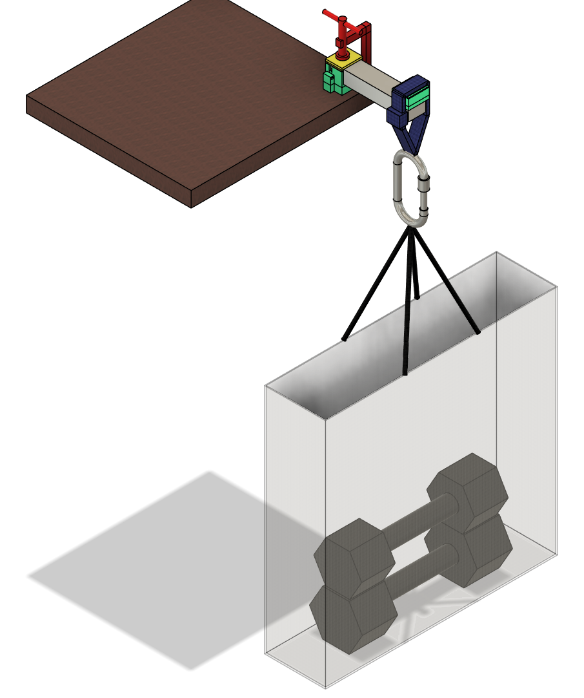 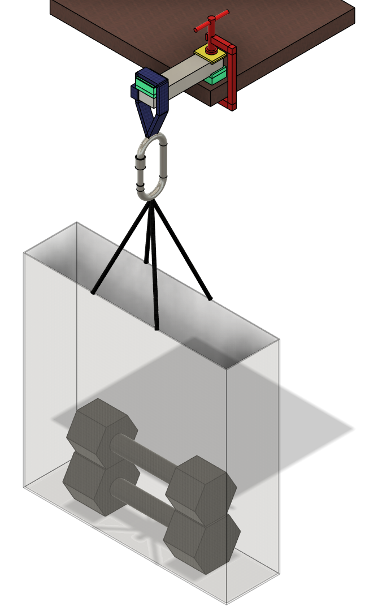

*Gambar 1. Load cell di sudut meja. Kiri: dari sisi kabel. Kanan: dari sisi klem C. Ujung tetap dijepit klem C di atas Clamp_Pad dengan Spacer A di bawahnya; ujung bebas menjorok keluar dari tepi meja, tas beban tergantung di Spacer B.*

Semua gambar diambil dari model Fusion "calibration rig" (hanya untuk gambar, bukan untuk dicetak). Gambar setup lama (`kalibrasi_setup.svg`, `kalibrasi_protokol.svg`, `kalibrasi_cradle.svg`) sudah dihapus dan tinggal di riwayat git.

**Bagian-bagian menurut warna di gambar**

| Warna | Bagian | Letak |
|---|---|---|
| Cokelat | Meja | tempat load cell dijepit, di dekat sudutnya |
| Merah | Klem C | menjepit ujung tetap ke meja, dari sisi yang berseberangan dengan kabel |
| Kuning | Clamp_Pad | di atas ujung tetap, di bawah sekrup klem |
| Abu-abu muda | Load cell | panah stiker di ujung bebas menghadap ke bawah; kabel keluar di ujung tetap |
| Hijau, ujung tetap | Spacer A | di bawah ujung tetap, di antara load cell dan meja; ada klem kabel di sisi kabel |
| Hijau, ujung bebas | Spacer B | di atas ujung bebas; tempat sling saat kalibrasi dan tempat telapak menekan saat dipakai |
| Biru tua | Sling | disampirkan di alur Spacer B |
| Perak | Karabiner | di bawah ujung bebas, mengunci kedua telinga sling |
| Hitam | Tali tas | dari karabiner ke tas |
| Bening | Tas | wadah beban |
| Abu-abu tua | Dumbbell | di dalam tas, yang terberat di bawah |

**Bahan dan ukuran setiap bagian**

| Bagian | Bahan | Ukuran | Siap |
|---|---|---|---|
| Meja | kayu padat atau multipleks tebal (diharapkan) | daun meja paling tebal ±64 mm (batas bukaan klem), tepi kokoh | ☐ |
| Klem C | baja | dalam leher 34,5 mm, bukaan 103,2 mm (terukur) | ☐ |
| Clamp_Pad | PLA, infill 100 % | 27 × 34 × 3 mm, bibir 2 mm | ☐ |
| Load cell | paduan aluminium (CZL 601, 80 kg) | 130 × 28 × 21,5 mm (terukur) | ☐ |
| Spacer A | PLA, infill 100 % | 27 × 34 mm, tebal 14 mm, ditambah klem kabel dan bantalan zip tie | ☐ |
| Spacer B | PLA, infill 100 % | 27 × 34 mm, tebal 14 mm, bibir sling 1,5 mm | ☐ |
| Flange bolt (4 buah) | baja tahan karat A2-70 | M6 × 25, flange Ø13 mm | ☐ |
| Zip tie | nilon | 2,5 × 100 mm | ☐ |
| Sling | nilon jahit | 17 × 2,7 mm, lingkaran 60 cm (dipendekkan ±40 cm), kuat tarik 22 kN (keterangan penjual) | ☐ |
| Karabiner | baja | oval, kunci putar, 105 × 53 mm, batang Ø10 mm, kuat tarik 25 kN (keterangan penjual) | ☐ |
| Tali tas dan tas | kain | tote bag | ☐ |
| Dumbbell | berlapis karet | heksagonal, 1–3 kg | ☐ |

> **Pemilihan meja adalah hal paling penting**
> - Tepi meja menahan seluruh gaya klem: ±0,4 kN saat kalibrasi 6 kg, ±1,4 kN saat tekan telapak 20 kg, dan ±2,7 kN pada batas tekan telapak 40 kg (pers. 6).
> - Daun meja paling tebal ±64 mm; lebih tebal dari itu, klem C tidak bisa menjepit.
> - Tepi meja harus padat dan tidak getas (tidak mudah gompal atau retak).
> - Bagian bawah daun meja harus rata di tempat rahang bawah klem.
> - Meja tidak boleh goyang; goyangan ikut terbaca.
> - Meja di lab belum disurvei. Meja yang dipakai masih dicek di lab atau menunggu konfirmasi asisten.

Urutan dari atas ke bawah:

- **Ujung tetap:** sekrup klem C → Clamp_Pad → load cell → Spacer A → meja.
- **Ujung bebas (jalur beban):** Spacer B → sling → karabiner → tali tas → tas berisi dumbbell.

## Tujuan

Mencari **faktor skala**, yaitu berapa hitungan HX711 untuk setiap 1 kg beban, supaya angka di LCD benar dalam kilogram-gaya (kgf). Nol (tare) sudah dikerjakan firmware, jadi yang dicari hanya kemiringan garis antara hitungan dan massa. Sambil mengukur, kita juga memeriksa apakah garisnya lurus (linearitas), apakah bacaan saat beban naik sama dengan saat turun (histeresis), apakah nol bergeser selama sesi (drift), dan seberapa besar pengaruh posisi beban (galat posisi). Beban kalibrasi menekan ke bawah di ujung bebas, **searah panah stiker dan searah tekanan telapak**, jadi faktor skala dari tas gantung langsung berlaku untuk tekan telapak dan tandanya tidak terbalik.

## Gambar detail

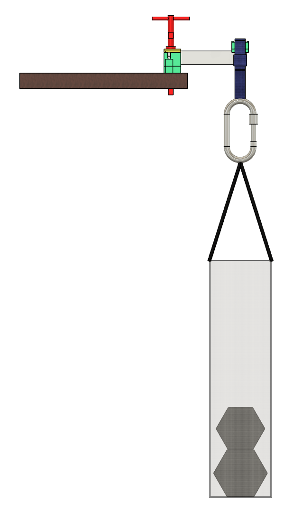 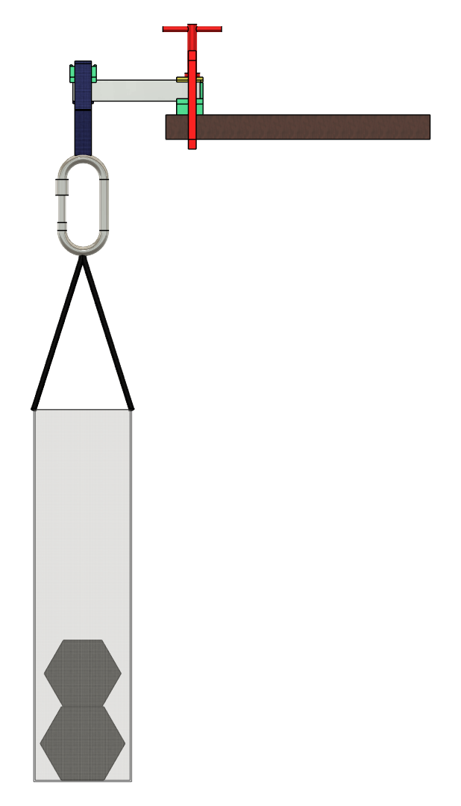

*Gambar 2. Kiri: tampak depan (sisi kabel). Kanan: tampak belakang (sisi klem C). Load cell terangkat 14 mm dari meja oleh Spacer A; hanya Spacer A yang menyentuh meja.*

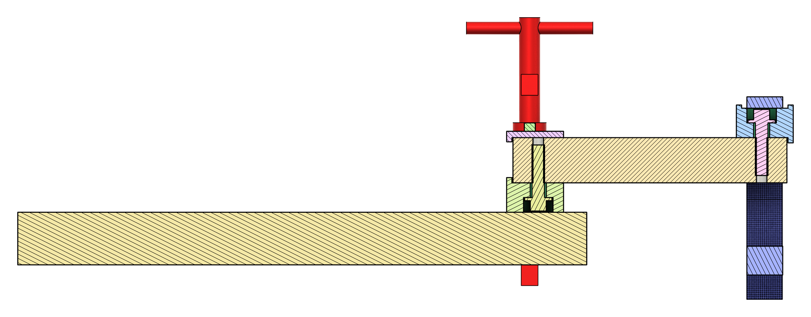

*Gambar 3. Potongan memanjang melewati satu baris baut: kantong kepala baut di Spacer A (menghadap meja) dan Spacer B (menghadap atas), panjang ulir di load cell, alur sling di Spacer B.*

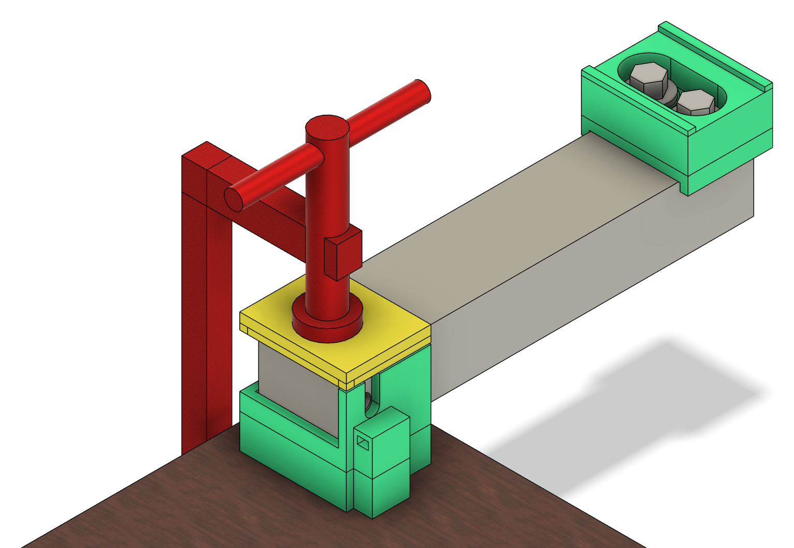 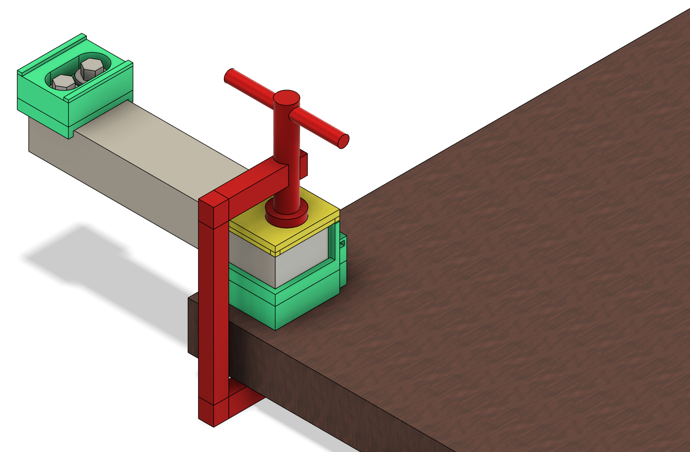

*Gambar 4. Ujung tetap. Kiri: sisi kabel, dengan dinding klem kabel bertakik dan bantalan zip tie di Spacer A. Kanan: sisi seberang kabel, tempat rangka klem C. Klem C menekan Clamp_Pad, load cell, dan Spacer A ke tepi meja.*

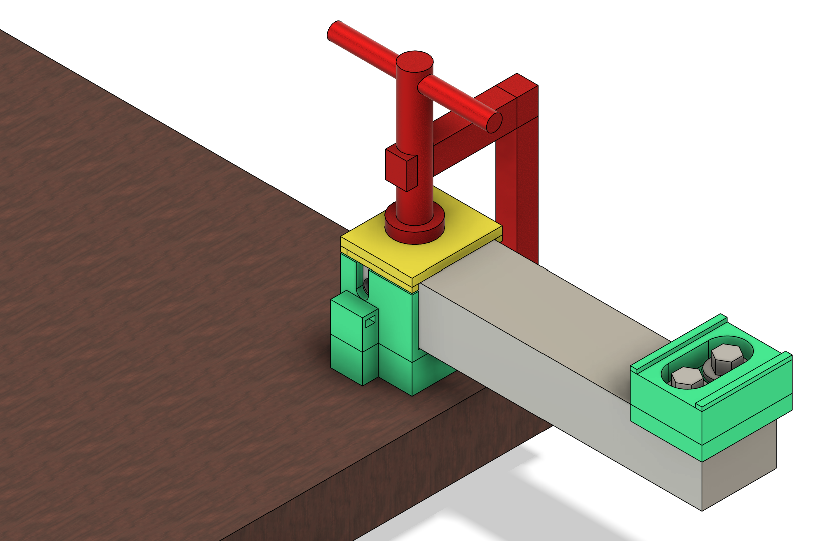 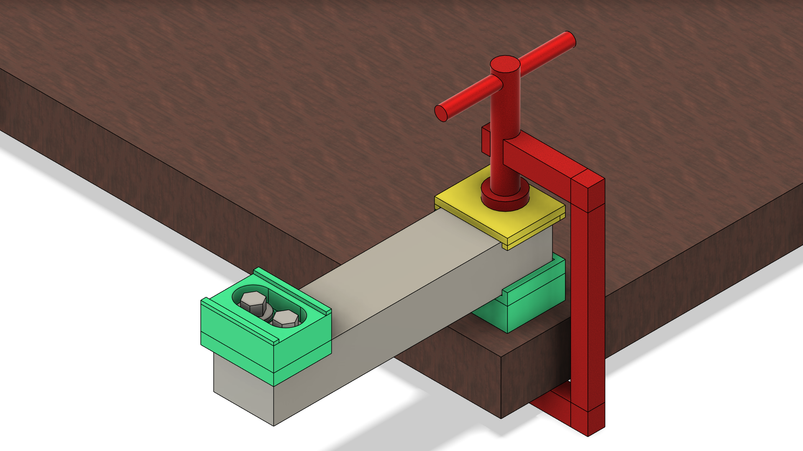

*Gambar 5. Susunan saat tekan telapak, tanpa sling dan beban. Atas: dari sisi kabel. Bawah: dari sisi klem C, Spacer A terlihat di bawah ujung tetap. Telapak menekan Spacer B: alur di antara dua bibir, kepala baut tenggelam di kantong.*

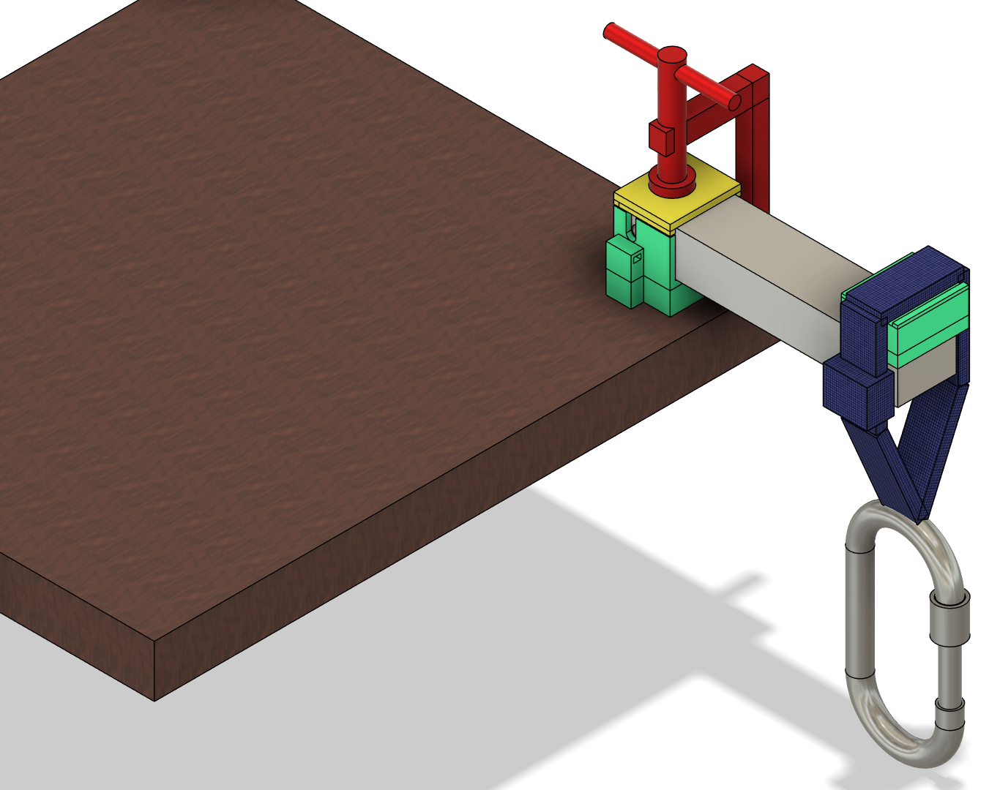 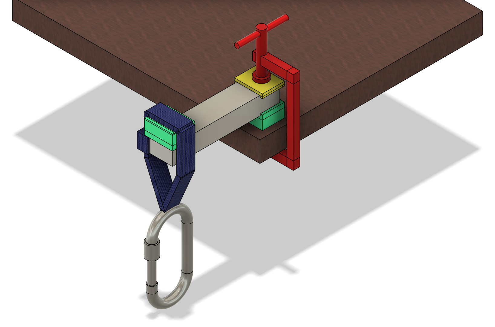

*Gambar 6. Sling di alur Spacer B (basket hitch), karabiner terkunci di bawah ujung bebas. Kiri: dari sisi kabel. Kanan: dari sisi klem C.*

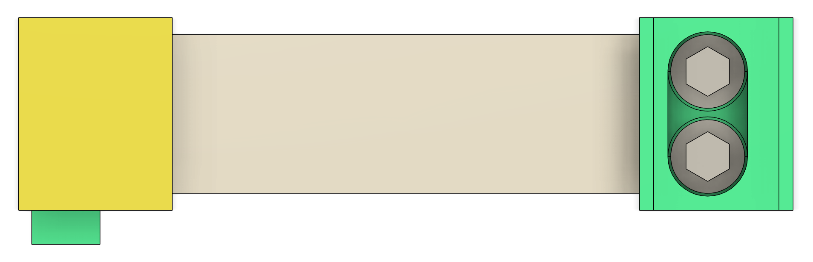 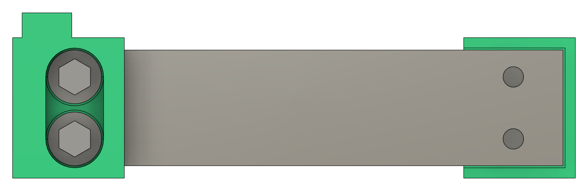

*Gambar 7. Atas: tampak atas, Clamp_Pad di ujung tetap dan kantong lonjong Spacer B dengan dua kepala flange bolt di ujung bebas. Bawah: tampak bawah (meja disembunyikan), kantong lonjong Spacer A di ujung tetap; di ujung bebas ujung baut tidak keluar dari muka bawah load cell.*

## Ukuran bagian cetak dan alasannya

Ukuran di bawah dipakai untuk kalibrasi **dan** untuk UAS: spacer tidak dilepas di antara keduanya. Angka adalah ukuran model; kompensasi susut PLA sudah masuk di `housing-load-cell/fusion/fusion_parameters_housing_grip.csv`.

| Bagian | Ukuran | Kenapa ukuran ini |
|---|---|---|
| Spacer A dan B: tebal di luar muka load cell | 14 mm | Dipilih dari baut M6 × 25 tanpa ring: lantai di bawah kepala baut 7 mm, jadi ulir yang masuk ke load cell 25 − 7 = **18 mm**, dan ujung baut masih **3,5 mm** dari muka seberang (21,5 − 18). Lebih tipis: ujung baut mentok di muka seberang. Lebih tebal: ulir yang menggigit makin pendek. |
| Spacer A dan B: panjang kontak di load cell | 24 mm dari muka ujung | Hanya menutup blok ujung load cell. Lebih panjang akan masuk ke bagian tengah, tempat strain gauge. |
| Spacer A dan B: ukuran luar | 27 × 34 mm | 24 mm kontak + 0,5 mm celah + bibir 2,5 mm; lebar load cell 28 mm + celah pas + dua bibir 2,5 mm. |
| Spacer A dan B: bibir samping dan ujung | tebal 2,5 mm, turun 2,5 mm | Memegang tepi load cell supaya spacer tidak ikut berputar saat baut dikencangkan. |
| Spacer A dan B: kantong kepala baut | stadion 14 × 29 mm, dalam 7 mm | Flange baut Ø13 mm masuk dengan celah ±0,2 mm per sisi. Dua lubang hanya berjarak 15 mm, jadi dibuat satu kantong. Kepala tenggelam ±0,5 mm, tidak menonjol ke meja atau ke telapak. |
| Spacer B: dua bibir penahan sling | lebar 2,5 mm, tinggi 1,5 mm; alur 22 mm | Sling selebar 17 mm hanya bisa bergeser ±2,5 mm, jadi titik beban tetap (Langkah Terpandu 5). |
| Spacer A: dinding klem kabel | tebal 2,5 mm, takik 4,6 mm, bantalan zip tie | Kabel diikat ke spacer, jadi tarikan pada kabel tidak sampai ke lubang kabel load cell. |
| Clamp_Pad | 27 × 34 × 3 mm, bibir 2 mm | Rahang baja klem menekan PLA, bukan aluminium. Bibir membuat pad duduk seperti tutup dan tidak bergeser sebelum klem dikencangkan. |
| Semua bagian | PLA, infill 100 % | Spacer A menahan gaya terbesar (lihat perhitungan di bawah). |

## Perhitungan gaya dan tekanan

Bagian ini menjawab dua pertanyaan secara berurutan: apakah spacer mengubah bacaan load cell, dan seberapa besar gaya yang ditahan spacer PLA dan tepi meja. Satuan memakai newton (N), milimeter (mm), dan megapascal (MPa); 1 MPa = 1 N/mm².

### 1. Besaran dan lambang

| Lambang | Arti | Nilai | Sumber |
|---|---|---|---|
| $m$ | massa beban (atau setara massa tekan telapak) | 6, 20, 40 kg | contoh di subbab 7 |
| $g$ | percepatan gravitasi | 9,81 m/s² | nilai standar |
| $F$ | gaya beban di ujung bebas | dihitung | pers. (1) |
| $L_b$ | lengan beban: tepi meja sampai titik sling di Spacer B | 96 mm | model rig |
| $L_k$ | lengan klem: tepi meja sampai tengah rahang klem | 16 mm | model rig |
| $F_k$ | gaya klem minimum agar ujung tetap tidak terangkat | dihitung | pers. (5) |
| $R$ | gaya tumpu tepi meja di bawah Spacer A | dihitung | pers. (6) |
| $A_B$ | luas muka atas Spacer B (tempat telapak) | 27 × 34 = 918 mm² | ukuran cetak |
| $A_A$ | luas dinding kantong Spacer A yang menumpu tepi meja | 6,5 × 34 = 221 mm² | ukuran cetak |
| $\sigma_{\mathrm{PLA}}$ | kuat tekan PLA cetak | 40 MPa (batas bawah angka umum 40–60 MPa) | belum diuji |
| $k$ | faktor skala | ±53.687 hitungan/kg (nilai lama) | diganti hasil kalibrasi |
| $m_s$ | massa Spacer B dan dua baut | ±0,03 kg | perkiraan, ditimbang setelah cetak |

### 2. Gaya beban

Dumbbell bermassa $m$ di dalam tas menarik ujung bebas ke bawah dengan gaya beratnya:

$$F = m\,g \tag{1}$$

Tekan telapak dianggap sama: telapak yang membuat timbangan menunjukkan $m$ kg memberi gaya $F = m\,g$ ke bawah di Spacer B.

### 3. Kenapa spacer tidak mengubah bacaan

**Model bacaan.** Di dalam rentang kerjanya, bacaan mentah HX711 naik lurus terhadap massa:

$$\mathrm{raw} = k\,m + \mathrm{raw}_0 \tag{2}$$

dengan $\mathrm{raw}_0$ bacaan tanpa beban (offset). Kalibrasi mencari $k$, yaitu kemiringan garis.

**Berat spacer hanya menggeser nol.** Dengan Spacer B dan dua baut terpasang, massa $m_s$ selalu ikut menekan:

$$\mathrm{raw} = k\,(m + m_s) + \mathrm{raw}_0 = k\,m + \left(\mathrm{raw}_0 + k\,m_s\right) \tag{3}$$

Bagian dalam kurung tetap, jadi ikut hilang saat dinolkan (tare), sama seperti berat tas. Kemiringannya tetap $k$. Besar geserannya: $k\,m_s \approx 53.687 \times 0{,}03 \approx 1.600$ hitungan.

**Letak spacer tidak menyentuh bagian yang mengukur.** Pada model ideal load cell batang di buku teks, strain gauge ditempel berpasangan di dua penampang bagian tengah yang melentur, berjarak $x_1$ dan $x_2$ dari titik beban. Momen lentur di kedua penampang adalah $F x_1$ dan $F x_2$, dan rangkaian jembatan membaca selisihnya:

$$M_1 - M_2 = F\,x_1 - F\,x_2 = F\,(x_1 - x_2) = F\,d \tag{4}$$

Jarak $d$ antara kedua gauge tetap, jadi bacaan hanya bergantung pada $F$, tidak pada letak titik beban. Spacer dibaut di blok ujung (24 mm dari tiap ujung), di luar bagian yang melentur, jadi tidak mengubah $d$ dan tidak membuat bagian tengah lebih kaku. Ini model ideal; susunan gauge di dalam CZL 601 belum kami lihat. Langkah Terpandu 5 mengujinya: bila model ini benar, menggeser sling hampir tidak mengubah bacaan.

**Faktor skala diukur pada rakitan yang dipakai.** Kalibrasi dilakukan dengan spacer terpasang, jadi pengaruh kecil apa pun yang tidak masuk model di atas sudah termasuk di $k$ yang dipakai saat UAS.

### 4. Keseimbangan di ujung tetap

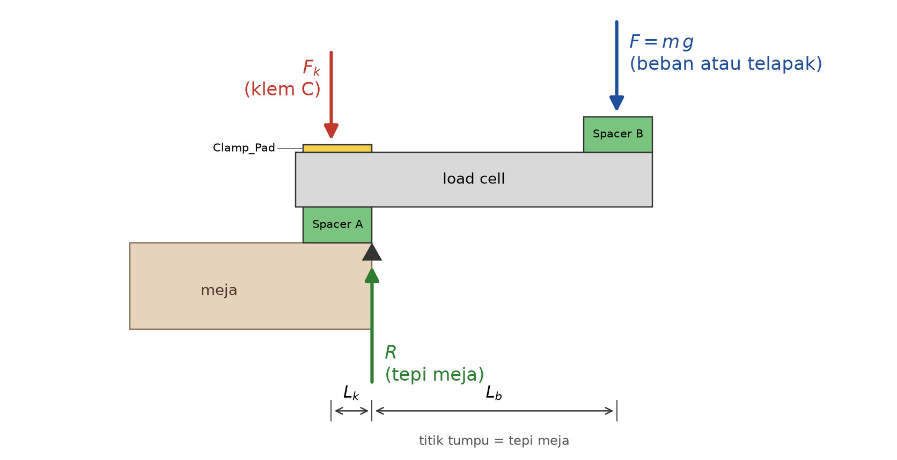

*Gambar 8. Diagram benda bebas load cell dengan Spacer A, Clamp_Pad, dan Spacer B (skematis, tidak berskala). Titik tumpu ada di tepi meja.*

Anggapan: load cell, kedua spacer, dan Clamp_Pad dianggap satu benda kaku; tepi meja menjadi titik tumpu; berat rakitan sendiri diabaikan karena sudah dinolkan. Gaya $F$ di ujung bebas cenderung memutar load cell pada tepi meja dan mengangkat ujung tetap. Klem C menahannya dengan gaya $F_k$ ke bawah.

Jumlah momen terhadap tepi meja sama dengan nol:

$$F_k\,L_k = F\,L_b \quad\Rightarrow\quad F_k = F\,\frac{L_b}{L_k} \tag{5}$$

Jumlah gaya tegak sama dengan nol; tepi meja menahan gaya klem dan gaya beban sekaligus:

$$R = F_k + F = F\left(1 + \frac{L_b}{L_k}\right) \tag{6}$$

Dengan $L_b / L_k = 96 / 16 = 6$: klem harus menahan **6 kali** gaya beban, dan tepi meja menahan **7 kali** gaya beban. Inilah alasan pemilihan meja dan uji kertas penting.

$F_k$ di pers. (5) adalah gaya klem **minimum**. Klem yang dikencangkan lebih keras dari itu menambah tekanan di Spacer A, jadi angka di bawah adalah batas bawah. Klem cukup dikencangkan sampai lolos uji kertas, tidak lebih.

### 5. Tekanan pada PLA

Tekanan adalah gaya dibagi luas bidang yang menahannya. Di muka Spacer B (telapak) dan di dinding kantong Spacer A (tepi meja):

$$p_B = \frac{F}{A_B} \qquad\qquad p_A = \frac{R}{A_A} \tag{7}$$

Pers. (7) menganggap gaya tersebar rata. Di tepi meja, tekanan sebenarnya lebih terpusat, jadi faktor keamanan di subbab 6 dibuat cukup besar.

### 6. Faktor keamanan PLA

Faktor keamanan membandingkan kekuatan bahan dengan tekanan yang bekerja:

$$n = \frac{\sigma_{\mathrm{PLA}}}{p_A} \tag{8}$$

Karena kuat tekan PLA cetak belum diuji dan tekanan di tepi tidak rata, kami memakai pegangan $n \ge 3$. Dari pers. (1), (6), (7), dan (8), massa terbesar yang masih memenuhi pegangan itu:

$$m_{\mathrm{maks}} = \frac{\sigma_{\mathrm{PLA}}\,A_A}{n\,g\left(1 + L_b/L_k\right)} = \frac{40 \times 221}{3 \times 9{,}81 \times 7} \approx 43\ \mathrm{kg} \tag{9}$$

### 7. Contoh hitungan

**Contoh: tekan telapak 20 kg.**

$$F = 20 \times 9{,}81 = 196{,}2\ \mathrm{N}$$

$$F_k = 196{,}2 \times \frac{96}{16} = 1.177\ \mathrm{N} \qquad R = 196{,}2 \times 7 = 1.373\ \mathrm{N}$$

$$p_B = \frac{196{,}2}{918} = 0{,}21\ \mathrm{MPa} \qquad p_A = \frac{1.373}{221} = 6{,}2\ \mathrm{MPa} \qquad n = \frac{40}{6{,}2} \approx 6{,}4$$

Hasil yang sama untuk tiga keadaan:

| Keadaan | $m$ (kg) | $F$ (N) | $F_k$ (N) | $R$ (N) | $p_B$ (MPa) | $p_A$ (MPa) | $n$ |
|---|---|---|---|---|---|---|---|
| Kalibrasi, beban terbesar | 6 | 58,9 | 353 | 412 | 0,06 | 1,9 | 21 |
| Tekan telapak, coba awal satu anggota | 20 | 196,2 | 1.177 | 1.373 | 0,21 | 6,2 | 6,4 |
| Batas tekan telapak di dokumen ini | 40 | 392,4 | 2.354 | 2.747 | 0,43 | 12,4 | 3,2 |

Angka 20 kg berasal dari satu anggota tim yang mencoba menekan timbangan badan di rumah: ±15 kg sambil berdiri membungkuk dan ±20 kg sambil duduk di lantai. Angka ini hanya pegangan desain, bukan data kalibrasi, dan tidak dimasukkan ke laporan sebagai hasil ukur.

### Kekurangan yang jujur

- **Rasa di telapak belum diketahui.** Ini satu-satunya kekurangan ide spacer yang tidak bisa dijawab dengan hitungan: kami belum pernah menekan Spacer B, jadi belum tahu rasanya. Saat UTS, menekan load cell telanjang membuat telapak sedikit memar.
- **Kekuatan PLA masih dianggap titik lemah sampai terbukti sebaliknya.** Pada 20 kg, $n \approx 6$, dan pers. (9) memberi $n \ge 3$ sampai ±43 kg. Namun 20 kg baru hasil coba satu orang, dan kuat tekan 40 MPa adalah angka umum, bukan hasil uji. Risiko baru bisa dinilai setelah kalibrasi selesai dan kekuatan maksimum setiap anggota diukur dengan alat ini (Langkah Terpandu 6). Karena itu batas tekan telapak dibuat 40 kg, sedikit di bawah ±43 kg. Bila nanti ada anggota yang bisa menekan lebih dari 40 kg, batas ini baru dinaikkan setelah Spacer A diperiksa atau dibuat lebih kuat.
- **Pemeriksaan retak:** saat uji tekan maksimum, periksa Spacer A setelah setiap orang selesai mencoba. Bila ada retak atau PLA memutih di dinding kantong, hentikan uji dan cetak ulang sebelum dipakai lagi. Retak bisa membuat load cell bergeser di bawah klem.

## Dugaan: kenapa spacer PLA tetap dicetak

Kekhawatiran tim: kalau ada yang diubah dari load cell, alatnya bisa rusak dan pengukurannya jadi salah. Bagian ini berisi **dugaan (hipotesis) kami, bukan teori buku**: alasan yang masuk akal tetapi belum dibuktikan, masing-masing dengan cara mengujinya. Silakan dibantah atau diganti dengan alasan yang lebih kuat.

**Yang tidak berubah pada load cell**

- Gerigi di bawah flange baut menggigit PLA, bukan aluminium, karena kepala baut duduk di spacer.
- Load cell tidak dibor, dipotong, diampelas, atau dilem. Spacer hanya dibaut ke empat lubang M6 yang memang disediakan pabrik untuk memasang load cell. Timbangan meja yang memakai load cell seperti ini juga dirakit begitu: satu ujung dibaut ke dudukan, ujung lain dibaut ke piringan.

> **Kesimpulan: memasang spacer ke load cell dengan baut itu aman**
> Spacer dipasang dengan cara yang memang disediakan pabrik, di lubang yang memang dibuat untuk itu, dan bisa dilepas lagi tanpa bekas. Syaratnya hanya dua, dijelaskan di bawah: baut M6 × 25 tanpa ring, dan panah stiker menghadap ke bawah.

**Alasan 1: untuk kalibrasi**

- **Spacer A membuat load cell hanya bertumpu di blok ujung tetap.** Muka bawah load cell rata dari ujung ke ujung. Tanpa spacer, muka itu menempel ke meja sampai mendekati bagian tengah (tempat strain gauge), jadi sebagian beban bisa ditahan meja dan tidak lewat strain gauge. Bacaan jadi lebih kecil, dan besarnya tergantung di mana tepi meja jatuh, sehingga berubah setiap kali dipasang. Dengan Spacer A, celah 14 mm menjamin hanya ada satu jalur gaya. *Cara menguji:* Langkah Terpandu 1, Amati nomor 2 (ujung bebas disentuh, bacaan turun) menunjukkan akibat jalur gaya kedua.
- **Spacer B memberi titik beban yang sama untuk semua titik kalibrasi.** Sling terkunci di alur dan hanya bisa bergeser ±2,5 mm. Di permukaan aluminium yang licin, sling bisa bergeser lebih jauh di antara titik beban. *Cara menguji:* Langkah Terpandu 5.
- **Klem dan meja tidak menyentuh aluminium.** Rahang baja klem menekan Clamp_Pad, dan meja menekan Spacer A. PLA lebih lunak daripada aluminium, jadi kalau ada yang penyok atau tergores, itu PLA, bukan load cell. *Cara menguji:* periksa permukaan load cell setelah spacer dilepas.

**Alasan 2: untuk UAS**

- **Faktor skala hanya berlaku untuk rakitan yang dikalibrasi.** Kalau spacer dilepas sesudah kalibrasi, titik tumpu dan titik tekan berubah, sehingga faktor skala bisa bergeser. Membiarkan spacer terpasang dari kalibrasi sampai UAS justru cara paling aman untuk "tidak mengubah apa-apa". *Cara menguji:* sebelum UAS, gantung satu kombinasi dumbbell dan bandingkan dengan hasil kalibrasi.
- **Telapak tidak bisa menekan bagian tengah load cell.** Spacer B mengangkat telapak 14 mm, jadi telapak hanya menyentuh Spacer B, bukan lapisan lunak penutup strain gauge yang tidak boleh ditekan. Saat UTS telapak menekan load cell telanjang, sehingga bagian tengah bisa ikut tertekan. *Cara menguji:* amati apakah telapak menyentuh bagian lain selain Spacer B.
- **Posisi tekan lebih seragam.** Telapak mendarat di bidang menonjol yang sama (27 × 34 mm) di setiap percobaan, jadi posisi tekan lebih mirip antarpercobaan dan antarorang. *Cara menguji:* bandingkan sebaran hasil tiga percobaan dengan data UTS.
- **Lebih nyaman daripada load cell telanjang.** Ini dugaan paling lemah dan belum diuji (lihat Keselamatan).

**Yang justru bisa merusak bila salah**

- Baut lebih panjang dari 25 mm, atau ditambah ring: ujung baut bisa mentok di muka seberang load cell. Ini satu-satunya cara rakitan ini bisa merusak load cell.
- Load cell dipasang terbalik: panah stiker harus menghadap ke bawah, searah beban.

**Cara memastikan load cell tidak berubah**

- Ukur resistansi jembatan dengan multimeter **sebelum merakit dan sesudah UAS**, dengan kabel load cell dilepas dari HX711 dan alat tidak menyala. Bandingkan dengan hasil uji resistansi sebelumnya. Angka yang sama berarti strain gauge tidak berubah.
- Catat bacaan nol mentah (perintah `k`) sebelum dan sesudah spacer dipasang. Perubahan kecil wajar (berat Spacer B dan dua baut ikut terbaca, ±1.600 hitungan); loncatan besar berarti ada yang menekan load cell.

## Hasil yang diharapkan

- Kamu bisa menghitung faktor skala dari minimal 5 titik beban dan menyebutkan galat di setiap titik.
- Kamu bisa menjelaskan kenapa beban gantung memberi titik beban yang lebih tetap daripada beban tumpuk.
- Kamu bisa menyebutkan sampai beban berapa hasil kalibrasi ini berlaku, dan bagian mana yang hanya hasil perpanjangan garis.
- Kamu bisa menurunkan gaya klem, gaya di tepi meja, dan tekanan di Spacer A dari keseimbangan momen (pers. 5–7).

## Persiapan sebelum hari kalibrasi

1. **Cetak** Spacer A, Spacer B, dan Clamp_Pad (PLA, **infill 100 %**) dari model Fusion buatan tim, dengan ukuran di bagian "Ukuran bagian cetak dan alasannya". Model "calibration rig" (Gambar 1–7) hanya untuk gambar, bukan untuk dicetak. Kepala flange bolt terukur tinggi 6,3–6,5 mm dan flange Ø12,8–13,0 mm, jadi di kantong sedalam 7 mm kepala tenggelam ±0,5 mm.
2. **Rakit load cell** dengan **panah stiker di ujung bebas menghadap ke bawah**: Spacer A di muka bawah ujung tetap (sisi kabel, dinding klem kabel di sisi lubang kabel) dan Spacer B di muka atas ujung bebas, masing-masing dengan 2 flange bolt M6 × 25 **tanpa ring** (flange sudah berfungsi sebagai ring; ring 1,3 mm akan mengangkat kepala keluar dari kantong). Kencangkan dengan kunci sok 8 mm yang diameter luarnya kurang dari 13 mm; kunci ring tidak masuk ke kantong. Bawah flange bergerigi halus (gerigi pengunci) dan akan menggigit PLA: kencangkan sampai rapat lalu tambah sekitar seperempat putaran saja, jangan sekuat mungkin, dan jangan bongkar-pasang berulang kali di lubang yang sama. Kabel diikat ke klem kabel Spacer A dengan zip tie.
3. **Timbang setiap dumbbell sendiri-sendiri** di timbangan dapur (resolusi 1 g), lalu catat massa sebenarnya di **Laporan Kalibrasi Tabel 7**. Label massa biasanya meleset beberapa persen. Massa gabungan (misalnya 2 + 3) adalah jumlah massa masing-masing, jadi tidak perlu ditimbang bersama.
4. **Timbang wadah beban** (tas + karabiner + sling) dan Spacer B dengan dua bautnya, lalu catat di Tabel 7. Angka ini hanya untuk dokumentasi; beratnya hilang saat dinolkan.
5. **Ukur klem C**: dalam leher (harus lebih dari 30 mm) dan bukaan maksimal (harus lebih dari tebal daun meja + 38,5 mm, yaitu load cell 21,5 + Spacer A 14 + Clamp_Pad 3). Klem kami: dalam leher 34,5 mm, bukaan 103,2 mm, jadi daun meja paling tebal ±64 mm.
6. **Pilih meja yang boleh dijepit.** Meja di lab belum disurvei. Tanyakan dulu ke laboran atau asisten meja mana yang boleh dijepit, lalu cek syarat di kotak "Pemilihan meja adalah hal paling penting": tebal daun meja, tepi, bagian bawah, dan goyangan.
7. **Unggah sketsa `firmware/sketches/uji_hx711`**, bukan firmware utama (alasannya di Langkah Terpandu 3).
8. **Cetak Bagian 5 Laporan Kalibrasi** (tabel pengukuran) dan bawa ke lab. **Semua angka ditulis di sana**, bukan di modul ini. Modul ini hanya menjelaskan cara mengerjakan dan cara mengisi.

## Alat dan bahan

| No | Barang | Untuk apa |
|---|---|---|
| 1 | Load cell CZL 601 80 kg + HX711 + ESP32 + kabel USB + laptop | alat yang dikalibrasi, pembacaan lewat Serial Monitor |
| 2 | Spacer A, Spacer B, Clamp_Pad (PLA) | ganjal ujung tetap, bantalan ujung bebas, pelindung di bawah rahang klem |
| 3 | Flange bolt M6 × 25 (4 buah), tanpa ring, + kunci sok 8 mm | mengikat spacer ke load cell |
| 4 | Zip tie 2,5 × 100 mm | klem kabel di Spacer A |
| 5 | Klem C (1 dipakai, 1 cadangan) | menjepit ujung tetap ke meja |
| 6 | Dumbbell 1, 2, 3 kg (sudah ditimbang) | beban kalibrasi |
| 7 | Sling nylon jahit 17 mm, 60 cm (dipendekkan dengan simpul hidup menjadi lingkaran ±40 cm), karabiner oval berkunci 105 × 53 mm, tote bag kain (disediakan, dipinjam dari anggota tim) | wadah beban gantung (sling disampirkan di alur Spacer B, kedua telinga masuk karabiner) |
| 8 | Timbangan dapur | menimbang dumbbell dan wadah |
| 9 | Timbangan badan digital (untuk cek di atas 6 kg) | pengecekan tekan telapak |
| 10 | Selembar kertas | uji apakah ujung tetap terangkat |
| 11 | Penggaris atau jangka sorong | menandai posisi sling |
| 12 | Kursi | menekan sambil duduk saat cek timbangan badan |

> **Keselamatan**
> - Load cell berkapasitas 80 kg; batas beban berlebih yang dianggap aman di dokumen ini 120 % kapasitas (96 kgf). **Batas tekan telapak 40 kg**, ditentukan oleh Spacer A (PLA), bukan oleh load cell: di atas ±43 kg faktor keamanan PLA turun di bawah 3 (pers. 9). Selalu sambil **duduk, satu tangan**, berhenti di 40 kg, jangan menumpukan berat badan. Posisi tubuh mengubah hasil (coba awal satu anggota: ±15 kg berdiri membungkuk, ±20 kg duduk), jadi semua tekan telapak dilakukan dalam posisi duduk yang sama.
> - **Kenyamanan telapak belum diuji.** Saat UTS, menekan load cell telanjang membuat telapak sedikit memar. Tekan Spacer B (PLA) belum pernah dicoba, jadi mulai dengan tekanan ringan dan naikkan bertahap. Berhenti bila terasa sakit; jangan memaksakan angka tinggi.
> - **Panah stiker harus menghadap ke bawah.** Bila terbalik, bacaan negatif dan firmware utama terus menolkan ulang (penjaga nol), jadi alat tidak pernah memulai percobaan.
> - Jangan menekan atau menjepit **bagian tengah load cell**. Strain gauge ada di bawah lapisan lunak di tengah.
> - Jangan menjepit kabel load cell dengan klem.
> - **Jangan pakai baut lebih panjang dari 25 mm dan jangan menambah ring.** Ujung baut hanya 3,5 mm dari muka seberang load cell; baut yang lebih panjang bisa mentok dan merusak ulir.
> - Turunkan dumbbell pelan-pelan; jangan dijatuhkan ke dalam tas. Kaki dan tangan tidak boleh berada di bawah beban.
> - Tas jangan diayun; tunggu sampai diam sebelum membaca dan sebelum menambah beban.

## Kenapa beban digantung, bukan ditumpuk

Metode tumpuk (dumbbell di atas nampan di Spacer B) sempat dipertimbangkan, tetapi tidak dipakai karena butuh papan atau nampan tambahan di luar anggaran. Perbandingannya tetap dicatat sebagai alasan. Gaya yang dibaca load cell **sama di kedua metode**: F = m × g, ke bawah, di ujung bebas (6 kg ≈ 59 N). Berat wadah hilang saat dinolkan. Bedanya ada di **titik kerja gaya** dan **kestabilan**.

| | Tas gantung | Tumpukan di nampan |
|---|---|---|
| Berat wadah yang dinolkan | tas + karabiner + sling ≈ 0,3 kg | riser + nampan PLA ≈ 0,1–0,17 kg |
| Titik kerja gaya | selalu di tengah sling (di alur Spacer B); tas gantung otomatis lurus di bawah titik gantung | di titik berat tumpukan, tergantung ketelitian menaruh |
| Momen puntir bila beban meleset 10 mm ke samping | ≈ 0 (tas mengoreksi sendiri) | 6 kg × 9,81 × 0,010 m ≈ 0,6 N·m, ikut terbaca sebagai galat posisi |
| Titik berat (6 kg) | di bawah titik gantung, jadi stabil seperti bandul | ±9 cm di atas riser, jadi labil |
| Bisa terguling? | tidak | ya, bila titik berat meleset lebih dari ±14 mm (setengah lebar riser 28 mm); riser wajib dilekatkan ke Spacer B |
| Gaya di klem | ≈ 0,5 kN | ≈ 0,5 kN (titik beban sama) |
| Gangguan saat menaruh | tas berayun: tunggu diam | benturan: taruh pelan |
| Syarat | ujung bebas menjorok keluar tepi meja | nampan 250 mm harus muat di bed printer |

**Dipakai: tas gantung.** Syaratnya hanya satu: ujung bebas harus menjorok keluar dari tepi meja supaya tas bisa menggantung bebas.

## Langkah Terpandu 1: Merakit dan menjepit

1. Letakkan Spacer A (yang sudah terbaut ke ujung tetap) di dekat **sudut meja**: ujung tetap di atas meja, ujung bebas menjorok keluar dari tepi depan meja sekitar 9–10 cm.
2. Pasang Clamp_Pad di atas ujung tetap seperti tutup: bibir samping mengapit load cell dan bibir ujung menempel muka ujung load cell (Gambar 4).
3. Jepit dengan klem C dari **tepi samping meja, di sisi yang berseberangan dengan kabel**, supaya kabel tidak terhalang rangka klem. Sekrup klem diletakkan **sejauh mungkin ke ujung luar** (sisi kabel), tetap di atas Clamp_Pad: kira-kira 8 mm dari ujung load cell, atau 16 mm dari tepi dalam Spacer A (Gambar 4). Kencangkan dengan tangan sampai mantap.
4. Pasang sling: sampirkan di alur Spacer B (basket hitch), turunkan kedua sisinya di kiri dan kanan load cell, masukkan **kedua telinga** ke karabiner, lalu kunci. Jahitan dan simpul sling jangan berada di atas Spacer B atau di dalam karabiner. Gate karabiner menghadap menjauhi meja (Gambar 6).
5. Cek: ujung bebas tidak menyentuh apa pun, kabel tidak terjepit, klem tidak menyentuh bagian tengah load cell, dan sling hanya menyentuh Spacer B.
6. Sambungkan HX711 dan ESP32 (HX711 dari 3V3, DT = GPIO18, SCK = GPIO19), nyalakan, lalu **diamkan 10 menit** supaya pembacaan stabil.

**Amati**

1. Jarak sekrup klem ke tepi dalam Spacer A, dan gaya yang dibutuhkan klem untuk beban 6 kg di ujung bebas bila lengan klem 8 mm dan bila 16 mm (lengan beban ±96 mm).
2. Bacaan dengan beban 1 kg saat ujung bebas menggantung bebas, lalu saat ujung bebas disentuh ringan dengan jari dari bawah.

> [!TIP]
> **Petunjuk (hasil yang diharapkan)**
> 1. Gaya klem = gaya beban × 96 / lengan klem. Beban 6 kg = 58,9 N, jadi lengan 8 mm butuh ±707 N dan lengan 16 mm hanya ±353 N. Lengan dua kali lebih panjang, gaya klem setengahnya; karena itu sekrup ditaruh sejauh mungkin ke ujung luar.
> 2. Saat disentuh, sebagian berat beban ditahan jari, jadi bacaan turun dan tidak stabil. Hal yang sama terjadi bila ujung bebas menyentuh meja: bacaan lebih kecil dari seharusnya dan faktor skala jadi salah.

## Langkah Terpandu 2: Cek klem dengan kertas

1. Selipkan selembar kertas di antara Spacer A dan meja, di bagian yang paling dekat ujung luar.
2. Gantungkan beban terberat yang akan dipakai (6 kg). Coba tarik kertasnya. Tulis hasilnya di **Laporan Kalibrasi Tabel 8**.
3. Kertas tidak bisa ditarik: klem cukup kuat, lanjut. Kertas bisa ditarik: ujung tetap terangkat, jadi kencangkan klem atau geser sekrupnya lebih ke luar, lalu ulangi.

**Amati**

1. Hasil uji kertas pada beban 6 kg, dan besar gaya klem saat tekan telapak dibandingkan saat kalibrasi.

> [!TIP]
> **Petunjuk (hasil yang diharapkan)**
> 1. Pada 6 kg kertas tidak bisa ditarik; gaya klem yang dibutuhkan hanya ±0,35 kN. Tekan telapak 20 kg butuh ±1,2 kN (pers. 5), lebih dari tiga kali lipat, jadi klem yang lolos di 6 kg belum tentu lolos saat tekan telapak. Karena itu uji kertas diulang sebelum Langkah Terpandu 6.

## Langkah Terpandu 3: Membaca hitungan mentah

Kalibrasi memakai sketsa `firmware/sketches/uji_hx711/uji_hx711.ino`, bukan firmware utama. Alasannya: berat wadah (tas + karabiner + sling, ±0,3 kg) ikut terbaca saat nol dan menggeser offset sekitar 16.000 hitungan (0,3 kg × 53.687 hitungan/kg). Firmware utama memeriksa apakah offset ada di jendela −39.000 ± 20.000 hitungan, jadi pergeseran ini bisa memicu galat `READING_INVALID` palsu. Sketsa uji tidak punya pemeriksaan itu.

1. Buka Serial Monitor (115200 baud). Sketsa mencetak baris hitungan terus-menerus.
2. Ketik `k` lalu Enter: sketsa mencetak **rata-rata 10 sampel mentah** dan sebarannya. Angka inilah yang dicatat di setiap titik.
3. Setiap pembacaan: tunggu **10 detik** setelah beban diam, lalu ketik `k`. Catat rata-rata dan sebarannya.

## Langkah Terpandu 4: Seri naik dan turun

Gantung tas kosong, tunggu diam, lalu catat **nol awal (R0) tiga kali**.

| Titik | Isi wadah | Massa yang dicatat |
|---|---|---|
| 0 | kosong | 0 |
| 1 | 1 kg | m₁ |
| 2 | 2 kg | m₂ |
| 3 | 3 kg | m₃ |
| 4 | 3 kg + 1 kg | m₃ + m₁ |
| 5 | 3 kg + 2 kg | m₃ + m₂ |
| 6 (opsional) | 3 + 2 + 1 kg | m₁ + m₂ + m₃ |

1. **Naik:** isi wadah sesuai tabel dari titik 1 sampai titik terakhir. Dumbbell terberat selalu di bawah. Catat setiap titik.
2. **Turun:** keluarkan beban dengan urutan terbalik, lalu catat lagi di setiap titik sampai wadah kosong (**R-akhir**).
3. Ulangi seri naik dan turun **dua kali**.

**Mengisi Tabel 9 di Laporan Kalibrasi**

Semua bacaan seri naik dan turun ditulis di **Laporan Kalibrasi Tabel 9**. Tabel itu punya tiga baris R0, satu baris untuk setiap titik, satu baris R-akhir, dan kolom Catatan. Baris di bawah ini contoh cara mengisinya.

**Contoh pengisian satu baris** (angka contoh, bukan hasil; skenario: tas berayun di Naik 1)

| Titik | Massa (kg) | Naik 1 | Turun 1 | Naik 2 | Turun 2 | Catatan |
|---|---|---|---|---|---|---|
| 4 | 4,016 (3,012 + 1,004) | ~~192884.0 (1240)~~ 192611.4 (96) | 192640.2 (110) | 192598.7 (84) | 192629.0 (102) | Naik 1: bacaan pertama ditolak, sebaran 1240 karena tas berayun setelah dumbbell 1 kg masuk; ditunggu diam, `k` diulang 1×. |

Yang ditulis di setiap sel dan cara membacanya:

1. **Massa:** massa timbang, bukan label, dalam kg dengan 3 desimal. Untuk kombinasi, tulis jumlahnya dan rinciannya, misalnya 4,016 (3,012 + 1,004).
2. **Bacaan:** salin dua angka dari baris `k: rata-rata 10 sampel mentah = 192611.4 (sebaran 96)` **persis seperti tertulis di Serial Monitor**, yaitu rata-rata dan sebaran di dalam kurung: `192611.4 (96)`. Titik di angka ini adalah **titik desimal**, bukan pemisah ribuan, dan tidak ada pemisah ribuan. Jangan diubah ke format Indonesia (192.611,4), supaya tidak salah salin dan tidak salah dibaca spreadsheet. Tanda minus ikut ditulis bila ada (R0 bisa negatif). Ini **bacaan mentah**: jangan dikurangi R0 dulu; pengurangan dikerjakan saat pengolahan data.
3. **Batas sebaran: 300 hitungan** (±6 g), sedikit di atas naik-turun bacaan diam yang terukur saat uji bench (0,004 kg ≈ 215 hitungan). Di atas 300: tunggu sampai tas diam, cek sling dan tas tidak menyentuh apa pun, lalu ketik `k` lagi.
4. **Bacaan yang ditolak dicoret satu garis, tidak dihapus,** lalu angka baru ditulis di sebelahnya dan alasannya di kolom Catatan. Bila tiga kali berturut-turut tetap di atas 300, hentikan seri dan cari penyebabnya (klem longgar, kabel tertarik, meja bergetar).
5. **Cek cepat di tempat:** di titik yang sama, Naik dan Turun hanya berbeda puluhan hitungan (contoh: 192640.2 − 192611.4 = 28.8 hitungan ≈ 0,5 g). Selisih ribuan hitungan berarti ada yang salah, misalnya dumbbell yang dimasukkan bukan yang tertulis di tabel titik; cek isi tas sebelum lanjut.
6. Catatan juga diisi untuk hal lain yang tidak biasa: klem dikencangkan ulang, sling digeser, ada orang menyentuh meja, Serial Monitor tertutup.

**Amati**

1. Titik dengan selisih naik dan turun terbesar, dan besarnya dalam kg setelah faktor skala diketahui.
2. Selisih R0 dan R-akhir dalam kg.

> [!TIP]
> **Petunjuk (hasil yang diharapkan)**
> 1. Selisih naik dan turun diharapkan sangat kecil, sekitar ±0,02–0,03 kg (error gabungan load cell ±0,03 % dari 80 kg ≈ ±24 g), biasanya paling besar di titik tengah (3–4 kg). Lebih dari ±0,1 kg berarti ada yang bergeser: klem melonggar, sling berpindah, atau tas belum diam saat dibaca.
> 2. Selisih R0 dan R-akhir diharapkan di bawah ±0,03 kg (creep load cell < 0,025 % per 30 menit ≈ 20 g). Lebih besar berarti pembacaan belum stabil (pemanasan kurang dari 10 menit) atau PLA di bawah klem ambles. Untuk pemakaian lama, nol bergeser pelan-pelan, jadi alat perlu dinolkan ulang sebelum setiap pengukuran.

## Langkah Terpandu 5: Uji posisi beban

Telapak tidak selalu menekan tepat di tengah Spacer B. Uji ini meniru itu dengan menggeser titik gantung. Sling selebar 17 mm di alur selebar 22 mm hanya bisa bergeser **±2,5 mm**, jadi uji ini mengukur galat untuk geseran sekecil itu.

1. Gantung dumbbell 3 kg dengan sling di tengah alur Spacer B, lalu ketik `k` dan catat di **Laporan Kalibrasi Tabel 12**.
2. Angkat beban sedikit, geser sling sampai menempel bibir luar (+2,5 mm, ke arah ujung load cell), turunkan pelan-pelan, tunggu diam, lalu catat. Ulangi dengan sling menempel bibir dalam (−2,5 mm).
3. Galat posisi = selisih terbesar terhadap bacaan di tengah, dalam kg. Bagi dengan 2,5 untuk mendapat galat per mm geseran.

**Amati**

1. Bacaan dengan sling di tengah alur dibandingkan saat menempel bibir luar dan bibir dalam, lalu perkiraan galat bila telapak meleset 10 mm (galat per mm × 10).

> [!TIP]
> **Petunjuk (hasil yang diharapkan)**
> 1. Selisihnya diharapkan sangat kecil, hanya beberapa gram, mendekati sebaran bacaan itu sendiri. Perkiraan untuk 10 mm hanya kasar: dihitung dengan memperpanjang hasil geseran 2,5 mm, hanya menguji geseran memanjang (bukan ke samping), dan telapak menekan bidang yang lebar, bukan satu garis seperti sling.

## Langkah Terpandu 6: Cek tekan telapak dengan timbangan badan

Kalibrasi hanya sampai 6 kg, sedangkan tekan telapak dipakai sampai ±20 kg atau lebih (coba awal satu anggota). Jadi sebagian besar bacaan saat UAS adalah perpanjangan garis kalibrasi. Karena itu langkah ini **wajib**. Langkah ini memeriksa apakah garis kalibrasi masih benar di beban tinggi. Ini **pengecekan, bukan kalibrasi**: ketelitian timbangan badan sekitar ±1 %.

1. Ulangi uji kertas dengan tekan telapak. Catat beban tertinggi yang lolos di **Laporan Kalibrasi Tabel 8**; batas cek ini tidak boleh melewatinya.
2. Jepit load cell ke **bangku kecil yang kokoh** (bukan meja besar), lalu berdirikan bangku itu di atas timbangan badan. Catat angka awal timbangan. Gaya telapak lalu mengalir lewat load cell, bangku, dan timbangan, jadi keduanya membaca gaya yang sama. Tangan yang lain tidak boleh bertumpu ke bangku.
3. **Duduk**, tekan Spacer B dengan satu telapak, tahan beberapa detik. Mulai ringan (±5–10 kg) untuk merasakan tepi kantong dan bibir Spacer B di telapak. Bila terasa sakit, letakkan alas tipis (kain dilipat atau busa tipis) di atas Spacer B saja; alas tidak mengubah gaya yang terbaca, asal tidak menyentuh meja, klem, atau load cell. Catat bila alas dipakai. Bandingkan bacaan alat dengan kenaikan angka timbangan.
4. Tulis bacaan alat dan kenaikan angka timbangan di **Laporan Kalibrasi Tabel 13**. Naikkan bertahap kira-kira tiap 5 kg (5, 10, 15, 20 kg, dan seterusnya sampai tekanan terkuat yang masih nyaman), tetapi **tidak melewati batas uji kertas dan tidak lebih dari 40 kg**.

## Pengolahan data

1. Untuk setiap titik, kurangi bacaan dengan R0.
2. Buat grafik hitungan (sumbu y) terhadap massa (sumbu x), lalu cocokkan garis lurus (regresi linier). **Kemiringan garis = faktor skala** (hitungan per kg). Bila kemiringannya negatif, pakai nilai negatif.
3. Hitung R² dan **galat di setiap titik** (selisih titik terhadap garis, dalam kg).
4. Histeresis: selisih terbesar antara bacaan naik dan turun di massa yang sama.
5. Drift: selisih R0 dan R-akhir.
6. Masukkan faktor skala ke `SCALE_COUNTS_PER_KG` di `firmware/hgd/hgd/config.h` (rencana P1), lalu ukur ulang jendela offset di susunan tekan telapak (rencana P2).
7. Verifikasi: setelah faktor skala dipasang di firmware, gantung satu kombinasi yang dihitung ulang (misalnya 1 + 2 kg) dan bandingkan angka LCD dengan massa timbang.

Satuan: alat menampilkan kilogram-gaya. Karena acuannya massa yang ditimbang, faktor skala langsung dalam hitungan per kg. Bila perlu dalam newton: F = m × g; tuliskan g yang dipakai (9,81 m/s² standar).

## Yang dimasukkan ke laporan

- Foto susunan (tanpa wajah, nama, atau barang pribadi yang terbaca).
- Tabel massa timbang setiap dumbbell dan resolusi timbangan.
- Tabel 9 lengkap, grafik, persamaan garis, R², galat di setiap titik, histeresis, drift.
- Hasil uji kertas dan hasil cek timbangan badan.
- Batasan di bawah.

## Batasan yang wajib ditulis

- Kalibrasi hanya 0–6 kg (±7 % dari kapasitas 80 kg). Di atasnya, angka alat adalah perpanjangan garis; cek timbangan badan hanya memeriksa, tidak mengkalibrasi. Tekan telapak dipakai sampai ±20 kg atau lebih, jadi sebagian besar bacaan saat UAS ada di daerah perpanjangan ini.
- Massa acuan berasal dari timbangan dapur; ketelitiannya membatasi ketelitian kalibrasi.
- Beban kalibrasi bekerja di satu titik (tengah Spacer B); telapak nyata menekan bidang yang lebih lebar dan bisa meleset.
- Batas tekan telapak ditentukan oleh uji kertas (klem C) dan oleh Spacer A (40 kg, pers. 9), bukan oleh load cell.
- Kekuatan Spacer A (PLA) belum diuji. Dari pers. (9), faktor keamanan $n \ge 3$ terpenuhi sampai ±43 kg bila kuat tekan PLA 40 MPa; angka 40 MPa adalah angka umum, bukan hasil uji.
- Kenyamanan menekan Spacer B (PLA) belum diuji. Bila telapak sakit sebelum batas uji kertas, batas praktis tekan telapak ditentukan oleh rasa sakit, bukan oleh alat.
