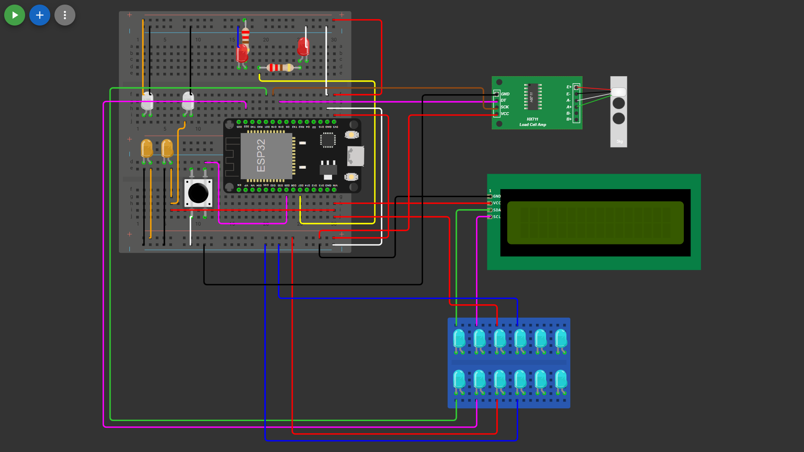

# Protokol Pengukuran Arus Rail - Hand Grip Dynamometer (v2)
**Proyek akhir - embedded system**

Cara mengukur arus tiap rail purwarupa breadboard dengan **satu multimeter, oleh satu orang**, persis seperti pengukuran 24 Okt. 2026 (uji S3 untuk UTS). Hasilnya ada di Bagian 5.1 [desain-pcb-hgd.md](../pcb/desain-pcb-hgd.md). Protokol ini ditulis untuk **wiring breadboard yang berlaku sampai hari UTS** (Bagian 2); bila wiring berubah, Bagian 2 harus dicek ulang dulu.

## 1. Yang diukur dan yang tidak

| Pembacaan | Kabel yang diganti multimeter | Beban yang tercakup |
|---|---|---|
| A1 | kabel 3V3 ke rail 3V3 **atas** | LED daya D2 + R2 220 Ω |
| A2 | kabel 3V3 ke rail 3V3 **bawah** | HX711 + eksitasi load cell, sisi LV level shifter |
| B1 | kabel VIN ke VCC backpack LCD | LCD 1602 + backpack PCF8574 (lampu latar) |
| B2 | kabel VIN ke HV level shifter | sisi HV level shifter (pull-up 10 kΩ) |

- **Tidak terukur:** arus papan DevKit sendiri (ESP32, CP2102, regulator 3,3 V) dan LED D1. Arus itu masuk dari soket USB langsung ke papan dan tidak lewat kabel yang bisa dicabut; D1 (GPIO27) mengambil arus dari 3V3 di dalam DevKit. Total dari USB karena itu = A1 + A2 + B1 + B2 + estimasi papan DevKit (Bagian 5.1 di desain PCB).
- **Pembacaan sesaat:** tiap angka adalah bacaan multimeter beberapa detik, bukan rata-rata operasi 30-60 menit seperti rencana uji S3 di catatan proyek. Multimeter memperbarui tampilan ≈ 2-3 kali per detik, jadi lonjakan singkat (mis. saat dinyalakan) tidak tertangkap.

## 2. Wiring breadboard (berlaku sampai UTS)

Diperiksa dengan uji kontinuitas, 24 Okt. 2026:

| Dari pin DevKit | Kabel | Ke | Beban di ujungnya |
|---|---|---|---|
| 3V3 | jumper 1 | rail 3V3 **atas** | D2 + R2 |
| 3V3 | jumper 2 | rail 3V3 **bawah** | VCC HX711, LV level shifter |
| VIN | kabel female-male langsung | VCC backpack LCD | LCD |
| VIN | kabel female-male langsung | HV level shifter | pull-up sisi HV |

**Ujung-ujung sambungan** (sesuai yang dilihat dan dicek saat pengukuran 24 Okt. 2026; letaknya di gambar Bagian 2.1):

| Sambungan | Ujung 1 | Ujung 2 | Dicabut saat mengukur | Dicek dengan |
|---|---|---|---|---|
| Jumper 1 | pin **3V3** DevKit | rail 3V3 **atas** | ujung di rail atas (A1) | ujung bebas ↔ rail atas: `1` |
| Jumper 2 | pin **3V3** DevKit | rail 3V3 **bawah** | ujung di rail bawah (A2) | ujung bebas ↔ rail bawah: > 1000 Ω (lewat komponen) |
| R2 (resistor D2) | kaki sisi 3V3: **langsung** di rail 3V3 atas (tanpa kabel) | kaki lain ke D2 | tidak | R2 ↔ rail atas: bunyi; ↔ rail bawah: tidak |
| VCC HX711 | pin VCC modul HX711 | rail 3V3 **bawah** | tidak | VCC ↔ rail bawah: bunyi (0 Ω); ↔ rail atas: tidak |
| LV level shifter | pin LV modul shifter | rail 3V3 **bawah** | tidak | LV ↔ rail bawah: bunyi (0 Ω); ↔ rail atas: tidak |
| Kabel LCD | ujung **female** di pin VCC backpack LCD | ujung **male** di baris pin **VIN** | ujung male (B1) | VCC backpack ↔ VIN: bunyi (≈ 0 Ω); ↔ rail 3V3: tidak |
| Kabel HV | ujung **female** di pin HV level shifter | ujung **male** di baris pin **VIN** | ujung male (B2) | |

- Rail 3V3 atas dan bawah **tidak tersambung satu sama lain**: tiap rail hanya diberi jumpernya sendiri. Karena itu mencabut **satu** jumper 3V3 hanya memutus satu rail. Pengukuran pertama memberi 0 mA karena jumper yang lain masih memberi arus ke beban (arus melewati jalur lain, bukan lewat meter).
- Kedua ujung bebas jumper 1 dan 2 berbunyi (beep, 0 Ω) satu sama lain: itu normal, keduanya berasal dari pin 3V3 yang sama.
- Sisi 5 V tidak memakai rail breadboard: kedua kabel langsung dari pin VIN. Sejak 24 Okt. 2026 malam (sesudah pengukuran) ada juga kabel dari baris VIN ke C3 dan C4 (Bagian 2.1).
- Secara listrik sama dengan net +3V3 dan +5V di skema (tidak ada perbedaan untuk R8).

### 2.1 Gambar wiring

Digambar di Wokwi sebagai **gambar saja, bukan simulasi**; berkasnya [wokwi/diagram.json](wokwi/diagram.json) (buka proyek ESP32 baru di wokwi.com, tempel isinya ke tab `diagram.json`). **Jangan jalankan simulasinya**: dua breadboard digambar bertumpuk, sehingga Wokwi menyambungkan satu baris pin ESP32 ke rail breadboard bawah dan hasilnya salah.

Cara membaca:
- **Patokan: posisi ESP32.** Tata letak gambar sama dengan papan nyata (USB DevKit di kanan); ESP32 menempati lubang yang sama dengan papan nyata.
- **Nomor kolom dan huruf baris di gambar tidak sama dengan papan nyata** (Wokwi tidak bisa membalik penomoran breadboard; di papan nyata nomor kolom berjalan 30 → 1 dari kiri ke kanan). Karena itu letak komponen di bawah ditulis sebagai posisi (kiri, kanan, atas, bawah), bukan nomor lubang.
- **Dua breadboard setengah.** Di papan nyata rail bawah breadboard atas dan rail atas breadboard bawah ditekuk, sehingga kedua breadboard rapat dan ESP32 berdiri di atas keduanya. Di gambar keduanya bertumpuk: anggap rail bawah breadboard atas tidak ada.
- Warna kabel = warna kabel nyata. Breadboard diberi warna abu-abu hanya supaya kabel terlihat.
- Wokwi tidak punya kapasitor, modul level shifter, dan load cell 80 kg; penggantinya ada di legenda.

| Di gambar | Komponen nyata | Letak |
|---|---|---|
| Resistor tegak + LED merah di kirinya | R2 220 Ω + D2 (LED daya) | breadboard atas, tengah atas; satu kaki R2 langsung di rail + atas |
| Resistor mendatar + LED merah di ujung kanannya | R1 220 Ω + D1 (LED status) | breadboard atas, tengah atas, kanan D2; kabel kuning dari GPIO27 (baris pin bawah ESP32) |
| Dua LED putih | kapasitor elektrolit 10 µF; kaki anoda LED = kaki + kapasitor | breadboard atas, kiri bawah: **C2** (kiri, di rail 3V3 atas), **C3** (kanan, ke VIN) |
| Dua LED oranye | kapasitor keramik 100 nF (104) | breadboard bawah, kiri atas: **C1** (kiri, di rail 3V3 bawah), **C4** (kanan, ke VIN) |
| Tombol hitam | tombol (GPIO25 ke GND) | breadboard bawah, kiri ESP32 |
| Modul HX711 + load cell "5kg" | HX711 + load cell CZL 601 80 kg (Wokwi hanya punya 5 kg; sama-sama single beam) | kanan atas |
| LCD 1602 | LCD 1602 + backpack PCF8574 | kanan tengah |
| Breadboard mini biru + 12 LED cyan | modul level shifter BSS138; LED cyan = label pin. Baris atas (kiri ke kanan): HV1, HV2, HV, GND, HV3, HV4; baris bawah: LV1, LV2, LV, GND, LV3, LV4 | kanan bawah |

**Kapasitor dipindah sesuai skema (24 Okt. 2026 malam, sesudah pengukuran arus).** Sebelumnya keempat kapasitor ada di 3V3 (C3 dan C4 seharusnya di +5V). Sekarang C1 + C2 di +3V3, C3 + C4 di +5V: kabel merah dari baris pin VIN (ujung kanan baris pin bawah ESP32) ke sisi kiri breadboard bawah, lalu kabel oranye ke kaki + C3 dan kabel oranye melintasi celah tengah ke C4; kaki lain ke rail GND. Kapasitor tidak menarik arus DC, jadi hasil A1-B2 tetap berlaku. Dicek:
- Kontinuitas (USB dicabut): 3V3 ↔ VIN 500-1500 Ω dan berubah-ubah; VIN ↔ GND dan 3V3 ↔ GND tidak bunyi; kaki + C3 dan kaki C4 ↔ VIN bunyi; kaki + C3 ↔ rail 3V3 atas dan kaki C4 ↔ rail 3V3 bawah tidak bunyi (kabel 3V3 lama sudah dicabut).
- Tegangan (DC 20 V, probe merah di kaki +): C1, C2 3,25 V; C3, C4 4,95 V. LCD `SIAP - UKUR 1/3` dan D2 menyala.

## 3. Alat

- Multimeter digital dengan arus DC (jack **mA**, rentang **200 mA** dan **2 mA**) dan uji kontinuitas (bunyi).
- **Satu jumper male-male cadangan** (perpanjangan pin VIN untuk B1/B2).
- Bila ada: kabel jepit (clip lead) supaya probe tidak perlu dipegang.
- Kabel USB biasa ke laptop (catu satu-satunya). `logger.py` tidak perlu dijalankan.

## 4. Aturan keselamatan

1. **Multimeter di mode arus hampir sama dengan kabel.** Pasang hanya **di tempat kabel yang dicabut** (seri). Jangan pernah menempelkan kedua probe ke dua rail berbeda atau ke rail dan GND: itu hubung singkat lewat meter (sekring meter putus, port USB terbebani).
2. **Jangan menyentuh pin header DevKit dengan probe saat mode mA.** Pin 3V3 bersebelahan dengan pin GND, dan pin VIN bersebelahan dengan GND serta pin GPIO: probe yang tergelincir menyambung rail ke GND lewat meter, atau memberi 5 V ke GPIO (merusak ESP32). Probe selalu ditempelkan ke **ujung bebas jumper** (A1, A2) atau ke **jumper cadangan** (B1, B2), tidak ke pin.
3. **Semua kabel dicabut dan dipasang hanya saat USB tidak tersambung.**
4. **Pasang semua sambungan dulu, baru nyalakan**, supaya kedua tangan bebas (satu untuk menekan load cell saat pembacaan puncak). Letakkan multimeter rata di meja; jepit atau ganjal probe supaya tidak bergeser. Lengan yang goyah membuat angka berkedip karena kontak probe berubah (B1: 25,4-26,2 mA saat lengan goyah, 26,4 mA saat stabil).
5. **Jangan sentuh kabel load cell** (A+/A−, E+/E−; disolder ke HX711).
6. **Ujung jumper yang tidak sedang diukur** (A1, A2) dikembalikan ke railnya; ujung bebas yang bertegangan tidak boleh dibiarkan menggantung.
7. **Bila alat tidak normal saat diukur** (LCD mati atau kosong, D1 berkedip terus, `ERR:...`): **cabut USB segera**, lalu cek Bagian 8. Modul yang tidak dicatu sementara ESP32 tetap mengirim sinyal ke pinnya (SCK ke HX711, SDA/SCL ke level shifter) membebani GPIO.

## 5. Keadaan diam dan puncak

| Keadaan | Cara | Yang aktif |
|---|---|---|
| **Diam** | Nyalakan, jangan sentuh alat, tunggu ≥ 15 s (kedip restart 5 s sudah selesai). LCD `SIAP - UKUR 1/3` / `Tekan tmbl START` | ESP32 menjalankan loop, HX711 + load cell, LCD dengan lampu latar, D2 |
| **Puncak** | Tekan tombol, lalu tekan load cell kuat dan stabil sampai LED D1 menyala dan LCD `Lepas ok`; tahan dan baca selama menekan | semua yang aktif saat diam, ditambah D1, pembaruan LCD tiap 500 ms, aliran data genggaman lewat USB |

Tanpa Wi-Fi/Bluetooth dan tanpa motor, keadaan puncak inilah beban tertinggi alat. Beban di breadboard hampir tidak berubah antara diam dan puncak (tidak ada beban yang dinyalakan-dimatikan firmware); yang naik sedikit hanya LCD dan bus I2C saat layar diperbarui.

## 6. Arah probe, jack, dan rentang

- **Probe merah di sisi catu** (ujung jumper dari pin), **probe hitam di sisi beban** (rail atau kabel ke modul). Dengan begitu semua angka positif; tanda minus berarti probe tertukar (besarnya tetap benar).
- **Mode arus:** probe merah di jack **mA**, hitam di **COM**, selektor di **arus DC** (A dengan garis lurus, bukan "~").
- **Mode kontinuitas:** probe merah kembali ke jack **VΩ**.
- Rentang dipindah hanya saat USB tidak tersambung.

| Pembacaan | Rentang | Alasan |
|---|---|---|
| A1, A2, B1 | **200 mA** | arus 5-30 mA |
| B2 | **2 mA** | arus < 1 mA; pada 200 mA hanya tampil `0.0` |
| **B1 tidak boleh 2 mA** | | LCD menarik ≈ 26 mA: rentang 2 mA lewat batas (tampil `1` atau `-1`), dan hambatan dalam meter pada rentang kecil menjatuhkan beberapa volt sehingga LCD hanya mendapat ≈ 2-3 V. Akibatnya lampu latar menyala tetapi layar kosong, dan pin I2C backpack menerima tegangan di atas catunya sendiri (membebani chip) |

## 7. Pemeriksaan kontinuitas sebelum tiap penyalaan

Dengan USB tidak tersambung, probe merah di **VΩ**, selektor kontinuitas. Antara ujung kabel yang dicabut dan tempat asalnya:

| Tampilan | Arti | Boleh lanjut? |
|---|---|---|
| `1` / OL | terputus | ya |
| ratusan Ω ke atas, atau angka yang **naik perlahan** | jalur lewat komponen (pull-up, GPIO, kapasitor yang terisi), bukan kabel | ya |
| bunyi, atau < ≈ 10 Ω | masih tersambung lewat jalur lain | **tidak**: cari jalur itu dulu |

Nilai yang wajar dari pengukuran 24 Okt. 2026: ujung jumper ↔ rail atas `1`; ujung jumper ↔ rail bawah > 1000 Ω (lewat komponen); 3V3 ↔ VIN 500-1500 Ω dan berubah-ubah (regulator dan kapasitor di DevKit, bukan hubung singkat).

## 8. Tanda dari alat saat meter terpasang

| Yang terlihat | Arti | Tindakan |
|---|---|---|
| Alat **normal** (LCD `SIAP ...`, D2 menyala, tanpa `ERR`) | semua beban dicatu, meter terpasang benar | baca |
| Alat normal tetapi meter **0** (rentang 200 mA, A1/A2/B1) | arus lewat jalur lain di sekitar meter (mis. jumper 3V3 yang lain masih terpasang ke rail yang sama) | cabut USB, cek Bagian 2 dan 7 |
| **LCD mati, D1 berkedip terus**, D2 menyala | salah satu rail 3V3 tidak dicatu (jumper rail lain tidak terpasang); HX711 dan/atau level shifter tanpa catu | **cabut USB segera**, pasang kembali jumper rail yang lain |
| Lampu latar LCD menyala, **layar kosong**, meter `1` / `-1` | B1 diukur pada rentang terlalu kecil | **cabut USB segera**, ganti ke 200 mA |
| Angka **negatif** | probe merah/hitam tertukar | catat besarnya; tukar probe untuk pembacaan berikutnya |

B2 tidak bisa dicek lewat LCD: backpack punya pull-up 5 V sendiri, jadi LCD tetap bekerja walau kabel HV terputus. Angka mendekati 0 pada B2 adalah hasil yang diharapkan.

## 9. Langkah

Siapkan dulu (USB tidak tersambung): multimeter di meja, jumper cadangan, kabel jepit. Alat dalam wiring Bagian 2 dengan semua kabel terpasang.

### A1: rail 3V3 atas (D2)
1. Cabut **ujung rail** jumper 1 dari rail 3V3 atas (ujung di pin 3V3 tetap). Jumper 2 tetap terpasang di rail bawah.
2. Kontinuitas: ujung bebas jumper 1 ↔ rail atas, sesuai Bagian 7.
3. Probe merah ke jack mA, selektor DC **200 mA**. Merah ke **ujung bebas jumper 1**, hitam ke lubang **rail atas**. Kencangkan.
4. Sambungkan USB. Cek alat normal (Bagian 8). Baca **A1 diam**.
5. Puncak (Bagian 5), baca **A1 puncak**. Boleh dilewati: D2 langsung dari 3V3 lewat resistor, firmware tidak bisa mengubahnya (24 Okt.: dicatat sama dengan diam).
6. Cabut USB, lepas meter, pasang kembali ujung jumper 1 ke rail atas.

### A2: rail 3V3 bawah (HX711, LV)
1. Cabut ujung rail jumper 2 dari rail 3V3 bawah. Jumper 1 sudah terpasang kembali di rail atas.
2. Kontinuitas: ujung bebas jumper 2 ↔ rail bawah, sesuai Bagian 7.
3. Rentang DC **200 mA**. Merah ke **ujung bebas jumper 2**, hitam ke lubang **rail bawah**.
4. Sambungkan USB, cek alat normal, baca **A2 diam**; puncak, baca **A2 puncak**.
5. Cabut USB, lepas meter, pasang kembali jumper 2 ke rail bawah.

### B1: LCD
1. Cabut **ujung male** kabel LCD dari baris pin VIN (ujung female tetap di VCC backpack). Tancapkan **jumper cadangan** ke baris VIN di tempat itu.
2. Kontinuitas: ujung kabel LCD ↔ ujung jumper cadangan, sesuai Bagian 7.
3. Rentang DC **200 mA** (bukan 2 mA, Bagian 6). Merah ke **jumper cadangan**, hitam ke **ujung kabel LCD**.
4. Sambungkan USB. LCD harus menampilkan `SIAP ...` dengan teks jelas. Baca **B1 diam**; puncak, baca **B1 puncak** (catat nilai tertinggi yang stabil).
5. Cabut USB, lepas meter dan jumper cadangan, pasang kembali kabel LCD ke baris VIN.

### B2: sisi HV level shifter
1. Sama seperti B1 dengan **kabel HV**: ujung male dicabut dari baris VIN, jumper cadangan di tempatnya, kontinuitas.
2. Rentang DC **2 mA**. Merah ke jumper cadangan, hitam ke ujung kabel HV.
3. Sambungkan USB, baca **B2 diam** dan **B2 puncak** (nilai berkedip: catat yang paling sering dan yang tertinggi).
4. Cabut USB, lepas meter dan jumper cadangan, pasang kembali kabel HV ke baris VIN.

## 10. Pemulihan dan uji akhir

1. Semua kabel kembali sesuai Bagian 2: jumper 1 di rail atas, jumper 2 di rail bawah, kabel LCD dan HV di baris VIN; jumper cadangan dilepas.
2. Kontinuitas (USB tidak tersambung): pin 3V3 ↔ rail atas **bunyi**; pin 3V3 ↔ rail bawah **bunyi**; VIN ↔ VCC backpack **bunyi**; VIN ↔ rail 3V3 **tidak** bunyi.
3. Probe merah kembali ke jack **VΩ** (supaya pemakaian berikutnya tidak tanpa sengaja di mode arus).
4. Nyalakan satu kali secara normal: D1 berkedip 5 s saat menyala, D2 menyala tetap, LCD `SIAP - UKUR 1/3` dengan teks jelas; satu genggaman singkat: D1 menyala saat stabil, tanpa `ERR`.

## 11. Tabel hasil (templat)

Tanggal: ……  Multimeter: ……  Firmware: ……

| Pembacaan | Beban | Rentang | Diam (mA) | Puncak (mA) | Catatan |
|---|---|---|---|---|---|
| A1 | D2 + R2 (rail 3V3 atas) | 200 mA | | | |
| A2 | HX711 + load cell, LV (rail 3V3 bawah) | 200 mA | | | |
| B1 | LCD + backpack (VIN) | 200 mA | | | |
| B2 | HV level shifter (VIN) | 2 mA | | | |
| **Beban luar** | A1 + A2 + B1 + B2 | | | | |
| Papan DevKit | estimasi (Bagian 5.1 desain PCB) | | | | estimasi, tidak terukur |
| **Total dari USB** | beban luar + estimasi | | | | |
| S3 | | | rata-rata ≤ 150 | puncak ≤ 600 | |

Hasil 24 Okt. 2026 sebagai pembanding: A1 6,7 / 6,7; A2 10,4 / 10,4; B1 26,4 / 27,0; B2 < 0,01 / 0,1-0,2 mA (Bagian 5.1 di [desain-pcb-hgd.md](../pcb/desain-pcb-hgd.md)).

## 12. Riwayat versi

| Versi | Tanggal | Perubahan |
|---|---|---|
| v2 | 24 Okt. 2026 | Bagian 2.1: gambar wiring breadboard (Wokwi) dengan cara membaca dan legenda; C3 dan C4 dipindah ke +5V sesuai skema, dengan hasil cek kontinuitas dan tegangan |
| v1 | 24 Okt. 2026 | Ditulis dari sesi pengukuran arus rail 24 Okt. 2026 |
